# Motolii

[](https://github.com/oshikaidesu/motolii/actions/workflows/build.yml) [](https://github.com/oshikaidesu/motolii/actions/workflows/assets.yml)

**Use a look you found on the net in your own video, right away.**

Motolii is an open-source video editor for making music videos and motion graphics.

It is being built so that the kind of work done in After Effects takes simpler handling. It can also use effects and scripts published on the web without rebuilding them as dedicated plugins.

[日本語](README.md) · [Questions (Discussions)](https://github.com/oshikaidesu/motolii/discussions) · [Bugs (Issues)](https://github.com/oshikaidesu/motolii/issues) — English or Japanese.

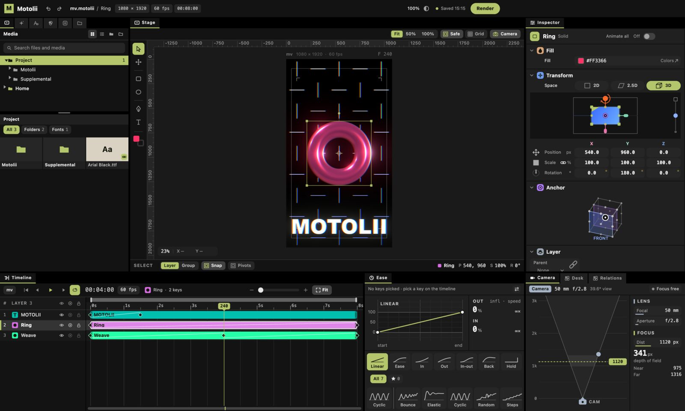

## Effects and scripts

Motolii can load effects published on websites and for other software.

A Shadertoy shader or a p5.js sketch, for example, can be used as a layer by copying its code and pasting it in. Once it is loaded, you can set keyframes on it and combine it with other effects.

ISF, WGSL and AviUtl2 scripts are supported too. Add a file to the designated folder and it appears in the effects list without restarting the app.

A preview is generated automatically for each newly added effect, so you can choose by how it actually looks as well as by its name.

Note: not all code in a supported format runs correctly. The test results are further down.

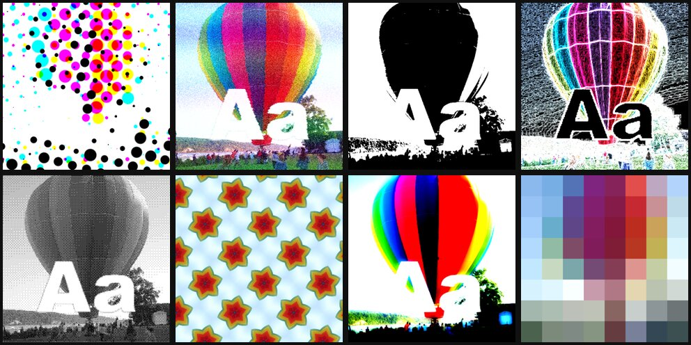

*Eight ISF effects as their authors share them, on a public-domain photo and text.*

## Editing

The handling is modelled on Alight Motion.

Text and shapes can be moved and transformed directly in the preview. With Animate on, changing a value records a keyframe. The easing between keyframes can be adjusted too.

Effects can be found by their moving thumbnails. Effects you add are kept in the same list.

There is no need to switch between 2D and 3D: text, images, video, 3D models and more can sit in the same scene.

## Making a video

Place media on the timeline and animate it with effects and keyframes.

Video and audio import, Lottie animations, animation from MIDI and physics are supported too.

A finished video can be written out as an MP4.

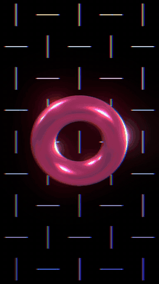

*8 seconds made with Motolii. Once built, the calls in [`docs/guide/readme_movie.md`](docs/guide/readme_movie.md), pasted, make the same as `~/Movies/Motolii/mv.mp4`.*

## Requirements

Motolii is still in development and supports Macs with Apple Silicon.

There is no packaged app yet, so trying it means building it from source.

A Windows version is planned. The main parts, such as Filament, ThorVG, GStreamer and Flutter, support Windows, and only a small share of the code, such as handing over video and the picture on screen, is tied directly to the Mac. It has not been built or tested on Windows yet.

How each format runs, known bugs and the build steps are below.

## Supported formats and how they run

| Format | What was checked |
|---|---|
| ISF | 318 of 327 |
| Shadertoy | 261 of 300 drew and moved |
| p5.js | 97 of 168 drew a picture |
| AviUtl2 | 372 of 594 ran to the end |

Each was checked at a different time under different conditions. A p5.js work that draws may not match the original. The detailed conditions and limits are in the [test record](docs/internal/reports/engine/sketch_import_2026-11-01.md) (Japanese).

### Each format in detail

| You can | With | State |
|---|---|---|
| Apply effects shared for VJ software | ISF (`.fs`, from [ISF-Files](https://github.com/Vidvox/ISF-Files) and others) | Drop one into the effects folder and it appears in the list. 318 of ISF-Files' 327 run (the check that counted them was removed). 419 bundled |
| Apply WebGPU shaders | WGSL (`.wgsl`, including screen effects ported from three.js and others) | Applied to the whole scene. 266 bundled |
| Paste a p5.js sketch | p5.js (copy the code, press ⌘V in the app) | It becomes a layer and stays in the Program tab. You can keyframe it and change its speed with Time Remap. Of 168 works from OpenProcessing, 97 drew a picture (counted on 1 November; checked by eye, about 16 of the first 42 looked like the original) |
| Paste a Shadertoy shader | GLSL (copy the code, press ⌘V in the app) | A shader that draws by itself becomes a layer; one that reads `iChannel` is applied to the selected layer. Either way it stays in the Program tab. Of 300 picked at random from an API dump of 36,668, 261 drew and moved (counted in early November 2026). Of the 30 black ones, 26 wait for input such as a mouse; 9 failed to load. Time Remap is p5.js only so far |
| Use scripts made for AviUtl2, a Japanese video editor | `.anm2`, `.obj2` (their HLSL converted to WGSL) | 172 packages bundled. Counted on 26 October: 372 of the 594 scripts bundled then ran to the end ([`docs/internal/reports/aviutl/aviutl2/catalogue.md`](docs/internal/reports/aviutl/aviutl2/catalogue.md)). Scripts that need a Windows DLL don't run yet |
| Use looks written in TSL (three.js's shading language) | three.js's own compiler to WGSL | 19 from [Shader Lab](https://github.com/basementstudio/shader-lab) are in the effects list; the rest are converted to WGSL only |
| Place video, photos, text, shapes, 3D models and point clouds | Video (GStreamer), text and shapes (ThorVG), glTF and `.ply` (Filament) | Works |
| Place After Effects animations | Lottie `.json` (ThorVG) | Works |
| Animate from MIDI | MIDI (`.mid`): a piano roll, or keyframes on values at each note | Works; MIDI isn't heard yet (a video's sound is) |
| Make shapes, or give a layer an in/out animation | Your own scripts (`.js`) | Drop one in and it appears in the list. 101 recipes (ready-made animated pieces) and 13 in/out animations bundled |
| Move many layers together (line up, follow, flock, spring, collide) | Relation scripts (`.js`) | Drop one into `relations/` and it appears in the Relations tab. 9 bundled, plus 5 built in |

A work's rights stay with its author. Many works on Shadertoy and OpenProcessing carry a non-commercial licence, so ask the author before using one in paid work.

Also: keyframes and easing (anime.js eases work as they are), physics (Jolt), refracting glass, a camera (focal length, aperture, focus) and MP4 export.

**Build check**: on a GitHub Apple silicon Mac (macos-15) it is built fresh exactly as this README says, then the UI's analyzer (`flutter analyze`) runs (the build badge above). There are no self-written tests; the external requirements are in [`docs/TESTING.md`](docs/TESTING.md).

**Speed** (M4, the 8-second example above, 1080×1920): about 4 ms a frame, no frame dropped even at 240 frames a second. Exporting the 8 seconds takes about 5 seconds, ffmpeg's encoding included. To measure again, make the example, then `printf 'time 240\n' | engine/edit.sh ~/Movies/Motolii/mv.motolii`.

## Before you try

- **Try it now if** you have an Apple silicon Mac, can paste commands into a terminal to build it, and want to use p5.js sketches, Shadertoy shaders, shader effects or AviUtl2 scripts in a video.
- **Wait if** you need it for everyday work, use Windows, or want an app you just install.

| | Where it stands |
|---|---|
| Works | Everything marked "Works" above, autosave and undo, playback (with a video's sound), MP4 export, the timeline, inspector and effects list |
| Partly | AviUtl2 scripts; Alight Motion's features (counts under "How it compares") |
| Known bug | Putting a screen effect (`.wgsl`) on a recipe layer made of copies (Iris, Weave, …) breaks the picture; on the whole scene it is fine |
| Not yet | Windows; an `.app` you can hand out (the engine loads Homebrew's libraries, so a build only runs on the Mac that built it); MIDI sound |

## Try it

### What you need

| | Version, size | Get it |
|---|---|---|
| Mac | Apple silicon (checked on an M4, macOS 15.5) | — |
| Xcode | Xcode from the App Store (the Command Line Tools alone can't build the UI); it can take more than 10 GB and 30 minutes to an hour to download | App Store; open it once to add its components, then `sudo xcodebuild -license accept` |
| Homebrew | — | The one line on [brew.sh](https://brew.sh/) |
| Flutter | 3.47.2 (stable), about 2 GB | "Get Flutter" below |
| Python 3 | The one macOS has (it comes with Xcode) | — |
| Disk | About 10 GB besides Xcode and Flutter (8.1 GB once built) | — |
| Downloads | About 1 GB (Filament's source 635 MB, Skia 65 MB, Jolt 16 MB and others; Homebrew's not counted) | — |
| Time | 1–2 hours from nothing, Xcode and Flutter included (depends on your connection); with them, about 10 minutes the first time on an M4 (Filament ~5, the engine ~1–2, the UI ~1–3) | — |

Homebrew versions it was checked with: GStreamer 1.28.8, SQLite 3.53.4, LuaJIT 2.1, QuickJS-ng 0.17.0, ffmpeg 9.0, cmake 4.1, ninja 1.13, meson 1.12.

### Get Flutter

```bash
git clone --depth 1 --branch 3.47.2 https://github.com/flutter/flutter.git ~/flutter
```

```bash
echo 'export PATH="$HOME/flutter/bin:$PATH"' >> ~/.zprofile && source ~/.zprofile
```

```bash
flutter doctor
```

Ticks on the `Xcode` and `macOS` lines mean it worked (crosses on Android or Chrome are fine). With FVM, `app/.fvmrc` names the version.

### Build and open

Paste one at a time. From the second on, run them inside the `motolii` folder (after `cd motolii`).

```bash
git clone https://github.com/oshikaidesu/motolii.git
```

```bash
cd motolii
```

```bash
brew bundle
```

Installs what the `Brewfile` lists (GStreamer, SQLite, ffmpeg, cmake, …). `Homebrew Bundle complete!` at the end means it worked.

```bash
engine/gpu/build.sh
```

Downloads and builds Filament with its WebGPU backend (~5 minutes on an M4). It worked if it ends without an error.

```bash
engine/edit.sh build.motolii < /dev/null
```

Builds the engine, downloading ThorVG, Skia, libtess2 and Jolt the first time. `edit.sh` opens a project file and waits for commands; `< /dev/null` gives it none, so it builds, makes an empty file and exits. `engine/out/libmotolii.dylib` existing means it worked (`build.motolii` can be deleted).

```bash
app/live.sh
```

Opens the app (the first time it seems to stall for 1–3 minutes while it builds; the text scrolling in the terminal can be ignored). The project file is `~/Movies/Motolii/Untitled.motolii` (saved automatically), and exported videos go beside it. Closing the window quits, and closing the terminal closes the window. Next time, in a new terminal: `cd ~/motolii && app/live.sh` (if you cloned in your home folder).

### The screen

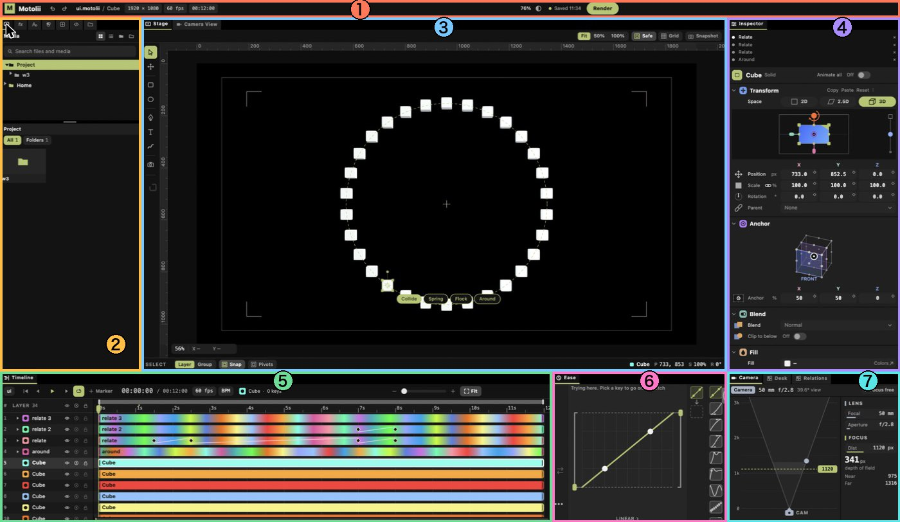

1. **Top bar**: project name, frame size, fps, length, undo and redo, Render (export).
2. **[Left tabs](docs/guide/tabs.en.md#left-tabs)**: Media, Effects, Fonts, Colors, Create (shapes and recipes), Program (pasted code), Presets (combinations you saved; not usable yet).
3. **[Preview (Stage)](docs/guide/tabs.en.md#preview-tabs)**: place and move layers while you watch. The tools are in the column on its left (select, move, shapes, pen, text, …). The tab above switches to Camera View, the finished picture through the camera.
4. **Inspector**: the selected layer's values (Transform, Anchor, Blend, Fill, …). The relations acting on the layer are listed at the top.
5. **Timeline**: layers and keyframes, playback, markers, BPM.
6. **Ease**: how a value moves between keyframes; the column on the right holds ready-made curves.
7. **[Bottom-right tabs](docs/guide/tabs.en.md#bottom-right-tabs)**: Camera (lens and focus), Desk (tools), Relations (move many layers together).

Each tab, with pictures and how to use it: [The tabs](docs/guide/tabs.en.md).

### Your first piece (in the app)

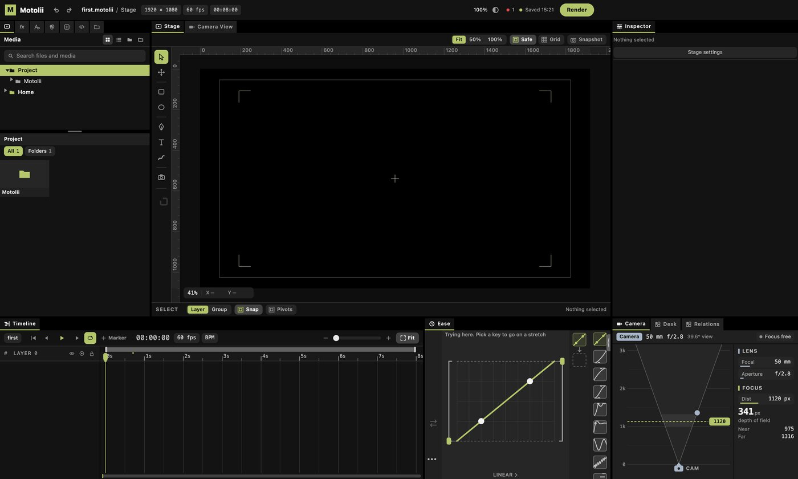

1. Press the 5th of the tabs at the top left (a square with a plus, **Create**) and type `Iris` in the search box.
2. Press the **Iris** tile, then **Create** at the bottom. A ring of colours appears in the preview, and a layer in the timeline.
   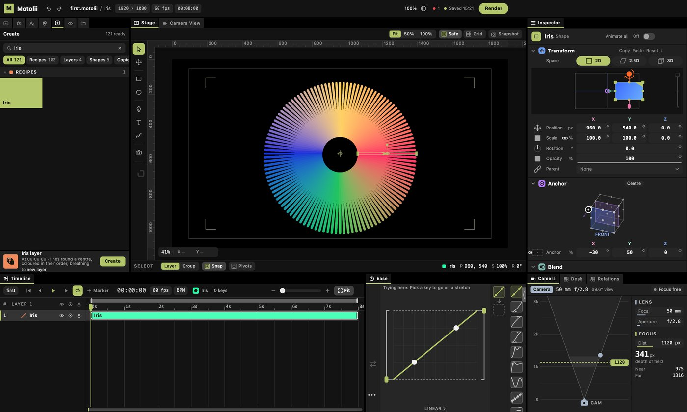
3. With the ring selected, switch to the 2nd tab (fx, **Effects**), find `Glow`, press it, then **Add** at the bottom. The ring glows and the button turns into **Remove**.
   
4. Press **Render** at the top right; the Render box opens. Type a name (e.g. `first`) and press the box's **Render**.
   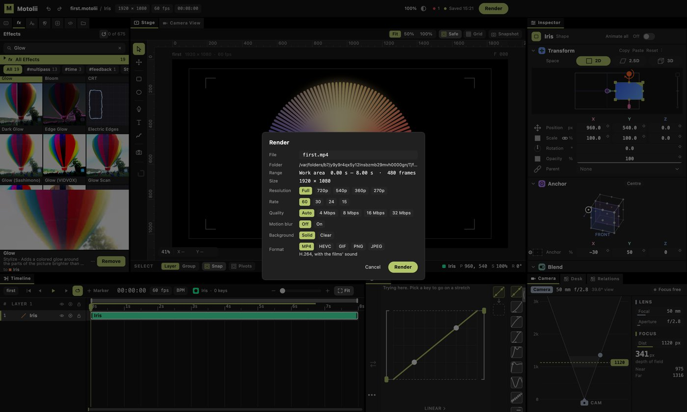
5. `first.mp4` is written beside the project, and the top bar says `Written: first.mp4`.
   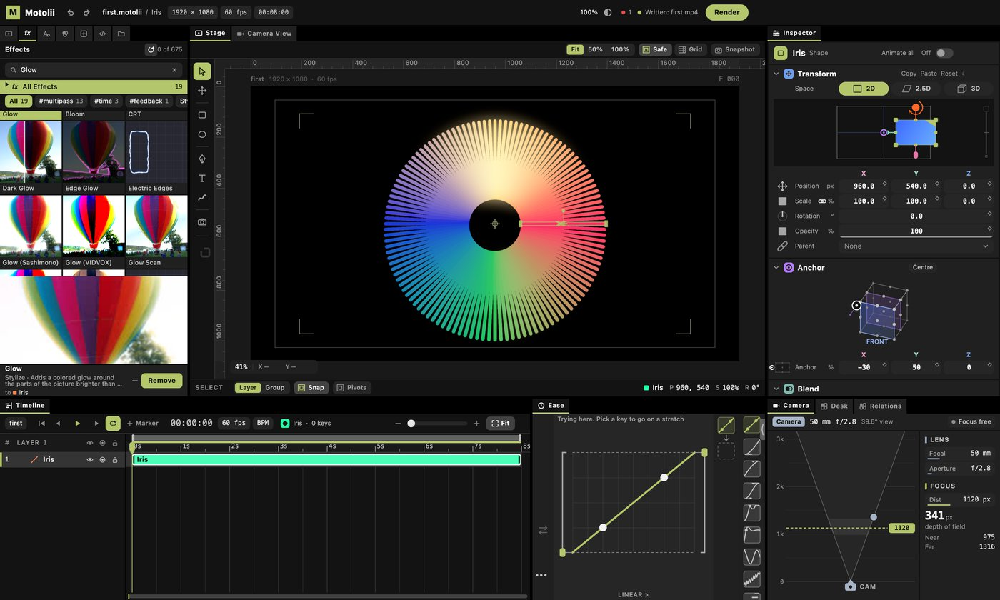

### Add an effect from the web

This is what Motolii is for. As an example, `ASCII Art.fs` from [ISF-Files](https://github.com/Vidvox/ISF-Files) (not bundled with Motolii):

1. Download the effect file (`.fs`). For example, open `ISF/ASCII Art.fs` on the ISF-Files page, press **Download raw file** (the ↓ button at the top right).
2. In Finder press ⌘⇧G, type `~/Library/Application Support/Motolii/` and go. Make a folder named `effects` there (if there is none) and put the file in it.
3. It appears in the Effects tab at once (no restart). Its thumbnail (a balloon photo with the effect applied) is made automatically within seconds, and plays while the pointer is over it. An effect whose default values change nothing shows **NO CHANGE**. Select a layer, press the tile, then **Add**.
   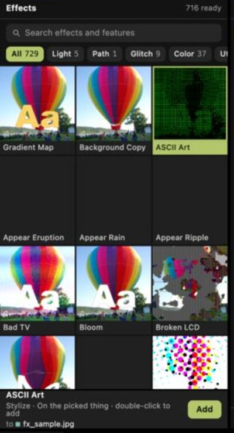
4. In the preview and in the export it looks like this (ASCII Art on a photo).
   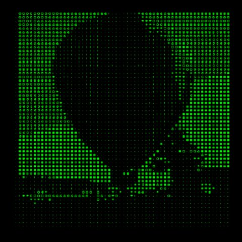

WGSL (`.wgsl`), Create tiles (`.js` in `create/`), Expression tiles (`.js` in `expressions/`), relations (`.js` in `relations/`), Ease presets (`.way` in `ease/`), skins (the folder, in `skins/`) and AviUtl2 scripts (the author's folder as it is, in `aviutl_scripts/`) go in the same way. Check that the saved file's name ends in `.fs` (a browser may add `.txt`).

p5.js and Shadertoy are pasted, not dropped: copy the work's code and press ⌘V in the app. The code stays in the Program tab.

### Next: your own media

- **Frame size**: press `1920 × 1080` at the top twice and type a new one (`1080x1920` for a vertical MV).
- **Music**: mp3, wav, m4a and others are placed from Media with **Place** too (they are included in the export).
- **Video and photos**: in the 1st tab (**Media**), open your folder from `Home`, pick a file and press **Place** at the bottom. A video's sound plays during playback and is included in the export.
- **Text**: pick **T** in the tools left of the preview and click the preview; a text layer appears. Change its words in the inspector's text box. Fonts are in the 3rd tab (**Fonts**).
- **Animation**: turn on **Animate all** in the inspector, then drag a value (position, size, …) sideways; a keyframe is set at the current time. Move the time and drag again, and it animates in between. Choose how it moves in **Ease** below.
- **Save and open**: saving is automatic (`Saved` and the time at the top). A new project: **File › New Document** (⌘N); another project in the same folder: **File › Open**.

<details>
<summary><b>Your first piece (commands)</b></summary>

Without the UI: a recipe makes a picture, a glow goes on it, an RGB split (`rgbshift.wgsl`) goes on the whole scene, and 8 seconds are exported as MP4. `engine/edit.sh` opens a project file and takes one command per line (`help` lists them).

```bash
engine/edit.sh $HOME/Movies/Motolii/first_cmd.motolii <<EOF
make Weave
effect 1 Glow
say 0 script $PWD/shelves/effects/glitch/rgbshift.wgsl
write $HOME/Movies/Motolii/first_cmd.mp4
EOF
```

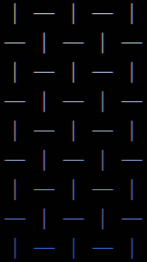

- `make Weave`: makes layer 1 from the recipe "Weave" (`recipes` lists them).
- `effect 1 Glow`: applies an effect to layer 1 (`effects` lists them).
- `say 0 script …`: puts a whole-scene effect on 0, the scene itself.
- `write …`: exports the MP4.
- Running the same commands again adds another layer to the same project; to start over, `rm ~/Movies/Motolii/first_cmd.motolii` first.

The calls of the 8-second example at the top are in [`docs/guide/readme_movie.md`](docs/guide/readme_movie.md).

</details>

<details>
<summary><b>If something goes wrong</b></summary>

| You see | Do |
|---|---|
| `flutter: command not found` | Run the second line of "Get Flutter" again, or `FLUTTER=/path/to/flutter app/live.sh` |
| `brew: command not found` | Install Homebrew with the one line on [brew.sh](https://brew.sh/) |
| `xcrun: error`, or Xcode missing | Install Xcode from the App Store, open it once to add its components, then `sudo xcodebuild -license accept` |
| `No space left on device` | Free 10 GB or more, then run the command that stopped again |
| `git clone` or `build.sh` stopped on the network | Run the same command again; if it still stops, delete the half-downloaded folder in `engine/third_party/` and run it again |
| `ld: library 'webgpu_dawn' not found` | Run `engine/gpu/build.sh` first |
| The app opens but the preview is black | Check the engine is built (`engine/out/libmotolii.dylib`); if not, `engine/edit.sh build.motolii < /dev/null` |

Still stuck? Open an [issue](https://github.com/oshikaidesu/motolii/issues) with the command you ran and what it printed (there is a template). Questions about using it go to [Discussions](https://github.com/oshikaidesu/motolii/discussions). English or Japanese.

</details>

<details>
<summary><b>Updating and removing</b></summary>

- Update: `git pull`, then run `engine/gpu/build.sh` and `engine/edit.sh build.motolii < /dev/null` again (only what changed is rebuilt); `app/live.sh` rebuilds the app.
- Remove: delete the `motolii` folder (everything downloaded and built is inside it). Your projects and videos stay in `~/Movies/Motolii/` (or wherever else you put them). Flutter: delete `~/flutter`. What `brew bundle` installed goes with `brew uninstall`.

</details>

## How it compares

<details>
<summary>Compare in a table</summary>

| | Motolii | After Effects | Cavalry | Alight Motion | Blender | VDMX, TouchDesigner | Motion Canvas, Rive |
|---|---|---|---|---|---|---|---|
| Made for | Making and exporting music-video footage | Compositing | 2D motion graphics | Video on a phone | 3D | Live visuals (performing) | Video in code (Motion Canvas), animation inside apps (Rive) |
| 2D and 3D | One scene (Filament) | 2D and 3D layers | Mostly 2D | Mostly 2D | Mostly 3D | Both (as you wire it) | 2D |
| Runs on | macOS (Apple silicon) only | Windows, macOS | Windows, macOS | iOS, Android | Windows, macOS, Linux | VDMX: macOS; TouchDesigner: Windows, macOS | Browser and others |
| Maturity | In development, one author, no release | Long established | Product | Product | Long established | Products | In use |
| Price, licence | Free, Apache-2.0 or MIT | Paid | Paid (free tier) | Paid (free tier) | Free, GPL | Paid (free tier) | Motion Canvas free, MIT; Rive has a free tier |

</details>

**What is different**: other tools read ISF as it is too (VDMX, MadMapper). Motolii's difference is the combination: ISF, WGSL and AviUtl2 effects, pasted p5.js and Shadertoy, Filament's 3D, a timeline and MP4 export in one tool.

**What it can't do yet**: stability and breadth of features as a finished tool are still to come. No app to hand out, no Windows, and no thought yet for performing live.

**Why Alight Motion is the model for its handling**: people who make MVs on their phones already know how it feels; Motolii copies all of it first, then goes further. Of Alight Motion's 169 effects and 32 other features, Motolii has 101, 37 in part, 62 not yet, and 1 unchecked (counted at the end of October, [`docs/internal/reports/alight_motion/alight_map.md`](docs/internal/reports/alight_motion/alight_map.md)).

## How it is built

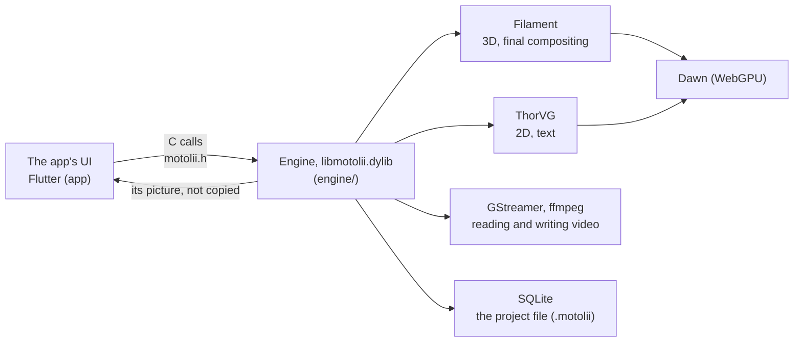

The UI only takes input; the engine (`engine/`) draws. Google's Filament is downloaded at build time. The engine's entry points are in [`engine/README.md`](engine/README.md), and the whole design in [`docs/ARCHITECTURE.md`](docs/ARCHITECTURE.md) (both in Japanese, with an English summary at the top).

## Next

1. An `.app` to hand out (Homebrew's libraries inside it), on Releases.
2. Windows.
3. The AviUtl2 calls still missing (`obj.computeshader`, the built-in effects, …), and TSL looks in the effects list.
4. The rest of Alight Motion's features.

## Contributing

See [`.github/CONTRIBUTING.en.md`](.github/CONTRIBUTING.en.md) (building, the rules, good first tasks), the [Code of Conduct](.github/CODE_OF_CONDUCT.md) and [`.github/SECURITY.md`](.github/SECURITY.md). Issues and pull requests in English are welcome.

The project's stance: **code you write yourself is a debt.** Look for an existing implementation first and use it the way its author meant; bundle other people's work as unchanged as possible, with their licence and source beside it; keep changes to upstream code as patches applied at build time; say in each commit what was borrowed from where. A lot of Motolii is still its own code today (the Flutter UI, for one); where something can be borrowed instead, the own code goes.

<details>
<summary><b>Folders</b></summary>

| Folder | What |
|---|---|
| `engine/` | The engine; its entry points and the files the current build uses: [`engine/README.md`](engine/README.md) (Japanese) |
| `shelves/effects/`, `recipes/`, `relations/`, `animators/`, `ways/` | Bundled effects, recipes, relations, in/out animations and eases (the same layout as your own folder) |
| `shelves/aviutl_scripts/` | Bundled AviUtl2 scripts (per author, with LICENSE and SOURCE.txt) |
| `app/` | The UI (Flutter, macOS) |
| `thorvg/`, `old/` | Earlier work, kept |
| `docs/` | This README's pictures (`pictures/`) and examples (`guide/`) and the author's working notes (`notes/`, Japanese) |

</details>

## Licence

Licensed under either of [Apache License 2.0](LICENSE-APACHE) or [MIT](LICENSE-MIT), at your option. Unless you explicitly state otherwise, any contribution intentionally submitted for inclusion in the work by you, as defined in the Apache-2.0 license, shall be dual licensed as above, without any additional terms or conditions. Bundled third-party works keep their own licences ([`THIRD_PARTY_NOTICES.md`](THIRD_PARTY_NOTICES.md)).
