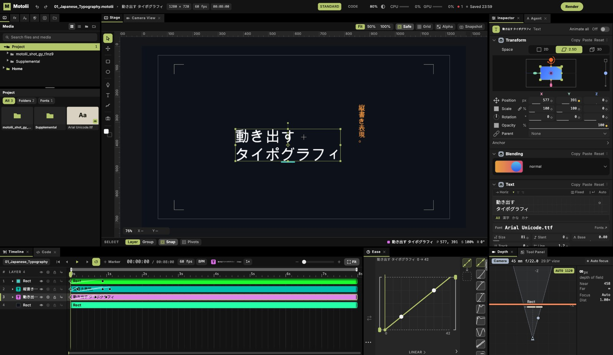
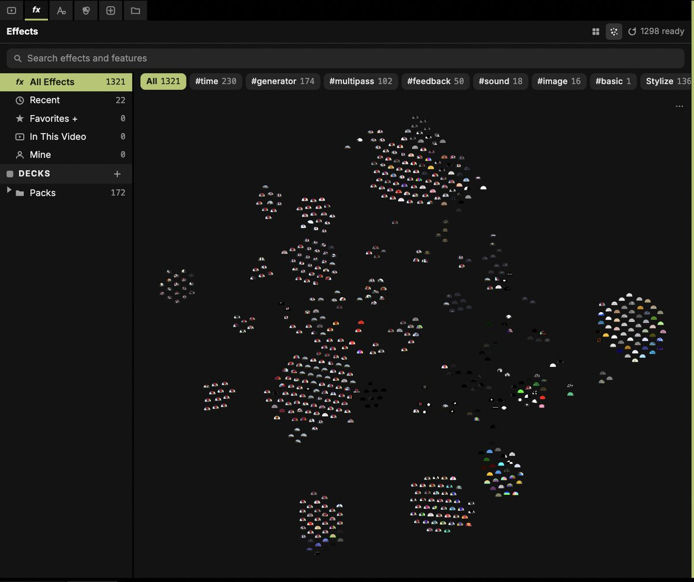
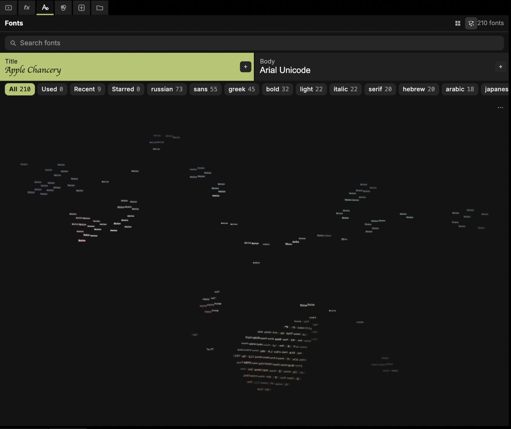
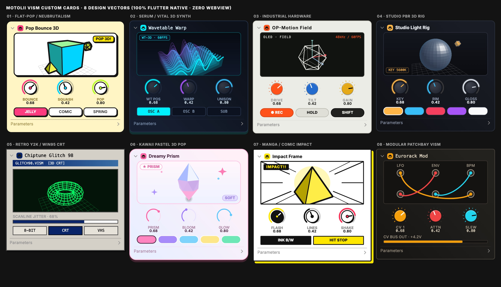
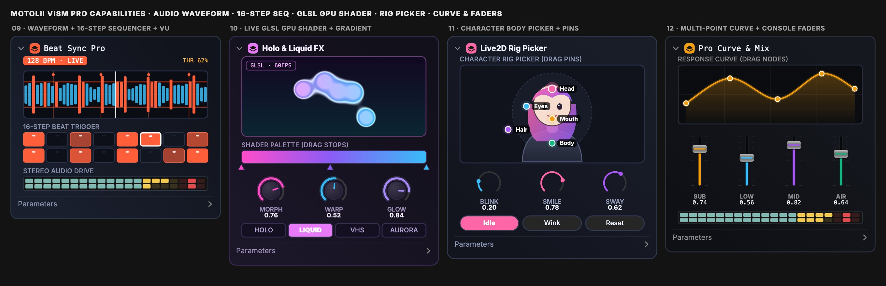

# Motolii

[English](README.md)

[](https://github.com/oshikaidesu/motolii/actions/workflows/build.yml) [](https://github.com/oshikaidesu/motolii/actions/workflows/checks.yml)

**クリエイティブコーディングとモーショングラフィックスの交差点。**

Shadertoy のシェーダーを音楽のビートに反応させる。After Effects のエクスプレッションと CSS `@keyframes` を同じテキストレイヤーに重ねる。p5.js のスケッチを Lottie アニメーションの背後に合成する。Web 上で見つけたコードを貼るだけで、そのまま映像として動きます。

Motolii は After Effects のプラグインやエクスプレッション、Shadertoy、Cavalry、p5.js、CSS、Lottie、AviUtl2 スクリプトなど、[20 種類以上の形式](#対応フォーマット)に対応するオープンソースの動画編集ソフトです。



- **GPU ネイティブ。** シェーダーやエクスプレッションが WebGPU 上で動作し、数千コピーでも 60 fps を維持できます。
- **エフェクトはプレーンファイル。** `.wgsl`・`.fs`・`.js` はローカルファイルとしてそのまま開いて編集でき、[ACP](https://github.com/anthropics/agent-client-protocol)（Zed や JetBrains と同じプロトコル）経由で AI エージェントと一緒に書くこともできます。
- **1 レイヤーに複数言語を混在。** CSS アニメーション、After Effects エクスプレッション、GPU シェーダー、ネイティブプラグインを同じレイヤー上に好きな順序で重ねられます。

## ダウンロード（ベータ版）

**macOS Apple Silicon（`.app`）** 向けのビルド済みベータ版は [GitHub Releases](https://github.com/oshikaidesu/motolii/releases) からダウンロードできます。

1. [Releases](https://github.com/oshikaidesu/motolii/releases) から `Motolii-*-macos-arm64.zip` をダウンロードして展開し、`Motolii.app` を `/Applications` に移動します。
2. 初期ベータ版は Apple Developer ID による公証前のため、初回起動前にターミナルで以下を 1 回だけ実行してください：
   ```bash
   xattr -cr /Applications/Motolii.app
   ```
3. Motolii を起動し、ホーム画面サイドバーの **SAMPLES** から同梱サンプルをクリックするとすぐ試せます。

> Windows（`x64`）・Linux 版は準備中です。ソースからビルドする場合は「[ビルドと実行](#ビルドと実行)」を参照してください。

## 画面構成と主な機能

すべてのタブの解説とスクリーンショットは [タブ・パネル一覧](docs/TABS.ja.md) を参照してください。

<p>


</p>

- **マップ表示。** Effects タブや Fonts タブを t-SNE による 2D 類似度マップに切り替えられます。1,300 以上のエフェクトを名前ではなく見た目の印象から探せます。
- **タイル型 Inspector。** パラメータを行ではなくコンパクトなブロックで配置し、パネル幅に応じて自動で列数が増えます。同梱エフェクトは視覚的な効き具合を 0〜10 で事前評価し、影響の大きいパラメータを浅黄・撫子・青磁で色分けしています。
- **ホバープレビュー。** エフェクトタイルにカーソルを乗せるだけで Stage 上に仮適用して結果を確認できます。イージングプリセットもホバーで動きを再生できます。
- **Code タブ & Code ワークスペース。** レイヤーに適用されたコードをノートブック形式のセルで編集できます。AE エクスプレッションの補完、再生ヘッド位置での評価結果、エラー行表示に対応。トップバーの **CODE** で Code・Stage・Timeline を並べて作業できます。
- **Agent タブ。** Claude Agent・Codex・Gemini CLI・Cursor など ACP 対応の AI エージェントをそのまま接続できます。選択レイヤーのカード・パラメータ値・コードがコンテキストとして渡され、新規提案は新しいカードとして追加されます（既存コードは明示的に依頼したときのみ編集）。
- **リレーション。** `Follow`・`Gravity`・`flock`・`spring`・`collide` など、複数レイヤーを連動させる動きを `shelves/relations/` の短い JavaScript で定義できます。
- **BPM グリッド。** Timeline でテンポをタップするだけで拍グリッドが表示され、ビートにスナップしながら編集できます。
- **スタック可能なイージング。** イージングをエフェクトのように重ねられます。プリセットは 1 行の数式ファイル（`.way`）です。
- **カラーツール。** macOS 標準スポイト、画像からのパレット自動抽出、テキストの選択文字単位での着色に対応。
- **Vism カスタムパネル＆カスタムカード。** WebView なしの 1 本の JavaScript で、フラットポップ外装・Flutter ネイティブ 3D（`ui.scene3d` / `.glb` / `.obj`）・リアルタイム GLSL シェーダー（`ui.shader`）・音声波形＆16 ステップシーケンサー・リグピッカー・ノブ／フェーダーを備えた専用 UI を作れます。Tools パネルの **`+ New Vism`** から IDE 型補完付きで即開発でき、`.vism` パックや 1 フォルダのドラッグ＆ドロップで配布可能です。

<p>


</p>

- **高いカスタマイズ性と透明性。** フォルダ単位のスキン、VS Code 形式の `~/.motolii/keybindings.json`、数行の Dart で追加できるパネル。書き出し時には使用エフェクトの作者・ライセンス一覧のクレジットファイルを自動出力します。

## 現在の開発状況

Motolii は Apple Silicon Mac（M4、macOS 15.5）向けに**初期ベータ版**を公開しています。自己完結型の macOS `.app` バンドルは [GitHub Releases](https://github.com/oshikaidesu/motolii/releases) から入手できます（Windows / Linux 版は未検証）。

- **動作する機能：** 動画・画像・テキスト・ベクターシェイプ・3D モデル（`.glb`/`.gltf`）・点群・Lottie アニメーションの混在編集、キーフレームとスタック型イージング、自動保存と Undo/Redo、音声付き再生、MP4 / MOV / GIF / 連番画像書き出し、`.motoliipack` 共有パック。
- **動作する外部形式：** `effects/` に置いた ISF（`.fs`）/ WGSL（`.wgsl`）や、`ae_plugins/` に置いた After Effects プラグインは再起動なしで一覧に反映されます。Shadertoy・p5.js・CSS・TSL などのコードは `⌘V` で貼り付けるだけでレイヤー／エフェクト化されます（※すべての外部コード・プラグインの動作を保証するものではありません）。
- **一部対応：** AviUtl2 スクリプト、Alight Motion 互換機能。
- **未対応・今後の課題：** Windows / Linux 実機検証、Apple Developer ID による公証、MIDI 音声再生。

形式ごとの詳細な対応状況と既知の制限は [仕様書（アーカイブ）](docs/archive/using/specifications.ja.md) を参照してください。

## ビルドと実行

### 必要な環境

- Apple Silicon 搭載 Mac（検証環境：M4、macOS 15.5）
- App Store 版 Xcode（Command Line Tools のみではビルド不可。インストール後に一度起動して追加コンポーネントを導入し、`sudo xcodebuild -license accept` を実行）
- [Homebrew](https://brew.sh/ja/)
- [Flutter](https://docs.flutter.dev/get-started/install) 3.50.0（stable、`PATH` に追加済み）
- Python 3（macOS / Xcode 付属のもので動作）
- 約 10 GB の空きディスク容量（Xcode・Flutter 除く）

### 手順

```bash
git clone https://github.com/oshikaidesu/motolii.git
cd motolii
brew bundle
engine/build.sh
app/tool/live.sh
```

- `brew bundle` で `Brewfile` に定義された依存ツール（GStreamer・SQLite・FFmpeg・CMake など）を導入します。
- `engine/build.sh` でサードパーティ依存の取得と C++ エンジンのビルドを行います。初回は Filament をソースからビルドするため M4 で約 5 分かかり、成功すると `engine/out/libmotolii.dylib` が生成されます。
- `app/tool/live.sh` で Flutter アプリをビルド・起動します（初回は 1〜3 分程度かかります）。

プロジェクトは `~/Movies/Motolii/Untitled.motolii` に自動保存され、書き出した動画も同じフォルダに出力されます。

テストの実行：C++ テストは `engine/build.sh test`（`ctest`）、Flutter テストは `cd app && flutter test`。詳細は [Testing](docs/TESTING.md) を参照してください。

トラブルシューティングは [ビルドガイド（アーカイブ）](docs/archive/using/guide.ja.md) にまとめています。

## 対応フォーマット

コードの貼り付け（`⌘V`）またはフォルダへの配置で、形式は自動判定されます。

| フォーマット | 追加方法 | 実行ランタイム |
|---|---|---|
| **Shadertoy** | 貼り付け（`⌘V`） | ISF → WGSL（glslang + Tint） |
| **GLSL Sandbox** | 貼り付け（`⌘V`） | 同上 |
| **twigl** | 貼り付け（`⌘V`） | 同上 |
| **Bonzomatic** | 貼り付け（`⌘V`） | 同上 |
| **ISF (`.fs`)** | `effects/` に配置 | glslang → SPIR-V → WGSL |
| **WGSL (`.wgsl`)** | `effects/` に配置 | WebGPU ネイティブ |
| **p5.js / Processing** | 貼り付け（`⌘V`） | QuickJS-ng |
| **Paper.js** | 貼り付け（`⌘V`） | QuickJS-ng |
| **Two.js** | 貼り付け（`⌘V`） | QuickJS-ng |
| **Canvas 2D** | 貼り付け（`⌘V`） | QuickJS-ng |
| **Dwitter** | 貼り付け（`⌘V`） | QuickJS-ng |
| **tixy.land** | 貼り付け（`⌘V`） | QuickJS-ng |
| **Turtletoy** | 貼り付け（`⌘V`） | QuickJS-ng |
| **Hydra** | 貼り付け（`⌘V`） | QuickJS-ng → WGSL |
| **After Effects エクスプレッション** | 貼り付け（`⌘V`）または Expression カード | lottie-web（QuickJS-ng） |
| **After Effects プラグイン (`.plugin`, `.aex`)** | `ae_plugins/` に配置（シンボリックリンク可） | [aexlo](https://github.com/potistudio/aexlo)（隔離ワーカー） |
| **Cavalry スクリプト** | Expression カード | QuickJS-ng |
| **CSS `@keyframes`** | テキストレイヤーへ貼り付け（`⌘V`） | Stylo（Firefox CSS エンジン） |
| **アニメーション SVG** | 貼り付け（`⌘V`）またはドラッグ＆ドロップ | ThorVG + Stylo |
| **three.js TSL** | 貼り付け（`⌘V`） | WGSLNodeBuilder（QuickJS-ng） |
| **AviUtl2 (`.anm2`, `.obj2`)** | `aviutl_scripts/` に配置 | LuaJIT |
| **Lottie (`.json`)** | ドラッグ＆ドロップ | ThorVG |
| **字幕 (`ASS`/`SRT`/`LRC`/`VTT`)** | ドラッグ＆ドロップ | libass（FFmpeg 経由） |

各ファイルの配置ルールは [`shelves/README.ja.md`](shelves/README.ja.md) を参照してください。

### After Effects 互換機能

After Effects で培った既存資産を、そのまま Motolii に持ち込めます。

- **ネイティブプラグイン（`.plugin` / `.aex`）** — 手持ちのサードパーティ製 After Effects プラグイン（Deep Glow、Quick Chromatic Aberration、Zink Tools、Satori など）をユーザーフォルダの `ae_plugins/` に配置またはシンボリックリンクするだけで、パラメータカード・`#ae` / `#cpu`（または `#gpu`）タグ・ライブプレビュー付きで Effects タブに表示されます。[aexlo](https://github.com/potistudio/aexlo) を隔離ワーカープロセスで動かすため、プラグイン側がハング・クラッシュしてもエディタ本体は落ちません。
- **エクスプレッション** — 独自再実装ではなく、lottie-web の `ExpressionManager` を QuickJS-ng のバイトコードにコンパイルしてそのまま実行しています。`thisComp`・`thisLayer`・`thisProperty`・`sampleImage`・`fromWorld`・`wiggle`・`linear`・`ease`・キーフレーム参照・他レイヤー参照がそのまま動作します。
- **Lottie（`.json`）** — Bodymovin 書き出しの Lottie を ThorVG で再生し、埋め込みエクスプレッションも JerryScript でランタイム評価します（ベイク不要）。キーフレーム・イージング・パス・親子付け・プリコンポジション・タイムリマップ・ループ・マット・ブレンドモードに加え、`thorvg_z.patch` による 3D レイヤー・カメラにも対応しています。

Cavalry スクリプトもそのまま動作します（`cavalry.Point`・`cavalry.PointCloud`・`cavalry.random` を提供、裸の `{ }` 式は自動で `each()` にラップ）。コミュニティ製の配置スクリプト 26 本を `shelves/create/cavalry/` に同梱しています。

**非対応の範囲：** Adobe 独自の組み込みエフェクト、未実装の AEGP ホスト API（コンプカメラ参照やテキストドキュメント操作など）に依存する一部プラグイン、AE 内部音声グラフ依存の音声連動プロパティ。これらは Motolii 独自の GPU シェーダーエフェクトと音声解析機能で補完しています。

## ディレクトリ構成

| ディレクトリ | 内容 |
|---|---|
| [`app/`](app/README.md) | Flutter 製デスクトップ UI（表示と入力処理を担当） |
| [`engine/`](engine/README.md) | C++ 製レンダリング＆プロジェクトエンジン（`libmotolii.dylib`） |
| [`shelves/`](shelves/README.ja.md) | 同梱のコミュニティ製エフェクト・スクリプト・イージング・スキン |
| [`docs/`](docs/README.md) | 各種ドキュメント |

## ドキュメント

- [タブ・パネル一覧](docs/TABS.ja.md) — 全タブの機能紹介（スクリーンショット付き）
- [After Effects 資産の持ち込みガイド](docs/AFTER_EFFECTS.ja.md) — 手持ちの AE プラグイン・エクスプレッション・Lottie の使い方
- [Vism 開発クイックスタート](docs/VISM_QUICKSTART.ja.md) / [カスタムカード仕様](docs/CUSTOM_CARDS.ja.md) — JS だけで 3D・シェーダー・音声連動の独自 UI を作る
- [コーディング・シェーダー開発リファレンス](docs/CODING.ja.md) — 各形式のベース仕様・互換性・WESL WGSL 属性・IDE 連携
- [使い方ガイド](docs/GUIDE.md) — プロジェクト作成から書き出しまでの操作リファレンス
- [アーキテクチャ](docs/ARCHITECTURE.md) — アプリ・エンジン・描画・棚の全体設計（英語）
- [エフェクトのライセンス管理](docs/design/effect_licences.md) — クレジット出力とライセンス境界（英語）
- [テスト](docs/TESTING.md) — 各テストスイートの実行方法（英語）
- [ブリッジ仕様](docs/app/BRIDGE.md) — Flutter と C++ エンジン間の FFI 契約（英語）
- [ジェスチャー仕様](docs/app/GESTURES.md) — 各コントロールの操作仕様（英語）
- [コントリビューションガイド](.github/CONTRIBUTING.ja.md) — ビルド・設計原則・PR の出し方
- [アーカイブ](docs/archive/) — 過去の設計メモ・旧ドキュメント

## コントリビューション

質問や相談は [Discussions](https://github.com/oshikaidesu/motolii/discussions)、バグ報告や機能要望は [Issues](https://github.com/oshikaidesu/motolii/issues) へどうぞ（日本語・英語どちらも歓迎）。Pull Request を送る際は [`.github/CONTRIBUTING.ja.md`](.github/CONTRIBUTING.ja.md)、[`CODE_OF_CONDUCT.md`](.github/CODE_OF_CONDUCT.md)、[`SECURITY.md`](.github/SECURITY.md) をご確認ください。

## ライセンス

[Apache License 2.0](LICENSE-APACHE) または [MIT](LICENSE-MIT) のデュアルライセンスです（利用者が選択できます）。特段の明記がない限り、Motolii へのコントリビューションも同一のデュアルライセンスで提供されるものとします。同梱されているサードパーティ製アセット・ライブラリはそれぞれのライセンスに従います（[`THIRD_PARTY_NOTICES.md`](THIRD_PARTY_NOTICES.md)）。
