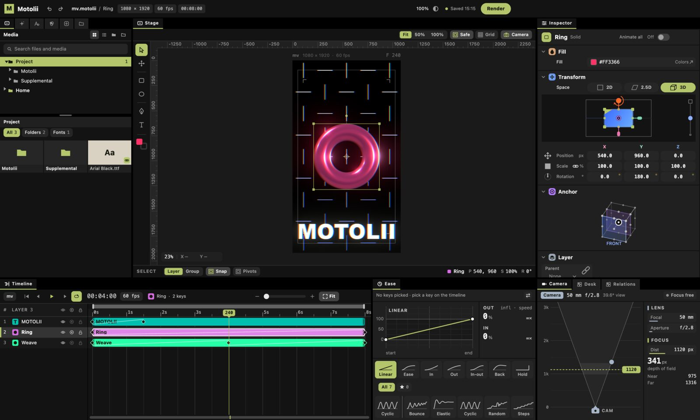

# Motolii

[English](README.md)

[](https://github.com/oshikaidesu/motolii/actions/workflows/build.yml) [](https://github.com/oshikaidesu/motolii/actions/workflows/checks.yml)

**ネットで見つけた表現を、すぐ自分の映像に。**

Motolii は、MV やモーショングラフィックスを制作するためのオープンソースの動画編集ソフトです。Web 上で公開されているエフェクトやスクリプトを、専用プラグインに作り直さずに利用できます。



## いまの状態

現在は開発途中で、Apple Silicon 搭載 Mac だけに対応しています。配布用アプリはまだ用意していないため、試す場合はソースコードからビルドする必要があります。

- **動く**：動画・写真・文字・図形・3D モデル・点群・Lottie アニメーションを同じシーンに置く、キーフレームとイージング、自動保存と取り消し、再生（動画の音も鳴る）、MP4 への書き出し。
- **動く**：ネットのエフェクト。ISF（`.fs`）と WGSL（`.wgsl`）のファイルは、エフェクトのフォルダに置くと、アプリを再起動せずにエフェクト一覧に出ます。p5.js のスケッチと Shadertoy のシェーダーは、貼り付けるとレイヤーになります。対応形式のコードでも、すべてが正しく動作するわけではありません。
- **一部**：AviUtl2 のスクリプト、Alight Motion の機能。
- **まだ**：Windows、配布できる `.app`（エンジンが Homebrew の部品を読むので、ビルドした Mac の外では動かない）、MIDI の音。

形式ごとの動作状況と数、知っている不具合は[ガイドの「対応形式と動作状況」](docs/using/guide.ja.md#対応形式と動作状況)にあります。

## ビルドして動かす

要る物：

- Apple Silicon の Mac（確かめたのは M4、macOS 15.5）。
- App Store の Xcode（Command Line Tools だけでは画面をビルドできません）。入れたら一度開いて追加の部品を入れ、`sudo xcodebuild -license accept`。
- Homebrew：[brew.sh](https://brew.sh/ja/) の 1 行。
- Flutter 3.47.2（stable）を `PATH` に：[ガイドの「Flutter を入れる」](docs/using/guide.ja.md#flutter-を入れる)。
- Python 3：macOS に付いている物（Xcode を入れると入る）でよい。
- 空き容量：Xcode と Flutter のほかに約 10 GB。

そのあと、1 行ずつ：

```bash
git clone https://github.com/oshikaidesu/motolii.git
cd motolii
brew bundle
engine/build.sh
app/tool/live.sh
```

- `brew bundle` で、`Brewfile` の物（GStreamer・SQLite・ffmpeg・cmake など）が入ります。
- `engine/build.sh` がエンジンをビルドします。初回は Filament をソースから組みます（M4 で約 5 分）。`engine/out/libmotolii.dylib` ができれば成功です。
- `app/tool/live.sh` でアプリが開きます。初回はビルドで 1〜3 分止まって見えます。

プロジェクトファイルは `~/Movies/Motolii/Untitled.motolii`（自動で保存）、書き出した動画もその隣にできます。

テストを走らせるには：エンジンは `engine/build.sh test`（CMake の ctest）、アプリは `cd app && flutter test`。詳しくは [Testing](docs/TESTING.md)。

手順の詳しい説明、最初の 1 本、困った時の直し方は[ガイドの「使ってみる」](docs/using/guide.ja.md#使ってみる)にあります。

## 見つけたファイルを使う

[`shelves/README.ja.md`](shelves/README.ja.md) を見てください。ファイルの種類ごとに置き場所と書き方があります。

- ファイル（シェーダー・`.js`・イージングなど）：種類に合うフォルダに置く。例：`effects/` に `.fs` を置くと Effects タブに出る
- コード（p5.js・Shadertoy など）：置かずに、コピーしてアプリで ⌘V

## フォルダの並び

| 場所 | 中身 |
|---|---|
| [`app/`](app/README.md) | Flutter のアプリ。画面は操作だけを受けます |
| [`engine/`](engine/README.md) | C++ のエンジン。絵を描き、`libmotolii.dylib` になります |
| [`shelves/`](shelves/README.ja.md) | アプリが動く時に読む、同梱のコミュニティの作品（エフェクト・スクリプト・イージング・スキン） |
| [`docs/`](docs/README.md) | 文書 |

`app/README.md` と `engine/README.md` は日本語で、頭に英語の要約があります。

## 文書

- [ガイド](docs/using/guide.ja.md)：Motolii でできる事、動く形式、ビルドの手順、最初の 1 本、他のソフトとの違い。
- [タブの紹介](docs/using/screen_tour.ja.md)：画面のタブごとの絵と使い方。
- [作り](docs/ARCHITECTURE.md)：全体の作り（日本語。頭に英語の要約があります）。
- [テスト](docs/TESTING.md)：テストの種類ごとの回し方（英語）。
- [関わり方](.github/CONTRIBUTING.ja.md)：ビルド、決まり、手を付けやすい所。

## 開発に加わる

質問・相談は [Discussions](https://github.com/oshikaidesu/motolii/discussions)、不具合は [Issues](https://github.com/oshikaidesu/motolii/issues) へ。日本語・英語のどちらでも。Pull Request も受けます：[`.github/CONTRIBUTING.ja.md`](.github/CONTRIBUTING.ja.md)、行動規範（[`.github/CODE_OF_CONDUCT.md`](.github/CODE_OF_CONDUCT.md)）、脆弱性の知らせ方（[`.github/SECURITY.md`](.github/SECURITY.md)）を見てください。

## ライセンス

Motolii 自身の物は [Apache License 2.0](LICENSE-APACHE) と [MIT](LICENSE-MIT) のどちらでも、使う人が選べます（ダブルライセンス）。送ってもらった貢献も、特に断りが無ければ同じ二つのライセンスで受けます。同梱した他の人の作品は、それぞれのライセンスに従います（[`THIRD_PARTY_NOTICES.md`](THIRD_PARTY_NOTICES.md)）。
