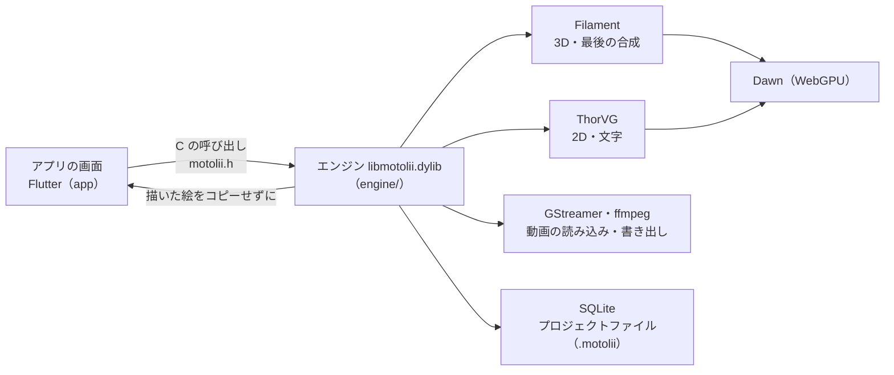

# Motolii

[](https://github.com/oshikaidesu/motolii/actions/workflows/build.yml) [](https://github.com/oshikaidesu/motolii/actions/workflows/assets.yml)

**ネットで見つけた表現を、すぐ自分の映像に。**

Motolii は、MV やモーショングラフィックスを制作するためのオープンソースの動画編集ソフトです。

After Effects のような映像制作を、より簡単な操作で行えるように開発しています。また、Web 上で公開されているエフェクトやスクリプトを、専用プラグインに作り直さずに利用できることも特徴です。

[English](README.en.md) ・ [質問・相談（Discussions）](https://github.com/oshikaidesu/motolii/discussions) ・ [不具合（Issues）](https://github.com/oshikaidesu/motolii/issues)　どちらも日本語・英語のどちらでも。


## エフェクトとスクリプト

Motolii では、ほかのソフトや Web サイトで公開されているエフェクトを読み込めます。

例えば、Shadertoy のシェーダーや p5.js のスケッチは、コードをコピーして貼り付けることでレイヤーとして利用できます。読み込んだあとも、キーフレームを設定したり、ほかのエフェクトと組み合わせたりできます。

ISF、WGSL、AviUtl2 のスクリプトにも対応しています。ファイルを指定のフォルダに追加すると、アプリを再起動せずにエフェクト一覧へ反映されます。

新しく追加したエフェクトにはプレビューが自動生成されるため、名前だけでなく、実際の見た目を確認しながら選べます。

※ 対応形式のコードでも、すべてが正しく動作するわけではありません。動作検証の結果は後述しています。


*配られている ISF の効果 8 本を、写真（パブリックドメイン）と文字に掛けた所。どれも作者のファイルのまま。*

## 編集操作

操作方法は Alight Motion を参考にしています。

文字や図形はプレビュー画面上で直接移動・変形できます。Animate を有効にすると、値の変更をキーフレームとして記録できます。キーフレーム間のイージングも調整できます。

エフェクトは動くサムネイルから探せます。追加したエフェクトも同じ一覧で管理できます。

また、2D と 3D を切り替える必要はなく、文字、画像、動画、3D モデルなどを同じシーンに配置できます。

## 映像制作

タイムライン上で素材を配置し、エフェクトやキーフレームを使ってアニメーションを制作できます。

動画や音声の読み込み、Lottie アニメーション、MIDI を利用したアニメーション、物理演算にも対応しています。

完成した映像は MP4 形式で書き出せます。


*Motolii で作った 8 秒。組み立てた後に [`docs/guide/readme_movie.md`](docs/guide/readme_movie.md) の命令を貼れば、同じ物が `~/Movies/Motolii/mv.mp4` にできます。*

## 動作環境

現在は開発途中で、Apple Silicon 搭載 Mac に対応しています。

配布用アプリはまだ用意していないため、試す場合はソースコードからビルドする必要があります。

Windows 版も作る予定です。Filament、ThorVG、GStreamer、Flutter など主な部品は Windows に対応しており、Mac に直接つないでいるのは動画と画面の受け渡しなど一部だけです。Windows でのビルドと動作確認はまだしていません。

対応形式ごとの動作状況、既知の不具合、ビルド手順については以下に記載しています。

## 対応形式と動作状況

| 形式 | 確認した結果 |
|---|---|
| ISF | 327 本中 318 本 |
| Shadertoy | 300 本中 261 本で絵が出て動いた |
| p5.js | 168 作中 97 作で絵が出た |
| AviUtl2 | 594 本中 372 本が最後まで動いた |

※ 検証時点・条件はそれぞれ異なります。p5.js は表示できても元作品と見た目が一致するとは限りません。詳しい条件と制限は[検証記録](docs/internal/reports/engine/sketch_import_2026-11-01.md)に記載します。

### 形式ごとの詳しい様子

| できる事 | 使う形式 | いまの様子 |
|---|---|---|
| VJ ソフト向けに配られているエフェクトをかける | ISF（`.fs`。[ISF-Files](https://github.com/Vidvox/ISF-Files) など） | エフェクトのフォルダに置くと一覧に出ます。ISF-Files の 327 本中 318 本が動きます（数えた検査は、消しました）。同梱 419 本 |
| WebGPU のシェーダーをかける | WGSL（`.wgsl`。three.js などの画面効果を移した物を含む） | シーン全体にかかります。同梱 266 本 |
| p5.js のスケッチを貼る | p5.js（コードをコピーして、アプリで ⌘V） | レイヤーになり、Program タブに残ります。キーフレームを打てて、Time Remap で時間の速さも変えられます。OpenProcessing の 168 作中 97 作で絵が出ました（11/1 の数え。元と見た目が一致したのは、最初の 42 作を目で見て約 16 作） |
| Shadertoy のシェーダーを貼る | GLSL（コードをコピーして、アプリで ⌘V） | 自分で描く作品はレイヤーになり、`iChannel` を読む作品は選んだレイヤーにかかります。どちらも Program タブに残ります。API の写し 36,668 本から無作為に選んだ 300 本中 261 本で絵が出て動きました（2026-11 初めの数え）。黒かった 30 本のうち 26 本はマウスなどの入力待ち。読み込めなかったのが 9 本。Time Remap はまだ p5.js だけです |
| AviUtl2（日本の動画編集ソフト）のスクリプトを使う | `.anm2`・`.obj2`（中の HLSL を WGSL に変換） | 同梱 172 パッケージ。10/26 の数えで、当時同梱の 594 本中 372 本が最後まで動きました（[`docs/internal/reports/aviutl/aviutl2/catalogue.md`](docs/internal/reports/aviutl/aviutl2/catalogue.md)）。DLL が要る物はまだ動きません |
| ネットの TSL（three.js のシェーダー言語）の表現を使う | three.js 自身の変換器で WGSL に | [Shader Lab](https://github.com/basementstudio/shader-lab) の 19 本はエフェクト一覧にあります。ほかは WGSL への変換まで |
| 動画・写真・文字・図形・3D モデル・点群を置く | 動画（GStreamer）、文字と図形（ThorVG）、glTF・`.ply`（Filament） | 動きます |
| After Effects のアニメーションを置く | Lottie の `.json`（ThorVG） | 動きます |
| MIDI をアニメーションに使う | MIDI（`.mid`）：ピアノロール、音に合わせて値にキーフレーム | 動きます。MIDI の音はまだ鳴りません（動画の音は鳴ります） |
| 図形を作る・出入りの動きを付ける | 自分のスクリプト（`.js`） | 置くと一覧に出ます。同梱のレシピ（動く作例）101 本、出入りの動き 13 本 |
| 複数のレイヤーをまとめて動かす（並べる・追う・群れ・ばね・ぶつかり合い） | 関係のスクリプト（`.js`） | `relations/` に置くと Relations タブに出ます。同梱 9 本と、組み込み 5 つ |

作品の権利は作者のものです。Shadertoy や OpenProcessing の作品には非営利の条件が付いた物が多いので、仕事に使う時は作者に確かめてください。

ほかに：キーフレームとイージング（anime.js のイージングもそのまま使えます）、物理演算（Jolt）、ガラスの屈折、カメラ（焦点距離・絞り・ピント）、MP4 への書き出し。

**ビルドの確認**：GitHub の Apple Silicon の Mac（macos-15）で、この README の手順どおりに新しくビルドし、画面のコードの検査（`flutter analyze`）を走らせています（上の build バッジ）。自分で書いたテストはありません。外から求める条件は [`docs/TESTING.md`](docs/TESTING.md)。

**速さ**（M4、上の 8 秒の作例、1080×1920）：1 フレーム約 4 ms で、毎秒 240 フレームでも落ちません。8 秒の書き出しは約 5 秒（ffmpeg のエンコードを含む）。測り直すには、作例を作ってから `printf 'time 240\n' | engine/edit.sh ~/Movies/Motolii/mv.motolii`。

## 試す前に

- **いま試すと良い人**：Apple Silicon の Mac があり、ターミナルにコマンドを貼ってビルドできる人。p5.js、Shadertoy、シェーダーのエフェクト、AviUtl2 のスクリプトを動画に使ってみたい人。
- **まだ待つと良い人**：普段の制作にすぐ使いたい人、Windows の人、アプリを入れるだけで使いたい人。

| | いまの状態 |
|---|---|
| 動く | 上の表で「動きます」の物、自動保存と取り消し、再生（動画の音も鳴る）、MP4 への書き出し、タイムライン・インスペクタ・エフェクト一覧 |
| 一部 | AviUtl2 のスクリプト、Alight Motion の機能（数は下の「他のソフトとの違い」） |
| 知っている不具合 | コピーで作るレシピ（Iris・Weave など）のレイヤーに、画面用の `.wgsl` エフェクトをかけると絵が崩れる（シーン全体にかけるのは大丈夫） |
| まだ | Windows、配布できる `.app`（エンジンが Homebrew の部品を読むので、ビルドした Mac の外では動かない）、MIDI の音 |

## 使ってみる

### 要る物

| 物 | 版・大きさ | 入れ方 |
|---|---|---|
| Mac | Apple Silicon（確かめたのは M4、macOS 15.5） | — |
| Xcode | App Store の Xcode（画面のビルドに要る。Command Line Tools だけでは足りない）。10 GB を超えることがあり、ダウンロードに 30 分〜1 時間かかることもある | App Store。入れたら一度開いて追加の部品を入れ、`sudo xcodebuild -license accept` |
| Homebrew | — | [brew.sh](https://brew.sh/ja/) の 1 行 |
| Flutter | 3.47.2（stable）。約 2 GB | 下の「Flutter を入れる」 |
| Python 3 | macOS に付いている物（Xcode を入れると入る）でよい | — |
| 空き容量 | Xcode と Flutter のほかに約 10 GB（ビルド後で 8.1 GB） | — |
| ダウンロード量 | 約 1 GB（Filament のソース 635 MB、Skia 65 MB、Jolt 16 MB ほか。Homebrew の物は別） | — |
| 時間 | Xcode と Flutter を入れる所からなら 1〜2 時間（回線しだい）。それらがあれば初回 約 10 分（M4。Filament 約 5 分、エンジン 約 1〜2 分、画面 約 1〜3 分） | — |

確かめた Homebrew の版：GStreamer 1.28.8、SQLite 3.53.4、LuaJIT 2.1、QuickJS-ng 0.17.0、ffmpeg 9.0、cmake 4.1、ninja 1.13、meson 1.12。

### Flutter を入れる

```bash
git clone --depth 1 --branch 3.47.2 https://github.com/flutter/flutter.git ~/flutter
```

```bash
echo 'export PATH="$HOME/flutter/bin:$PATH"' >> ~/.zprofile && source ~/.zprofile
```

```bash
flutter doctor
```

`Xcode` と `macOS` の行に ✓ が付けば成功です（Android や Chrome の行は ✗ でかまいません）。FVM を使う人は `app/.fvmrc` に版が書いてあります。

### ビルドして開く

ターミナルで 1 つずつ貼ります。2 つ目からは、`motolii` のフォルダの中で（`cd motolii` した後で）走らせます。

```bash
git clone https://github.com/oshikaidesu/motolii.git
```

```bash
cd motolii
```

```bash
brew bundle
```

`Brewfile` の物（GStreamer・SQLite・ffmpeg・cmake など）が入ります。最後に `Homebrew Bundle complete!` と出れば成功です。

```bash
engine/gpu/build.sh
```

Filament（WebGPU）をダウンロードしてビルドします（M4 で約 5 分）。エラーで止まらずに終われば成功です。

```bash
engine/edit.sh build.motolii < /dev/null
```

エンジンをビルドします。ThorVG・Skia・libtess2・Jolt などは、ここで初回だけダウンロードします。`edit.sh` はプロジェクトファイルを開いて命令を待つ道具なので、`< /dev/null` で「命令なし」を渡し、ビルドして空のファイルを作ったらすぐ終わります。`engine/out/libmotolii.dylib` ができれば成功です（`build.motolii` は消してかまいません）。

```bash
app/live.sh
```

アプリが開きます（初回はビルドで 1〜3 分止まって見えます。ターミナルに流れる文字は気にしなくてかまいません）。プロジェクトファイルは `~/Movies/Motolii/Untitled.motolii`（自動で保存）、書き出した動画もその隣にできます。ウィンドウを閉じると終わり、ターミナルを閉じてもウィンドウは閉じます。次からは、新しいターミナルで `cd ~/motolii && app/live.sh`（ホームのフォルダで `git clone` した時）。

### 画面の見方


1. **上の帯**：プロジェクト名、画面サイズ、fps、長さ、取り消し・やり直し、Render（書き出し）。
2. **[左のタブ](docs/guide/tabs.md#左のタブ)**：Media（素材）、Effects（エフェクト）、Fonts（書体）、Colors（色）、Create（図形とレシピ）、Program（貼ったコード）、Presets（保存した組み合わせ。まだ使えません）。
3. **[プレビュー（Stage）](docs/guide/tabs.md#プレビューのタブ)**：見ながら置く・動かす所。左の縦の列が道具（選択・移動・図形・ペン・文字など）。上のタブで Camera View（カメラから見た仕上がり）に切り替えます。
4. **インスペクタ**：選んだレイヤーの値（Transform・Anchor・Blend・Fill など）。上に、そのレイヤーにかかっている関係が並びます。
5. **タイムライン**：レイヤーとキーフレーム、再生、マーカー、BPM。
6. **Ease**：キーフレームの間の動き方。右の列が曲線の見本です。
7. **[右下のタブ](docs/guide/tabs.md#右下のタブ)**：Camera（レンズとピント）、Desk（道具）、Relations（複数のレイヤーをまとめて動かす）。

タブごとの絵と使い方は [タブの紹介](docs/guide/tabs.md) にあります。

### 最初の 1 本（画面で）


1. 左上のタブの 5 つ目（四角に ＋、**Create**）を押し、検索に `Iris` と打ちます。
2. **Iris** のタイルを押し、下の **Create** を押します。プレビューに色の輪が置かれ、タイムラインにレイヤーが 1 本増えます。
   
3. 輪を選んだまま、タブの 2 つ目（fx、**Effects**）に替えて `Glow` を探し、押して下の **Add** を押します。輪が光り、ボタンが **Remove**（外す）に変わります。
   
4. 右上の **Render** を押すと、書き出しの小窓が出ます。名前（例 `first`）を入れて、小窓の **Render** を押します。
   
5. プロジェクトの隣に `first.mp4` ができ、上に `Written: first.mp4` と出ます。
   

### ネットのエフェクトを 1 本追加する

Motolii の一番の使い方です。例として、[ISF-Files](https://github.com/Vidvox/ISF-Files) の `ASCII Art.fs`（Motolii には同梱していない物）を使います。

1. エフェクトのファイル（`.fs`）をダウンロードします。例：ISF-Files のページで `ISF/ASCII Art.fs` を開き、右上の **Download raw file**（↓ のボタン）を押します。
2. Finder で ⌘⇧G を押し、`~/Library/Application Support/Motolii/` と打って開きます。中に `effects` フォルダを作り（無ければ）、ファイルを入れます。
3. Effects タブに、すぐ出ます（再起動は要りません）。サムネイル（気球の写真にそのエフェクトをかけた見本）も数秒で自動で作られ、ポインタを乗せると動きます。既定の値では見た目が変わらない物には **NO CHANGE** と出ます。レイヤーを選んで、タイルを押し、下の **Add** を押します。
   
4. プレビューでも書き出しでも、こうなります（写真に ASCII Art をかけた所）。
   

WGSL（`.wgsl`）、レシピ（`.js` を `recipes/` に）、関係（`.js` を `relations/` に）、イージング（`.way` を `ways/` に）、AviUtl2 のスクリプト（作者のフォルダごと `aviutl_scripts/` に）も同じように置けます。保存したファイル名の最後が `.fs` になっているか確かめてください（ブラウザが `.txt` を付けることがあります）。

p5.js と Shadertoy は、置かずに貼ります。作品のコードをコピーして、アプリで ⌘V。コードは Program タブに残ります。

### 次に：自分の素材で

- **プロジェクトのサイズ**：上の `1920 × 1080` を 2 回押して打ち直します（縦の MV なら `1080x1920`）。
- **曲を置く**：mp3・wav・m4a なども Media から **Place** で置けます（書き出しにも入ります）。
- **動画・写真を置く**：左のタブの 1 つ目（**Media**）で `Home` から自分のフォルダを開き、ファイルを選んで下の **Place**。動画の音は再生中に鳴り、書き出しにも入ります。
- **文字を置く**：プレビューの左の道具から **T** を選んでプレビューを押すと、文字のレイヤーができます。文字はインスペクタの文字欄で変えます。書体は左のタブの 3 つ目（**Fonts**）から。
- **動かす**：インスペクタの **Animate all** を入れてから、値（位置・大きさなど）を横にドラッグします。今の時刻にキーフレームが打たれます。時刻を変えてもう一度ドラッグすると、その間が動きます。動き方は下の **Ease** で選びます。
- **保存・開く**：保存は自動です（上に `Saved 時刻`）。新しいプロジェクトはメニューの **File › New Document**（⌘N）、同じフォルダの別のプロジェクトは **File › Open**。

<details>
<summary><b>最初の 1 本（コマンドで）</b></summary>

画面を使わずに、レシピで絵を作り、光（Glow）とシーン全体の RGB のずれ（`rgbshift.wgsl`）をかけて、8 秒の MP4 に書き出す例です。`engine/edit.sh` はプロジェクトファイルを開いて、1 行ずつの命令を受けます（`help` で一覧）。

```bash
engine/edit.sh $HOME/Movies/Motolii/first_cmd.motolii <<EOF
make Weave
effect 1 Glow
say 0 script $PWD/shelves/effects/glitch/rgbshift.wgsl
write $HOME/Movies/Motolii/first_cmd.mp4
EOF
```


- `make Weave`：レシピ「Weave」でレイヤー 1 を作る（`recipes` で一覧）。
- `effect 1 Glow`：レイヤー 1 にエフェクトをかける（`effects` で一覧）。
- `say 0 script …`：0（シーンそのもの）にシーン全体のエフェクトを置く。
- `write …`：MP4 に書き出す。
- 同じ命令をもう一度走らせると、同じプロジェクトにレイヤーがもう 1 つ増えます。やり直すなら先に `rm ~/Movies/Motolii/first_cmd.motolii`。

上の 8 秒の作例の命令は [`docs/guide/readme_movie.md`](docs/guide/readme_movie.md)。

</details>

<details>
<summary><b>困ったら</b></summary>

| 出た事 | 直し方 |
|---|---|
| `flutter: command not found` | 上の「Flutter を入れる」の 2 行目をもう一度。別の場所なら `FLUTTER=/path/to/flutter app/live.sh` |
| `brew: command not found` | [brew.sh](https://brew.sh/ja/) の 1 行で Homebrew を入れる |
| `xcrun: error` や、Xcode が無いと言われる | App Store で Xcode を入れ、一度開いて追加の部品を入れ、`sudo xcodebuild -license accept` |
| `No space left on device` | 空きを 10 GB 以上にしてから、止まったコマンドをもう一度 |
| `git clone` や `build.sh` がネットの途中で止まった | 同じコマンドをもう一度。直らなければ `engine/third_party/` の中の止まった物のフォルダを消してからもう一度 |
| `ld: library 'webgpu_dawn' not found` | `engine/gpu/build.sh` を先に走らせる |
| アプリは開くがプレビューが黒い | エンジンをビルドしたか確かめる（`engine/out/libmotolii.dylib` があるか）。無ければ `engine/edit.sh build.motolii < /dev/null` |

それでも止まったら [Issue](https://github.com/oshikaidesu/motolii/issues) に、走らせたコマンドと出た文をそのまま貼ってください（ひな型があります）。使い方の質問は [Discussions](https://github.com/oshikaidesu/motolii/discussions) へ。日本語・英語のどちらでも。

</details>

<details>
<summary><b>更新する・消す</b></summary>

- 更新：`git pull` の後、`engine/gpu/build.sh` と `engine/edit.sh build.motolii < /dev/null` をもう一度（変わった所だけビルドし直します）。アプリは `app/live.sh` がビルドし直します。
- 消す：`motolii` のフォルダを消します（ダウンロードした物とビルドした物は全部この中）。作ったプロジェクトと動画は `~/Movies/Motolii/` に残ります（別の所に置いた物はそこに）。Flutter は `~/flutter` を消します。`brew bundle` で入れた物は `brew uninstall` で。

</details>

## 他のソフトとの違い

<details>
<summary>表で比べる</summary>

| | Motolii | After Effects | Cavalry | Alight Motion | Blender | VDMX・TouchDesigner | Motion Canvas・Rive |
|---|---|---|---|---|---|---|---|
| 主な使い道 | MV の映像を作って書き出す | 映像の合成 | 2D のモーショングラフィックス | スマホで映像 | 3D 全般 | ライブの映像（演奏） | コードで映像（Motion Canvas）、アプリの中のアニメーション（Rive） |
| 2D と 3D | 一つのシーン（Filament） | 2D と 3D のレイヤー | 2D が中心 | 2D が中心 | 3D が中心 | 両方（組み方による） | 2D |
| 動く所 | macOS（Apple Silicon）だけ | Windows・macOS | Windows・macOS | iOS・Android | Windows・macOS・Linux | VDMX は macOS、TouchDesigner は Windows・macOS | ブラウザ・各種 |
| 成熟度 | 開発中、作者 1 人、リリース無し | 長く使われている | 製品 | 製品 | 長く使われている | 製品 | 使われている |
| 値段・ライセンス | 無料、Apache-2.0 か MIT | 有料 | 有料（無料版あり） | 有料（無料版あり） | 無料、GPL | 有料（無料版あり） | Motion Canvas は無料・MIT、Rive は無料版あり |

</details>

**違い**：ISF をそのまま読むソフトは他にもあります（VDMX・MadMapper）。Motolii の違いは、ISF・WGSL・AviUtl2 のエフェクト、p5.js と Shadertoy の貼り付け、Filament の 3D、タイムライン、MP4 の書き出しを一つにした組み合わせです。

**まだできない事**：ソフトとしての安定と機能の数は、これからです。配布できるアプリが無い事、Windows で動かない事、ライブで演奏する使い方は考えていない事。

**操作の手本が Alight Motion な訳**：スマホで MV を作る人が慣れている触り方を、まず全部なぞってから、その先へ行くためです。Alight Motion の効果 169 と機能 32 のうち、Motolii に有るのは 101、一部が 37、無いのが 62、未確認が 1 です（10 月末の数え、[`docs/internal/reports/alight_motion/alight_map.md`](docs/internal/reports/alight_motion/alight_map.md)）。

## 作り



画面は操作だけで、絵はエンジン（`engine/`）が描きます。Google の Filament はビルドの時にダウンロードします。エンジンの入口は [`engine/README.md`](engine/README.md)、全体の作りは [`docs/ARCHITECTURE.md`](docs/ARCHITECTURE.md) にあります。

## これから

1. 配布できる `.app`（Homebrew の部品を中に入れる）を作り、Releases に置く。
2. Windows 版。
3. AviUtl2 のスクリプトで足りない呼び出し（`obj.computeshader`、本体のエフェクトなど）と、TSL の表現をエフェクト一覧に。
4. Alight Motion の機能を揃える。

## 開発に加わる

[`.github/CONTRIBUTING.md`](.github/CONTRIBUTING.md)（[English](.github/CONTRIBUTING.en.md)）に、ビルド、決まり、手を付けやすい所があります。行動規範は [`.github/CODE_OF_CONDUCT.md`](.github/CODE_OF_CONDUCT.md)、脆弱性の知らせ方は [`.github/SECURITY.md`](.github/SECURITY.md)。

### 考え方

- **自作は負債。** まず既存の実装を探し、作者のやり方のまま使います。無ければ周りの技術やコミュニティまで探します。
- 他の人の作品はなるべく手を入れずに同梱し、隣に作者のライセンスと出所を置きます。手を入れる時は、元に当てる差分（`.patch`）に分けて元は作者の配布元からダウンロードするか、ファイルの 1 行目に元と改変を書きます。
- 今は自分で書いたコードも多くあります（画面の Flutter など）。借りられる物が見つかれば、自分のコードを捨てて取り替えます。
- コミットごとに、何をどこから借りたか（出典）を書きます。

<details>
<summary><b>フォルダの並び</b></summary>

| 場所 | 中身 |
|---|---|
| `engine/` | エンジン。入口と、今のビルドが使うファイルの一覧は [`engine/README.md`](engine/README.md) |
| `shelves/effects/`・`recipes/`・`relations/`・`animators/`・`ways/` | 同梱のエフェクト・レシピ・関係・出入りの動き・イージング（利用者のフォルダと同じ形） |
| `shelves/aviutl_scripts/` | 同梱の AviUtl2 のスクリプト（作者ごと、LICENSE と SOURCE.txt つき） |
| `app/` | アプリの画面（Flutter、macOS） |
| `thorvg/` | ThorVG を wgpu に載せた前の結合（前の試しのスクリプトが使う） |
| `old/` | 前の土台の実験（今の作りからは使っていない） |
| `docs/` | この README の絵（`pictures/`）と作例（`guide/`）、作者の作業メモ（`notes/`） |

</details>

<details>
<summary><b>文書の地図</b></summary>

| 外向け | 作者の作業メモ（日本語、そのまま公開） |
|---|---|
| `README.md`・`README.en.md`・[`docs/README.md`](docs/README.md)（docs の地図）・`docs/ARCHITECTURE.md`・`.github/CONTRIBUTING.md`・`.github/CONTRIBUTING.en.md`・`THIRD_PARTY_NOTICES.md`・`engine/README.md` | `docs/internal/notes/`（やること・採点表）・`docs/internal/reports/`（調べた記録。絵と動画、人の投稿を集めた物は git に入れていない）・`docs/internal/reports/window/design_lab_*.md`（10 月初めの記録） |

</details>

## ライセンス

Motolii 自身の物は [Apache License 2.0](LICENSE-APACHE) と [MIT](LICENSE-MIT) のどちらでも、使う人が選べます（ダブルライセンス）。送ってもらった貢献も、特に断りが無ければ同じ二つのライセンスで受けます。同梱した他の人の作品は、それぞれのライセンスに従います（[`THIRD_PARTY_NOTICES.md`](THIRD_PARTY_NOTICES.md)）。

*Licensed under either of [Apache License 2.0](LICENSE-APACHE) or [MIT](LICENSE-MIT), at your option. Unless you explicitly state otherwise, any contribution intentionally submitted for inclusion in the work by you, as defined in the Apache-2.0 license, shall be dual licensed as above, without any additional terms or conditions. Bundled third-party works keep their own licences.*
