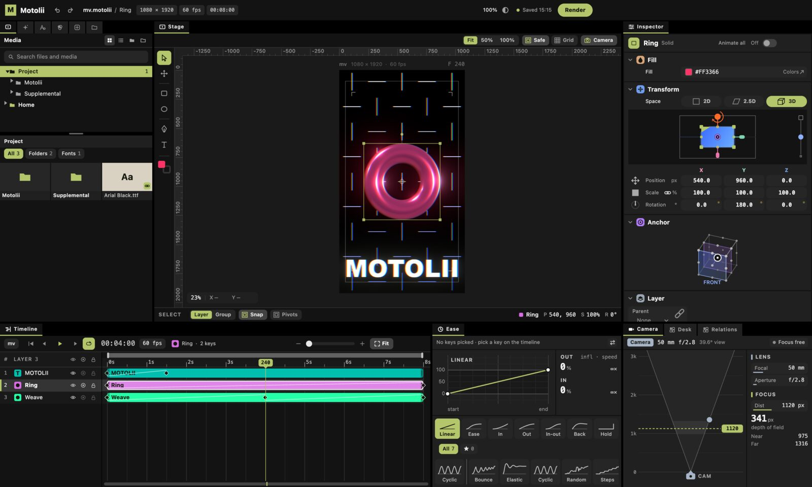

# Motolii

[日本語](README.ja.md)

[](https://github.com/oshikaidesu/motolii/actions/workflows/build.yml) [](https://github.com/oshikaidesu/motolii/actions/workflows/checks.yml)

**Use a look you found on the net in your own video, right away.**

Motolii is an open-source video editor for making music videos and motion graphics. It can use effects and scripts published on the web without rebuilding them as dedicated plugins.



## Status

Motolii is still in development and has been tried only on a Mac with Apple silicon (an M4, macOS 15.5); Windows and Linux have not been tried yet. There is no packaged app yet, so trying it means building it from source.

- **Works**: placing video, photos, text, shapes, 3D models, point clouds and Lottie animations in one scene; keyframes and easing; autosave and undo; playback (with a video's sound); MP4 export.
- **Works**: effects from the web. An ISF (`.fs`) or WGSL (`.wgsl`) file put in the effects folder appears in the effects list without restarting the app; a p5.js sketch or a Shadertoy shader is pasted in and becomes a layer. Not all code in a supported format runs correctly.
- **Partly**: AviUtl2 scripts; Alight Motion's features.
- **Not yet**: Windows; an `.app` you can hand out (the engine loads Homebrew's libraries, so a build only runs on the Mac that built it); MIDI sound.

How each format runs, with counts, and the known bug: [Specifications, "Supported formats and how they run"](docs/using/specifications.md#supported-formats-and-how-they-run).

## Build and run

You need:

- A Mac with Apple silicon (checked on an M4, macOS 15.5).
- Xcode from the App Store (the Command Line Tools alone can't build the UI). Open it once to add its components, then `sudo xcodebuild -license accept`.
- Homebrew: the one line on [brew.sh](https://brew.sh/).
- Flutter 3.47.2 (stable) on your `PATH`: [guide, "Get Flutter"](docs/using/guide.md#get-flutter).
- Python 3: the one macOS has (it comes with Xcode).
- About 10 GB of disk besides Xcode and Flutter.

Then, one line at a time:

```bash
git clone https://github.com/oshikaidesu/motolii.git
cd motolii
brew bundle
engine/build.sh
app/tool/live.sh
```

- `brew bundle` installs what the `Brewfile` lists (GStreamer, SQLite, ffmpeg, cmake, …).
- `engine/build.sh` builds the engine. The first time it builds Filament from source (~5 minutes on an M4); `engine/out/libmotolii.dylib` existing means it worked.
- `app/tool/live.sh` opens the app. The first time it seems to stall for 1–3 minutes while it builds.

The project file is `~/Movies/Motolii/Untitled.motolii` (saved automatically), and exported videos go beside it.

To run the tests: `engine/build.sh test` for the engine (CMake's ctest) and `cd app && flutter test` for the app. More in [Testing](docs/TESTING.md).

Each step in detail, a first piece, and what to do if something goes wrong: [guide, "Try it"](docs/using/guide.md#try-it).

## Use a file you found

See [`shelves/README.md`](shelves/README.md). Each kind of file has its own folder and its own way of being written.

- A file (a shader, a `.js`, an easing...): put it in the folder for its kind. For example, a `.fs` in `effects/` shows in the Effects tab.
- Code (p5.js, Shadertoy...): do not place it; copy it and press ⌘V in the app.

## Repository layout

| Folder | What it is |
|---|---|
| [`app/`](app/README.md) | The Flutter app: the UI, which only takes input |
| [`engine/`](engine/README.md) | The C++ engine, which draws; it becomes `libmotolii.dylib` |
| [`shelves/`](shelves/README.md) | The bundled community content the app reads at run time: effects, scripts, eases, skins |
| [`docs/`](docs/README.md) | Documents |

## Documentation

- [What sets Motolii apart](docs/using/highlights.md): what it does today that is hard to get elsewhere, and where each one stops.
- [Specifications](docs/using/specifications.md): the system it needs, the formats it runs with counts, what it exports, speed.
- [Guide](docs/using/guide.md): what Motolii does, building step by step, a first piece, how it compares.
- [The tabs](docs/using/screen_tour.md): each tab of the screen, with pictures and how to use it.
- [Architecture](docs/ARCHITECTURE.md): the whole design: how the app, the engine, drawing and video connect.
- [Testing](docs/TESTING.md): how to run each kind of test.
- [Contributing](.github/CONTRIBUTING.md): building, the rules, good first tasks.

## Contributing

Questions go to [Discussions](https://github.com/oshikaidesu/motolii/discussions) and bugs to [Issues](https://github.com/oshikaidesu/motolii/issues), in English or Japanese. Pull requests are welcome: see [`.github/CONTRIBUTING.md`](.github/CONTRIBUTING.md), the [Code of Conduct](.github/CODE_OF_CONDUCT.md) and [`.github/SECURITY.md`](.github/SECURITY.md).

## License

Licensed under either of [Apache License 2.0](LICENSE-APACHE) or [MIT](LICENSE-MIT), at your option. Unless you explicitly state otherwise, any contribution intentionally submitted for inclusion in the work by you, as defined in the Apache-2.0 license, shall be dual licensed as above, without any additional terms or conditions. Bundled third-party works keep their own licences ([`THIRD_PARTY_NOTICES.md`](THIRD_PARTY_NOTICES.md)).
