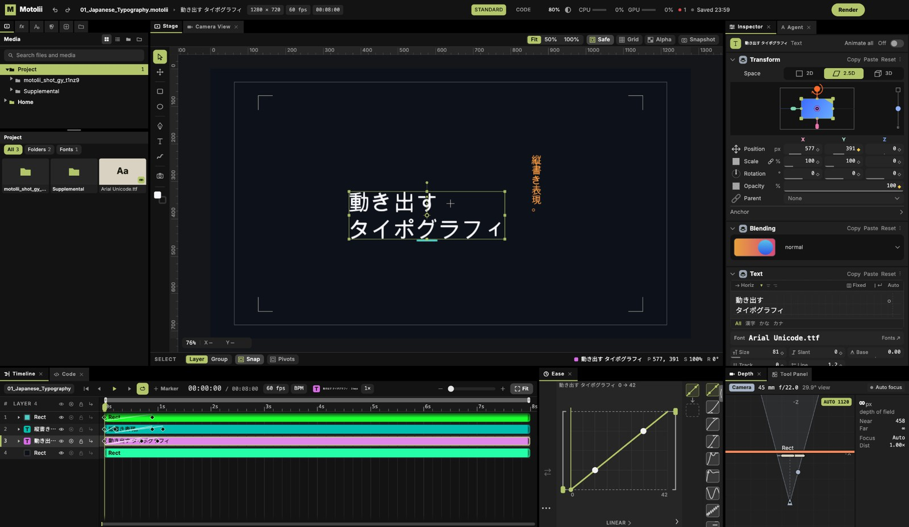

# Motolii

[日本語](README.ja.md)

[](https://github.com/oshikaidesu/motolii/actions/workflows/build.yml) [](https://github.com/oshikaidesu/motolii/actions/workflows/checks.yml)

**A crossroads of expressions that were apart.**

A Shadertoy shader reacting to the beat of a song. CSS @keyframes animating the letters while a p5.js sketch draws behind them. An After Effects expression and a Lottie animation on the same layer. Paste code from the web; it works as it was published.

After Effects expressions, Shadertoy, Cavalry, p5.js, CSS, Lottie and more. Paste it; it runs. An open-source video editor — [20+ formats and counting](#what-runs).



- **GPU-native.** Expressions compile to GPU shaders. Thousands of copies stay at 60 fps.
- **Effects are files.** A `.wgsl`, a `.fs`, a `.js` — open them, read how they work, change them, or let an AI agent do it with you. Motolii speaks [ACP](https://github.com/anthropics/agent-client-protocol), the same protocol Zed and JetBrains use. Not a black box.
- **One layer, many languages.** A CSS animation, an After Effects expression and a shader effect compose on the same text, in the order you stack them.

## The window

Every tab, with pictures: [The window, tab by tab](docs/TABS.md)

<p>


</p>

- **Maps.** The Effects and Fonts shelves switch to a map where similar-looking items sit together (t-SNE). Browse 1,300+ effects without knowing their names.
- **Values as blocks, not rows.** The Inspector lays values out as tiles. A wider panel gets more columns, so an effect with many values stays a short card. Every bundled effect was reviewed value by value (0 to 10); the values that change the picture most are tinted pale yellow, pink and celadon.
- **Hover to try.** Hover an effect tile and it is tried on the Stage. Hover an ease preset and it plays.
- **Code tab and Code workspace.** The layer's code as cells. AE expressions get completion, and each cell shows its value at the playhead or its error. **CODE** in the top bar puts code, Stage and Timeline in view together.
- **Agent tab.** Any ACP agent (Claude Agent, Codex, Gemini CLI, Cursor, …). It gets the layer's cards, values and code. New things arrive as new cards; existing code changes only when asked.
- **Relations.** `Follow`, `Gravity`, `flock`, `spring`, `collide` and more move many layers at once. Short JavaScript files in `shelves/relations/`.
- **BPM.** Tap the tempo in the Timeline; a beat grid appears and edits snap to it.
- **Stacked easings.** Easings stack like effects. A preset is a one-line formula file.
- **Colour.** The Mac's eyedropper, palettes from photos, colour on selected letters only.
- **Replaceable.** Skins are folders, keys are a VS Code style `keybindings.json`, a panel is a few lines of Dart. The author and licence of each effect used go into the export log.

## Status

Motolii is still in development and has been tried only on a Mac with Apple silicon (an M4, macOS 15.5); Windows and Linux have not been tried yet. There is no packaged app yet, so trying it means building it from source.

- **Works**: placing video, photos, text, shapes, 3D models, point clouds and Lottie animations in one scene; keyframes and easing; autosave and undo; playback (with a video's sound); MP4 export.
- **Works**: effects from the web. An ISF (`.fs`) or WGSL (`.wgsl`) file put in the effects folder appears in the effects list without restarting the app; a p5.js sketch or a Shadertoy shader is pasted in and becomes a layer. Not all code in a supported format runs correctly.
- **Partly**: AviUtl2 scripts; Alight Motion's features.
- **Not yet**: Windows; an `.app` you can hand out (the engine loads Homebrew's libraries, so a build only runs on the Mac that built it); MIDI sound.

How each format runs, with counts, and the known bug: [Specifications](docs/archive/using/specifications.md).

## Build and run

You need:

- A Mac with Apple silicon (checked on an M4, macOS 15.5).
- Xcode from the App Store (the Command Line Tools alone can't build the UI). Open it once to add its components, then `sudo xcodebuild -license accept`.
- Homebrew: the one line on [brew.sh](https://brew.sh/).
- Flutter 3.50.0 (stable) on your `PATH`: [flutter.dev/get-started](https://docs.flutter.dev/get-started/install).
- Python 3: the one macOS has (it comes with Xcode).
- About 10 GB of disk besides Xcode and Flutter.

Then, one line at a time:

```bash
git clone https://github.com/oshikaidesu/motolii.git
cd motolii
brew bundle
engine/build.sh
app/tool/live.sh
```

- `brew bundle` installs what the `Brewfile` lists (GStreamer, SQLite, ffmpeg, cmake, …).
- `engine/build.sh` builds the engine. The first time it builds Filament from source (~5 minutes on an M4); `engine/out/libmotolii.dylib` existing means it worked.
- `app/tool/live.sh` opens the app. The first time it seems to stall for 1–3 minutes while it builds.

The project file is `~/Movies/Motolii/Untitled.motolii` (saved automatically), and exported videos go beside it.

To run the tests: `engine/build.sh test` for the engine (CMake's ctest) and `cd app && flutter test` for the app. More in [Testing](docs/TESTING.md).

Each step in detail and what to do if something goes wrong: [Guide](docs/archive/using/guide.md).

## What runs

Paste code (⌘V) or drop a file. The language is detected automatically.

| World | How it gets in | Run by |
|---|---|---|
| **Shadertoy** | ⌘V | ISF → WGSL via glslang and Tint |
| **GLSL Sandbox** | ⌘V | same |
| **twigl** | ⌘V | same |
| **Bonzomatic** | ⌘V | same |
| **ISF (.fs)** | file in `effects/` | glslang → SPIR-V → WGSL |
| **WGSL (.wgsl)** | file in `effects/` | as is |
| **p5.js / Processing** | ⌘V | QuickJS-ng |
| **Paper.js** | ⌘V | QuickJS-ng |
| **Two.js** | ⌘V | QuickJS-ng |
| **Canvas 2D** | ⌘V | QuickJS-ng |
| **Dwitter** | ⌘V | QuickJS-ng |
| **tixy.land** | ⌘V | QuickJS-ng |
| **Turtletoy** | ⌘V | QuickJS-ng |
| **Hydra** | ⌘V | QuickJS-ng → WGSL |
| **After Effects expressions** | ⌘V or expression card | lottie-web in QuickJS-ng |
| **After Effects plugins (.plugin, .aex)** | place or symlink in `ae_plugins/` | [aexlo](https://github.com/potistudio/aexlo) (isolated worker) |
| **Cavalry scripts** | expression card | QuickJS-ng |
| **CSS @keyframes** | ⌘V on a text layer | Stylo (Firefox's CSS engine) |
| **Animated SVG** | ⌘V or D&D | ThorVG + Stylo |
| **three.js TSL** | ⌘V | WGSLNodeBuilder in QuickJS-ng |
| **AviUtl2 (.anm2, .obj2)** | file in `aviutl_scripts/` | LuaJIT |
| **Lottie (.json)** | D&D | ThorVG |
| **Subtitles (ASS/SRT/LRC/VTT)** | D&D | libass via FFmpeg |

Not all code in a supported format runs correctly. Counts and details: [Specifications](docs/archive/using/specifications.md).

See also [`shelves/README.md`](shelves/README.md) for where each kind of file goes.

### After Effects compatibility

Bring your existing After Effects assets with you:

- **Native plugins (`.plugin` / `.aex`)** — Drop or symlink your existing third-party After Effects plugins (e.g. Deep Glow, Quick Chromatic Aberration, Zink Tools, Satori, …) into your user `ae_plugins/` folder and they appear directly in the Effects shelf with their own parameters, `#ae` / `#cpu` (or `#gpu`) tags, and live preview tiles. Plugins run through [aexlo](https://github.com/potistudio/aexlo) inside an isolated worker process so a hanging or crashing plugin cannot take the editor down. Plugins that depend on host-only AEGP camera/comp APIs or Adobe's private built-in suites are not yet covered.
- **Expressions** — Motolii runs After Effects expressions **as they are**, without reimplementing them. The runtime is lottie-web's ExpressionManager compiled to bytecode and evaluated in QuickJS-ng — the same code that runs expressions on the web. `thisComp`, `thisLayer`, `thisProperty`, `sampleImage`, `fromWorld`, `wiggle`, `linear`, `ease`, keyframe access and cross-layer references all work. Paste an expression from a tutorial or a forum; it runs.
- **Lottie (`.json`)** — Lottie files exported by Bodymovin play through ThorVG, which also evaluates Lottie-embedded expressions at runtime with JerryScript — they are not baked. Keyframes, easing, paths, parents, precompositions, time remapping, loops, mattes and blend modes are handled by ThorVG. Motolii adds 3D layer and camera support on top (`thorvg_z.patch`).

Cavalry scripts also run as they are: the `cavalry.Point`, `cavalry.PointCloud` and `cavalry.random` APIs are provided, and a bare `{ }` expression is wrapped into `each()` automatically. Twenty-six distribution scripts from the Cavalry community ship in `shelves/create/cavalry/`.

What is **not** covered: Adobe's private built-in effects, plugins requiring unimplemented AEGP host suites (such as comp cameras or text documents), and audio-reactive properties tied to AE's internal audio graph. Motolii covers those with its own GPU shader effects and sound analysis.

## Repository layout

| Folder | What it is |
|---|---|
| [`app/`](app/README.md) | The Flutter app: the UI, which only takes input |
| [`engine/`](engine/README.md) | The C++ engine, which draws; it becomes `libmotolii.dylib` |
| [`shelves/`](shelves/README.md) | The bundled community content the app reads at run time: effects, scripts, eases, skins |
| [`docs/`](docs/README.md) | Documents |

## Documentation

- [The window, tab by tab](docs/TABS.md): every tab and what you can do in it, with pictures.
- [Architecture](docs/ARCHITECTURE.md): the whole design: how the app, the engine, drawing and video connect.
- [Effect licences](docs/design/effect_licences.md): how Motolii handles credit and attribution for bundled effects.
- [Testing](docs/TESTING.md): how to run each kind of test.
- [Bridge](docs/app/BRIDGE.md): the contract between the Flutter app and the C++ engine.
- [Gestures](docs/app/GESTURES.md): what a press, a drag, a wheel and each key mean on every control.
- [Contributing](.github/CONTRIBUTING.md): building, the rules, good first tasks.
- [Archive](docs/archive/): older docs kept for history (highlights, specifications, guide, screen tour).

## Contributing

Questions go to [Discussions](https://github.com/oshikaidesu/motolii/discussions) and bugs to [Issues](https://github.com/oshikaidesu/motolii/issues), in English or Japanese. Pull requests are welcome: see [`.github/CONTRIBUTING.md`](.github/CONTRIBUTING.md), the [Code of Conduct](.github/CODE_OF_CONDUCT.md) and [`.github/SECURITY.md`](.github/SECURITY.md).

## License

Licensed under either of [Apache License 2.0](LICENSE-APACHE) or [MIT](LICENSE-MIT), at your option. Unless you explicitly state otherwise, any contribution intentionally submitted for inclusion in the work by you, as defined in the Apache-2.0 license, shall be dual licensed as above, without any additional terms or conditions. Bundled third-party works keep their own licences ([`THIRD_PARTY_NOTICES.md`](THIRD_PARTY_NOTICES.md)).
