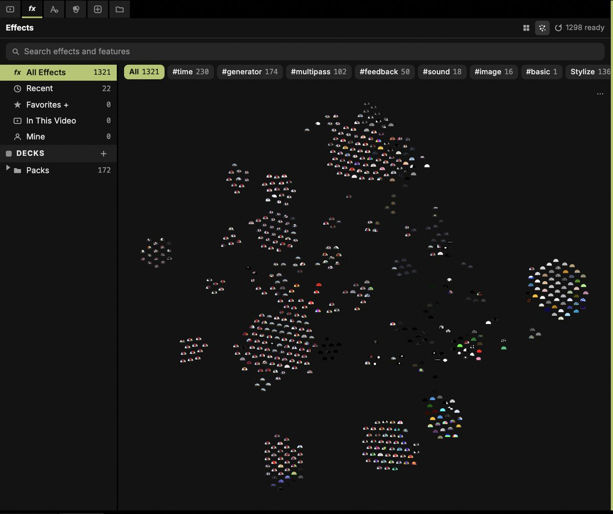

# Motolii

[日本語](README.ja.md)

[](https://github.com/oshikaidesu/motolii/actions/workflows/build.yml) [](https://github.com/oshikaidesu/motolii/actions/workflows/checks.yml)

**Where creative coding and motion design meet.**

React to audio with a Shadertoy shader. Combine CSS `@keyframes` and After Effects expressions on the same text layer. Composite a p5.js sketch behind a Lottie animation. Paste code from the web and run it as published.

Motolii is an open-source video editor supporting [20+ creative formats](#supported-formats) — After Effects plugins and expressions, Shadertoy, Cavalry, p5.js, CSS, Lottie, AviUtl2 scripts, and more.


- **GPU-native.** Shaders and expressions run on WebGPU, keeping thousands of copies smooth at 60 fps.
- **Effects are plain files.** `.wgsl`, `.fs`, and `.js` effects live right on disk — inspect them, edit them directly, or co-edit them with an AI agent over [ACP](https://github.com/anthropics/agent-client-protocol) (the same protocol used by Zed and JetBrains).
- **Mix languages on one layer.** Stack CSS animations, After Effects expressions, GPU shaders, and native plugins on the same layer in any order.

## Download (Beta)

Prebuilt **macOS Apple Silicon (`.app`)** beta builds are published on [GitHub Releases](https://github.com/oshikaidesu/motolii/releases).

1. Download `Motolii-*-macos-arm64.zip` from [Releases](https://github.com/oshikaidesu/motolii/releases), unzip, and move `Motolii.app` to `/Applications`.
2. Because early beta builds are not yet notarized with an Apple Developer ID, run this once in Terminal before launching:
   ```bash
   xattr -cr /Applications/Motolii.app
   ```
3. Launch Motolii and pick one of the bundled **SAMPLES** in the Home sidebar to try it right away.

> Windows (`x64`) and Linux builds are in progress. To build from source, see [Build and run](#build-and-run).

## Interface overview

See [Tabs & Panels](docs/TABS.md) for a visual tour of every tab.

<p>


</p>

- **Visual Maps.** Switch the Effects and Fonts shelves to a 2D t-SNE similarity map to browse 1,300+ effects visually without remembering names.
- **Tile-based Inspector.** Parameters render as compact multi-column blocks rather than long rows, scaling cleanly when you widen the panel. Bundled effects are scored by visual impact (0–10) and color-coded (pale yellow, pink, celadon) so high-impact controls stand out immediately.
- **Hover to preview.** Hover an effect tile to preview it live on the Stage, or hover an easing preset to preview its motion curve.
- **Code tab & Code workspace.** Edit every effect or expression on a layer as stacked notebook cells with AE expression autocompletion, live evaluated values, and inline error reporting. Switch to the **CODE** workspace in the top bar to keep Code, Stage, and Timeline visible side by side.
- **Agent tab.** Connect any ACP-compatible AI agent (Claude Agent, Codex, Gemini CLI, Cursor, etc.) with full context of the selected layer's cards, parameter values, and code. New effects arrive as new cards, and existing code is modified only when requested.
- **Relations.** Drive multiple layers together (`Follow`, `Gravity`, `flock`, `spring`, `collide`, etc.) using small JavaScript files in `shelves/relations/`.
- **BPM grid.** Tap tempo directly in the Timeline to generate a beat grid with snap-to-beat editing.
- **Stackable easings.** Stack multiple easings like effects. Each preset is a one-line formula file.
- **Color tools.** Native macOS eyedropper, automatic palettes extracted from images, and per-character text styling.
- **Customizable & transparent.** Folder-based skins, VS Code-style `~/.motolii/keybindings.json`, minimal Dart panels, and automatic export credit logs listing authors and licenses for every effect used.

## Current status

Motolii is in **early beta** on Apple Silicon macOS (M4, macOS 15.5). Self-contained macOS `.app` beta builds are available on [GitHub Releases](https://github.com/oshikaidesu/motolii/releases); Windows and Linux builds are not yet verified.

- **Working:** Video, images, text, vector shapes, 3D models (`.glb`/`.gltf`), point clouds, and Lottie animations in one scene; keyframes and stackable easings; autosave and undo/redo; audio/video playback; MP4/MOV/GIF/image-sequence export; `.motoliipack` sharing bundles.
- **Working:** External creative formats — drop `.fs`/`.wgsl` shaders in `effects/` or native After Effects plugins in `ae_plugins/` to load them without restarting, or paste Shadertoy/p5.js/CSS/TSL code directly with ⌘V. (Not every third-party file or script is guaranteed to run cleanly.)
- **Partial:** AviUtl2 scripts; Alight Motion compatibility features.
- **Not yet ready:** Verified Windows/Linux builds, Apple Developer ID notarization, and MIDI audio playback.

For per-format details and known limitations, see [Specifications](docs/archive/using/specifications.md).

## Build and run

### Requirements

- Apple Silicon Mac (tested on M4, macOS 15.5)
- Xcode from the App Store (Command Line Tools alone are not sufficient; launch Xcode once to install components, then run `sudo xcodebuild -license accept`)
- [Homebrew](https://brew.sh/)
- [Flutter](https://docs.flutter.dev/get-started/install) 3.50.0 (stable) on your `PATH`
- Python 3 (bundled with macOS / Xcode)
- ~10 GB of free disk space (excluding Xcode and Flutter)

### Commands

```bash
git clone https://github.com/oshikaidesu/motolii.git
cd motolii
brew bundle
engine/build.sh
app/tool/live.sh
```

- `brew bundle` installs dependencies listed in `Brewfile` (GStreamer, SQLite, FFmpeg, CMake, etc.).
- `engine/build.sh` fetches third-party libraries and builds the C++ engine. The first run compiles Filament from source (~5 minutes on an M4) and produces `engine/out/libmotolii.dylib`.
- `app/tool/live.sh` builds and launches the Flutter app (the first build takes ~1–3 minutes).

Projects are auto-saved under `~/Movies/Motolii/Untitled.motolii`, and exported videos are written beside the project file.

To run tests: `engine/build.sh test` for C++ tests (`ctest`) and `cd app && flutter test` for Flutter tests. See [Testing](docs/TESTING.md) for details.

For troubleshooting, see the [Build Guide](docs/archive/using/guide.md).

## Supported formats

Paste code (`⌘V`) or drop files into your shelf folders — formats are detected automatically.

| Format | How to add | Runtime |
|---|---|---|
| **Shadertoy** | Paste (`⌘V`) | ISF → WGSL (glslang + Tint) |
| **GLSL Sandbox** | Paste (`⌘V`) | Same |
| **twigl** | Paste (`⌘V`) | Same |
| **Bonzomatic** | Paste (`⌘V`) | Same |
| **ISF (`.fs`)** | Place in `effects/` | glslang → SPIR-V → WGSL |
| **WGSL (`.wgsl`)** | Place in `effects/` | Native WebGPU |
| **p5.js / Processing** | Paste (`⌘V`) | QuickJS-ng |
| **Paper.js** | Paste (`⌘V`) | QuickJS-ng |
| **Two.js** | Paste (`⌘V`) | QuickJS-ng |
| **Canvas 2D** | Paste (`⌘V`) | QuickJS-ng |
| **Dwitter** | Paste (`⌘V`) | QuickJS-ng |
| **tixy.land** | Paste (`⌘V`) | QuickJS-ng |
| **Turtletoy** | Paste (`⌘V`) | QuickJS-ng |
| **Hydra** | Paste (`⌘V`) | QuickJS-ng → WGSL |
| **After Effects expressions** | Paste (`⌘V`) or Expression card | lottie-web in QuickJS-ng |
| **After Effects plugins (`.plugin`, `.aex`)** | Place or symlink in `ae_plugins/` | [aexlo](https://github.com/potistudio/aexlo) (isolated worker) |
| **Cavalry scripts** | Expression card | QuickJS-ng |
| **CSS `@keyframes`** | Paste (`⌘V`) on a text layer | Stylo (Firefox CSS engine) |
| **Animated SVG** | Paste (`⌘V`) or drag & drop | ThorVG + Stylo |
| **three.js TSL** | Paste (`⌘V`) | WGSLNodeBuilder in QuickJS-ng |
| **AviUtl2 (`.anm2`, `.obj2`)** | Place in `aviutl_scripts/` | LuaJIT |
| **Lottie (`.json`)** | Drag & drop | ThorVG |
| **Subtitles (`ASS`/`SRT`/`LRC`/`VTT`)** | Drag & drop | libass via FFmpeg |

See [`shelves/README.md`](shelves/README.md) for where each file type belongs.

### After Effects compatibility

Bring your existing After Effects assets directly into Motolii:

- **Native plugins (`.plugin` / `.aex`)** — Drop or symlink third-party After Effects plugins (Deep Glow, Quick Chromatic Aberration, Zink Tools, Satori, etc.) into your user `ae_plugins/` folder. They appear in the Effects shelf with auto-generated parameter cards, `#ae` / `#cpu` (or `#gpu`) tags, and live preview tiles. Plugins execute inside an isolated worker process via [aexlo](https://github.com/potistudio/aexlo) so a crashing or hanging plugin cannot bring down the editor.
- **Expressions** — After Effects expressions run directly without reimplementation, using lottie-web's `ExpressionManager` compiled to QuickJS-ng bytecode. `thisComp`, `thisLayer`, `thisProperty`, `sampleImage`, `fromWorld`, `wiggle`, `linear`, `ease`, keyframe access, and cross-layer references all work out of the box.
- **Lottie (`.json`)** — Bodymovin exports play via ThorVG, which evaluates embedded expressions at runtime with JerryScript rather than baking them. Keyframes, easings, paths, parenting, precomps, time remapping, loops, mattes, and blend modes are supported, plus 3D layer and camera support via `thorvg_z.patch`.

Cavalry scripts also run natively (`cavalry.Point`, `cavalry.PointCloud`, `cavalry.random`), and bare `{ }` expressions are automatically wrapped into `each()`. Twenty-six Cavalry community distribution scripts ship in `shelves/create/cavalry/`.

**Not covered:** Adobe's private built-in effects, plugins requiring unimplemented AEGP host suites (such as comp cameras or text documents), and audio-reactive properties tied to AE's internal audio graph. Motolii covers those with its own GPU shader effects and Web Audio-compatible sound analysis.

## Repository layout

| Directory | Description |
|---|---|
| [`app/`](app/README.md) | Flutter desktop UI (presentation and input handling) |
| [`engine/`](engine/README.md) | C++ rendering and project engine (`libmotolii.dylib`) |
| [`shelves/`](shelves/README.md) | Bundled community effects, scripts, easings, and skins |
| [`docs/`](docs/README.md) | Guides, architecture notes, and testing docs |

## Documentation

- [Tabs & Panels](docs/TABS.md) — Visual overview of every tab and feature
- [After Effects Migration Guide](docs/AFTER_EFFECTS.md) — Using your existing AE plugins, expressions, and Lottie assets
- [Coding & Shader Reference](docs/CODING.md) — Supported formats, WESL WGSL attributes, compatibility model, and IDE workflow
- [User Guide](docs/GUIDE.md) — End-to-end guide from creating a project to exporting (Japanese)
- [Architecture](docs/ARCHITECTURE.md) — System design: Flutter app, C++ engine, WebGPU rendering, and shelves
- [Effect Licenses](docs/design/effect_licences.md) — Attribution, export credit files, and bundling boundaries
- [Testing](docs/TESTING.md) — C++, Flutter, golden, and mutation test suites
- [Bridge Contract](docs/app/BRIDGE.md) — FFI contract between Flutter and the C++ engine
- [Gestures](docs/app/GESTURES.md) — Pointer, drag, wheel, and keyboard interaction specs
- [Contributing](.github/CONTRIBUTING.md) — Setup, design principles, and contribution guidelines
- [Archive](docs/archive/) — Historical design notes and older documentation

## Contributing

Questions are welcome in [Discussions](https://github.com/oshikaidesu/motolii/discussions) and bug reports in [Issues](https://github.com/oshikaidesu/motolii/issues) (English or Japanese). For pull requests, please see [`.github/CONTRIBUTING.md`](.github/CONTRIBUTING.md), [`CODE_OF_CONDUCT.md`](.github/CODE_OF_CONDUCT.md), and [`SECURITY.md`](.github/SECURITY.md).

## License

Dual-licensed under [Apache License 2.0](LICENSE-APACHE) or [MIT](LICENSE-MIT), at your option. Unless explicitly stated otherwise, any contribution intentionally submitted for inclusion in Motolii is dual-licensed as above without additional terms or conditions. Bundled third-party works retain their own licenses (see [`THIRD_PARTY_NOTICES.md`](THIRD_PARTY_NOTICES.md)).
