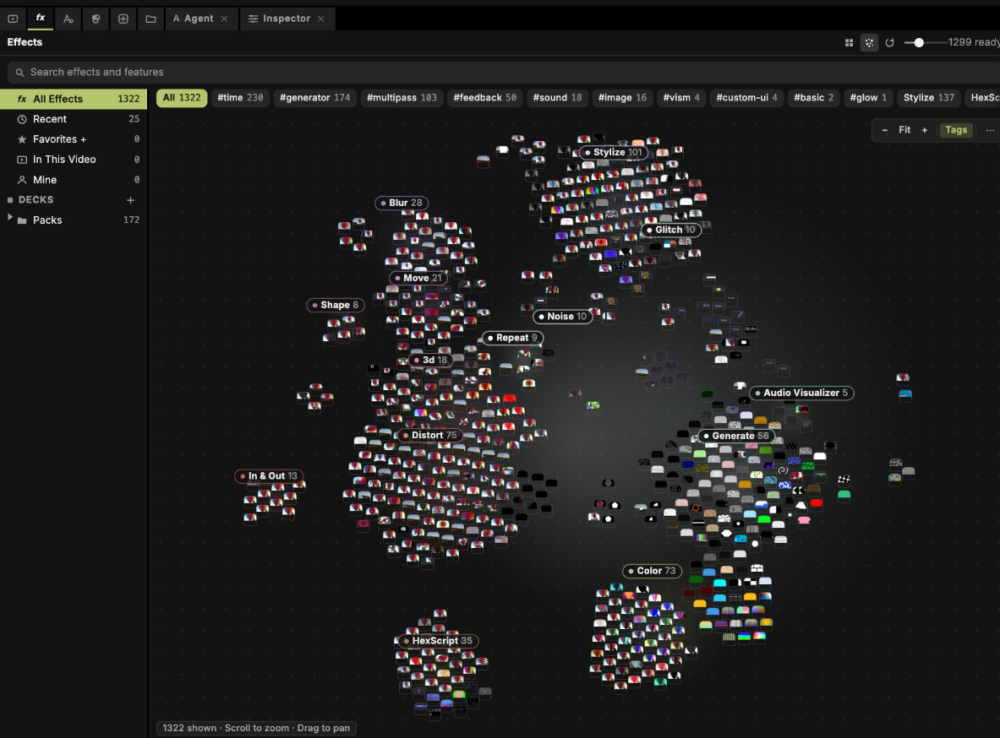
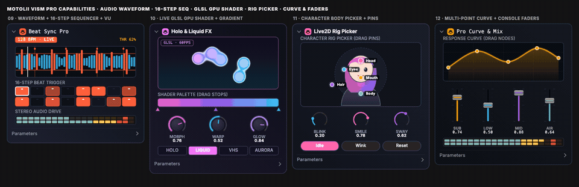

# Motolii

[日本語](README.ja.md)

[](https://github.com/oshikaidesu/motolii/actions/workflows/build.yml) [](https://github.com/oshikaidesu/motolii/actions/workflows/checks.yml)

**Where creative coding and motion design meet.**

React to audio with a Shadertoy shader. Combine CSS `@keyframes` and After Effects expressions on the same text layer. Composite a p5.js sketch behind a Lottie animation. Paste code from the web and run it as published.

Motolii is an open-source, WebGPU-native video editor built on plain files — keeping thousands of copies and stacked shaders smooth at 60 fps while supporting 20+ creative formats.


---

## Bring Your Existing Plugins, Expressions, and Assets With You

Switching or adding a new tool shouldn't mean leaving behind the plugins, scripts, and workflows you already rely on. Motolii lets you bring your existing creative library straight in:

- **Native After Effects plugins (`.plugin` / `.aex`) run directly**  
  Drop or symlink third-party AE plugins (Deep Glow, Quick Chromatic Aberration, Zink Tools, Satori, etc.) into `ae_plugins/`. They appear in the Effects shelf with parameter cards, `#ae` tags, and live previews, executing in an isolated worker via [aexlo](https://github.com/potistudio/aexlo) to keep the editor stable.
- **After Effects expressions evaluate natively**  
  Powered by `lottie-web`'s `ExpressionManager` compiled to QuickJS-ng — `thisComp`, `thisLayer`, `wiggle`, `linear`, `ease`, `sampleImage`, and keyframe queries work directly without reimplementation.
- **Lottie, PSD layers, Cavalry, AviUtl2, Shadertoy, p5.js & CSS on one timeline**  
  Import multi-layer PSDs ready for rigging, run 26 bundled Cavalry scripts, and mix 20+ creative formats on the same layer in any order.
- **Alpha Stage preview & ProRes 4444 alpha export**  
  Toggle the live checkerboard (`Alpha`) on the Stage and export straight-alpha ProRes 4444 `.mov` clips so Motolii fits cleanly alongside Premiere, DaVinci Resolve, or After Effects.

> See the [After Effects Migration Guide](docs/AFTER_EFFECTS.md) for full compatibility details.

---

## Designed for Tactile, Fluid Motion Work (UI / UX)

### 1. Discover Effects & Fonts Visually

Browse 1,300+ bundled effects and your font library on an interactive **2D similarity map** with category islands, zoom controls, and an enlarged hover loupe — or hover any tile to preview it live on the Stage without applying it first.



<p>


</p>

### 2. Clear, Scannable Controls

- **Tile-based Inspector**: Parameters sit in compact multi-column blocks that expand as you widen the panel, color-coded by visual impact so key controls stand out immediately.
- **Timeline & HDR Environment Objects**: Audio waveforms, tap-tempo BPM beat grids, stackable easings, and **timeline `Environment` layers** that let you trim, toggle, and keyframe HDR room lighting, rotation, fog, and skyboxes directly on the timeline.
- **Adjustable Freehand Smoothing & 3D Boxcam**: Tune Brush/Pen stroke stabilization (`Off`–`High`) with corner preservation, and steer 3D cameras alongside the live Depth radar panel.

<p>


</p>
<p>


</p>

### 3. Co-Create with Code & AI Agents (Code Workspace & ACP Agent)

Switch to the **CODE** workspace to keep **ACP AI Agents**, stacked **Code notebook cells**, **Stage**, and **Timeline** open side by side. Connect Claude Agent, Codex, Gemini CLI, or Cursor with full live context of the selected layer's cards, values, and code.


---

## Vism — Build & Share Custom Tactile Interfaces in Plain JS

**Vism** lets creators build bespoke Inspector faceplates and dockable tool panels in **a single JavaScript file** — zero WebView, rendered 100% natively in Flutter with 3D scenes (`.glb`/`.obj`/wavetables), 60 fps GLSL shaders, audio waveforms, 16-step sequencers, character rig pickers, and rotary knobs.




- **Start in 10 seconds**: Click **`+ New Vism`** in the Tools panel to scaffold a runnable starter with IDE autocomplete (`motolii-ui.d.ts`), open it as a live docking tab, and launch your editor — every save hot-reloads in ~80 ms.
- **Presets & 1-click `.vism` sharing**: Save parameter presets on any Vism card, export a `.vism` package (presets & assets bundled), and double-click or drop onto Motolii to install instantly.
- **Uniform UI whenever you want**: Toggle `Settings → Appearance → Vism Card Faceplates` off at any time to keep full functionality in Motolii's standard skin.

👉 [Vism 5-Minute Quickstart (Japanese)](docs/VISM_QUICKSTART.ja.md) · [Vism Custom Card Specification](docs/CUSTOM_CARDS.md)

---

## Download (Beta)

Prebuilt **macOS Apple Silicon (`.app`)** beta builds are published on [GitHub Releases](https://github.com/oshikaidesu/motolii/releases).

1. Download `Motolii-*-macos-arm64.zip` from [Releases](https://github.com/oshikaidesu/motolii/releases), unzip, and move `Motolii.app` to `/Applications`.
2. Because early beta builds are not yet notarized with an Apple Developer ID, run this once in Terminal before launching:
   ```bash
   xattr -cr /Applications/Motolii.app
   ```
3. Launch Motolii and click any bundled project under **SAMPLES** in the Home sidebar to explore right away.

> Windows (`x64`) and Linux builds are in progress. To build from source, see below.

## Build and Run

### Requirements

- Apple Silicon Mac (tested on M4, macOS 15.5)
- Xcode from the App Store (launch once, then run `sudo xcodebuild -license accept`)
- [Homebrew](https://brew.sh/), [Flutter](https://docs.flutter.dev/get-started/install) 3.50.0 (stable), Python 3, ~10 GB free disk space

```bash
git clone https://github.com/oshikaidesu/motolii.git
cd motolii
brew bundle
engine/build.sh
app/tool/live.sh
```

Run tests with `engine/build.sh test` (C++) and `cd app && flutter test` (Flutter). See [Testing](docs/TESTING.md).

---

## Supported Formats (20+)

Paste code (`⌘V`) or drop files into your shelf folders — formats are detected automatically.

| Format | How to add | Runtime |
|---|---|---|
| **After Effects plugins (`.plugin`, `.aex`)** | Place or symlink in `ae_plugins/` | [aexlo](https://github.com/potistudio/aexlo) (isolated worker) |
| **After Effects expressions** | Paste (`⌘V`) or Expression card | lottie-web in QuickJS-ng |
| **Lottie (`.json`)** | Drag & drop | ThorVG (with runtime expressions) |
| **Photoshop (`.psd` / `.psb`)** | Drag & drop | Multi-layer group import |
| **Shadertoy / GLSL Sandbox / twigl / Bonzomatic** | Paste (`⌘V`) | ISF → WGSL (glslang + Tint) |
| **ISF (`.fs`) / WGSL (`.wgsl`)** | Place in `effects/` | Native WebGPU |
| **p5.js / Paper.js / Two.js / Canvas 2D / Dwitter / tixy / Turtletoy** | Paste (`⌘V`) | QuickJS-ng |
| **Hydra / three.js TSL** | Paste (`⌘V`) | QuickJS-ng → WGSL |
| **Cavalry scripts** | Expression card | QuickJS-ng |
| **CSS `@keyframes` / Animated SVG** | Paste (`⌘V`) or D&D | Stylo (Firefox CSS engine) + ThorVG |
| **AviUtl2 (`.anm2`, `.obj2`)** | Place in `aviutl_scripts/` | LuaJIT |
| **3D models (`.glb`, `.gltf`) / Point clouds (`.ply`)** | Drag & drop | Filament WebGPU |
| **Subtitles (`ASS`/`SRT`/`LRC`/`VTT`)** | Drag & drop | libass via FFmpeg |

---

## Documentation

- [Tabs & Panels](docs/TABS.md) — Visual overview of every tab and feature
- [After Effects Migration Guide](docs/AFTER_EFFECTS.md) — Using your existing AE plugins, expressions, and Lottie assets
- [Vism Custom Panel & Card Quickstart (Japanese)](docs/VISM_QUICKSTART.ja.md) / [Specification](docs/CUSTOM_CARDS.md)
- [ACP Agent Tutorial (Japanese)](docs/ACP_TUTORIAL.ja.md) — PSD auto-rigging, Group Focus, and `ops.json` workflows
- [Camera Guide (Japanese)](docs/CAMERA.ja.md) — Boxcam 3D camera, Z-target lock-on, and Depth radar
- [Coding & Shader Reference](docs/CODING.md) — Supported formats, WESL WGSL attributes, and IDE workflow
- [User Guide (Japanese)](docs/GUIDE.md) — End-to-end guide from project creation to export
- [Architecture](docs/ARCHITECTURE.md) / [Bridge Contract](docs/app/BRIDGE.md) / [Testing](docs/TESTING.md)
- [Contributing](.github/CONTRIBUTING.md)

## Contributing & License

Questions are welcome in [Discussions](https://github.com/oshikaidesu/motolii/discussions) and bug reports in [Issues](https://github.com/oshikaidesu/motolii/issues) (English or Japanese).  
Dual-licensed under [Apache License 2.0](LICENSE-APACHE) or [MIT](LICENSE-MIT), at your option (see [`THIRD_PARTY_NOTICES.md`](THIRD_PARTY_NOTICES.md) for bundled third-party works).
