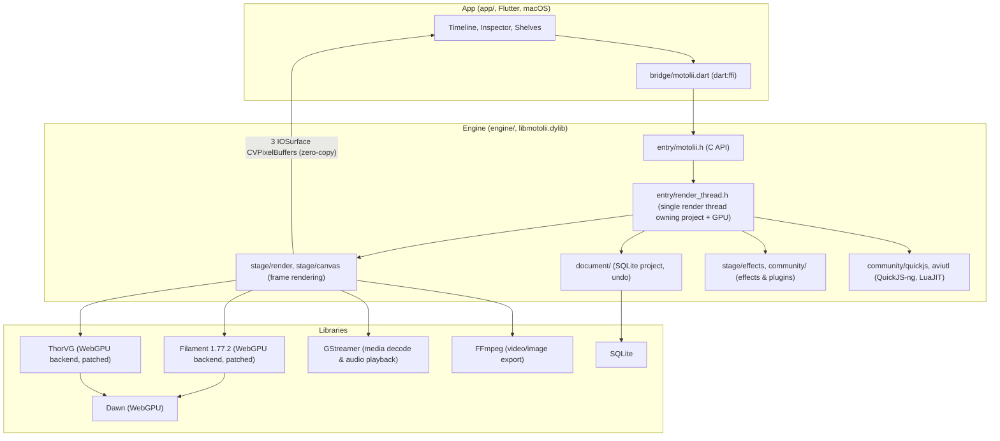

# Architecture

Technical overview of Motolii's codebase for contributors.

Motolii pairs a Flutter desktop frontend (`app/`) with a C++ engine (`engine/`, compiled as `libmotolii.dylib`) over a narrow C FFI surface (`engine/entry/motolii.h`). A single render thread in the engine owns both the project database (SQLite) and the GPU device. Filament — built from source with its WebGPU (Dawn) backend and Motolii patches — renders 3D scenes and composites layers, while ThorVG's WebGPU backend draws 2D vector art and text on the same Dawn device. GStreamer decodes video and audio, FFmpeg encodes exports, and finished frames reach Flutter zero-copy via IOSurface-backed `CVPixelBuffer`s.

Terminology follows After Effects, Filament, Flutter, and Blender, with two Motolii-specific terms:
- **Shelf:** Left-dock asset tabs displaying bundled and user-supplied items (following Blender's Asset Shelf).
- **Skin:** A drop-in theme folder customizing UI colors, metrics, fonts, and SVG parts.

See [`design/renamed_words.md`](design/renamed_words.md) for historical symbol/name mappings.

## System overview

## Process & module boundaries

| Boundary | Location | Contract |
|---|---|---|
| App entry | `app/lib/main.dart` → `app/lib/workspace/workspace.dart` (`Workspace`) and `app/lib/workspace/state/workspace_controller.dart` (`WorkspaceController`) | See [`app/README.md`](../app/README.md). Custom panels register through `Workspace`'s `extra` `Pane` list. |
| App ↔ Engine FFI | `engine/entry/motolii.h` (~490 lines); Dart bindings in `app/lib/bridge/motolii.dart` and ffigen-generated `motolii_bindings.dart` | The UI holds no authoritative project state. All reads and writes go through the C API ([`app/BRIDGE.md`](app/BRIDGE.md)). |
| Render thread | `engine/entry/render_thread.h` | Only the render thread touches the SQLite project and GPU. Writes enqueue asynchronously and return immediately; reads consume immutable snapshots built on the render thread ([`app/BRIDGE.md`](app/BRIDGE.md) rules 1, 3, 6). |
| Zero-copy preview frames | `engine/stage/live.h` | Renders into three IOSurface-backed `CVPixelBuffer`s imported into Dawn as Filament render targets and exposed to Flutter as an external texture (`app/macos/Runner/MainFlutterWindow.swift`). |
| Upstream patches | `engine/deps/patches/<library>/` | Third-party dependencies are never edited in place; pinned versions are fetched and patched at build time ([`THIRD_PARTY_NOTICES.md`](../THIRD_PARTY_NOTICES.md) §2). |

## Rendering pipeline

- **Filament v1.77.2** is compiled from source with the WebGPU (Dawn) backend (`engine/deps/filament.sh`). Patches under `engine/deps/patches/filament/`:
  - `filament_dawn_compute.patch`: adds a compute dispatch entry point, exposes the Dawn device, and adds `Texture::Builder::import` for external textures.
  - `filament_webgpu_viewport.patch` & `filament_webgpu_depth_fragment.patch`: align Filament's viewport origin with WebGPU's top-left origin and adjust WebGPU pipeline cache depth/fragment state.
  - `engine/deps/patches/glslang/glslang_hlsl.patch`: enables glslang's HLSL frontend required by AviUtl2 shaders.
- **ThorVG** runs its WebGPU engine on Filament's shared Dawn device (`engine/deps/thorvg.sh`, `engine/gpu/thorvg_on_dawn.cpp`, `engine/stage/canvas/canvas.h`). 2D vector drawings composite as planes inside Filament, inheriting masks, glass materials, and keying.
- **Skia** (path operations only, `engine/deps/skia.sh`) performs boolean path ops; **libtess2** triangulates 2D shapes.
- **Frame pacing** uses Thermion's `FrameScheduler` driven by `CVDisplayLink` (`engine/third_party/thermion_frame/`).

### Effect runtimes

| Format | Execution path | Location |
|---|---|---|
| ISF (`.fs`, GLSL) | Compiled via Filament's bundled glslang → SPIR-V → Tint → WGSL | `engine/community/isf/isf.cpp` |
| WGSL (`.wgsl`) | Executed natively on WebGPU. Parameters declared in AviUtl2-style header comments; adjacent images loaded once via ThorVG (`--image@name:file`). | `engine/stage/effects/screen_fx.h`, `engine/stage/layer_effects/layer_fx.h` |
| AviUtl2 (`.anm2`, `.obj2`) | Lua runs in LuaJIT with engine-backed `obj` APIs; embedded HLSL compiles via glslang → SPIR-V → Tint → WGSL. | `engine/community/aviutl/` (`aviutl_run.h`, `aviutl_fx.h`) |
| After Effects plugins (`.plugin`, `.aex`) | Probed and rendered inside an isolated persistent worker (`motolii_ae_worker`, backed by [aexlo](https://github.com/potistudio/aexlo)) over timed binary pipe IPC. Straight RGBA8 buffers cross process boundaries; plugins are never bundled. | `engine/community/after_effects_plugin/` (`ae_plugin.h`, `ae_plugin_fx.h`, `ae_worker_proc.h`) |
| three.js solids (`shelves/solids/*.js`) | Evaluated in QuickJS-ng to extract `BufferGeometry`. | `engine/community/three/solid_three.cpp` |
| Recipes (`shelves/create/*/*.js`) | Executed once in QuickJS-ng to instantiate layers and keyframes. | `engine/community/quickjs/script.cpp` |
| three.js TSL | Converted to WGSL via `WGSLNodeBuilder` in QuickJS-ng (bundled outputs live in `shelves/effects/`). | `engine/community/three_shading_language_to_shelf/` |

## Media I/O

- **Decode:** GStreamer decodes video into plane textures (`engine/media/video_layer.h`, `gstreamer_file_source.h`).
- **Audio playback:** GStreamer `playbin` (`engine/media/sound_playback.h`).
- **Export:** Renders at the target frame rate and pipes frames and mixed audio to FFmpeg (`engine/stage/render/render_draw.h`).

## Project storage

- `.motolii` files are SQLite databases storing layers, properties, keyframes, and easing expressions (evaluated via custom SQLite functions `bezier()` and `anime()` in `engine/document/undo.cpp`).
- Undo history is recorded in `undo_step` (`engine/document/undo.h`).
- Layer types: `video`, `image`, `text`, `solid`, `shape`, `camera`, `light`, and `behaviour` (`engine/document/kinds.h`).
- `engine/document/edit/` mutates project state; `engine/document/evaluate/` evaluates the scene at any timestamp.

## Where the shelves are read

Both bundled (`shelves/`) and user folders are resolved through `doc_folders` (`engine/shelf/shelf_folders.h`) on the engine side, and `motoliiShelves` / `motoliiOwn` (`app/lib/bridge/engine_paths.dart`) on the Flutter side. Legacy user folders (`recipes/`, `animators/`, `ways/`) remain supported, and `script_shelf_file` (`engine/community/quickjs/script.cpp`) transparently remaps old saved paths.

| Folder | Engine | App (`app/lib/`) |
|---|---|---|
| `effects/` | `document/scripts/recipes.h` (`doc_folder_names`) | `workspace/state/tiles/effect_tiles.dart` |
| `aviutl_scripts/` | `document/scripts/recipes.h` (`doc_aviutl_names`) | `workspace/state/tiles/effect_decks_store.dart` (`effectPack`) |
| `ae_plugins/` | `document/scripts/recipes.h` (`doc_ae_plugin_names`) | `workspace/state/tiles/effect_tiles.dart`, `workspace/state/tiles/effect_decks_store.dart` (`effectPack`) |
| `create/` | `document/scripts/recipes.h` (`doc_recipes_read`) | `workspace/dock/create/create_shelf.dart`, `workspace/dock/create/expressions.dart` |
| `expressions/` | `entry/calls_shelf.cpp` (`motolii_animators`) | `workspace/dock/create/expressions.dart`, `workspace/shelf/shelf_add.dart` |
| `relations/` | `entry/calls_shelf.cpp` (`motolii_relations`) | `workspace/edits/make_relation.dart` |
| `looks/` | `document/edit/presets.h` | `bridge/motolii_shelves.dart` |
| `solids/` | `community/three/solid_three.cpp` | — |
| `ease/` | `document/scripts/recipes.h` (`doc_own_easings`) | `workspace/tool_panel/ease/ease_shelf.dart` |
| `skins/` | — | `skin/theme.dart` (`ColorTheme.skinNames`) |
| `behaviours/` | `document/scripts/recipes.h` | — |
| `workspaces/` | — | `workspace/workspace.dart` |
| `extensions/hydra/` | `document/scripts/import_adapter.h`, `community/hydra/hydra_isf.cpp` | — |
| `engine/third_party/wordnet_ja/` | `entry/calls_find.cpp` (`find_english`) | — |
| `engine/third_party/noto_sans_jp/` | `stage/canvas/canvas_renderables.h` (`type_fallback`) | `workspace/dock/fonts/fonts_shelf.dart` |
| `engine/third_party/gflanguages/` | — | `workspace/dock/fonts/fonts_controller.dart` (`samples.json`) |

## Metadata, user tags, and credits

- Shelf folders may include a `meta.yaml` mapping effect names to `author`, `license`, and `source` (`app/lib/storage/shelf_meta.dart`). ISF effects derive metadata from `CREDIT` headers; AviUtl2 packages from `SOURCE.txt`.
- In the UI, `CardMetaRow` (Inspector) and `_metaRow` (`code_pane.dart`) display attribution and editable tag chips.
- User tags persist in `~/.motolii/tags.json` via `ShelfTags.shared` (`app/lib/workspace/dock/common/shelf_tags.dart`).
- The Effects shelf's **Mine** place (`app/lib/workspace/dock/effects/effect_places.dart`) filters to items under `ownFolder()`.
- On export, `writeCreditsFile` (`app/lib/workspace/state/effect_credits.dart`) writes a credits text file beside the output video listing every effect used, grouped by license.

## Home screen & settings

`app/lib/workspace/window/home.dart` opens as an overlay on launch, listing projects from `WindowFile.projectsFolder` with a **Continue** card (`WindowFile.lastProject`) and **New Project** action. Window preferences persist in `~/.motolii/window.xml` (`app/lib/storage/window_settings.dart`).

## Top-level directories

| Directory | Contents |
|---|---|
| `app/` | Flutter desktop app ([`app/README.md`](../app/README.md)) |
| `engine/` | C++ engine ([`engine/README.md`](../engine/README.md)) |
| `shelves/` | Bundled effects, scripts, presets, and skins ([`shelves/README.md`](../shelves/README.md)) |
| `docs/` | Project documentation ([`docs/README.md`](README.md)) |
