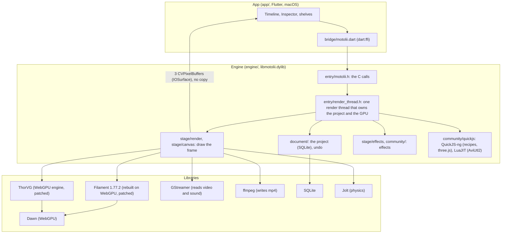

# Architecture

How Motolii is built, for a developer about to read or change the code.

A Flutter app drives a C++ engine through a small C API (`engine/entry/motolii.h`). One render thread in the engine owns the project (a SQLite file) and the GPU. Filament, built from source with its WebGPU (Dawn) backend and a few patches, draws the 3D scene and composites the layers. ThorVG's WebGPU engine draws 2D art and text on the same Dawn device. GStreamer reads video and sound, and ffmpeg writes the exported video. Shared effects are compiled to WGSL with the toolchain Filament already ships (glslang to SPIR-V to Tint). The finished frame reaches the app without a copy, through CVPixelBuffers backed by IOSurface.

Two words are specific to Motolii. A *shelf* is one of the tabs on the left of the window, where the bundled content and the user's own files appear, as in Blender's Asset Shelf. A *skin* is a theme for the app. Other names follow After Effects, Filament, Flutter and Blender. [`design/renamed_words.md`](design/renamed_words.md) maps older names in the code to the present ones.

## Overview

## The two halves and the boundary between them

| Boundary | Where | Rule |
|---|---|---|
| App entry | `app/lib/main.dart` opens `app/lib/workspace/workspace.dart` (`Workspace`: the whole window, opening a project, the menus). App state lives in `app/lib/workspace/state/workspace_state.dart` (`WorkspaceController`). | [`app/README.md`](../app/README.md) maps the app's files. A new panel is added through `Workspace`'s `extra` list of `Pane`s. |
| App to engine | `engine/entry/motolii.h` (about 400 lines). On the Dart side: `app/lib/bridge/motolii.dart` and `motolii_bindings.dart`, which ffigen generates. | The app holds no values. It reads and changes everything through C calls, and the project is the source of truth. The contract is in [`app/BRIDGE.md`](app/BRIDGE.md). |
| Inside the engine | `engine/entry/render_thread.h` | Only the render thread touches the project and the GPU. The app never waits for it: a write is queued and returns at once, and a read takes a snapshot the render thread built (rules 1, 3 and 6 in [`app/BRIDGE.md`](app/BRIDGE.md)). |
| Engine to app (frames) | `engine/stage/live.h` | The preview is drawn into three CVPixelBuffers on IOSurfaces. Each is imported into Dawn as a texture and used as a Filament render target. The app (a Flutter external texture, `app/macos/Runner/MainFlutterWindow.swift`) reads the same buffers. |
| Third-party code | `engine/deps/patches/<library>/` | Third-party code is not edited in place. A pinned version is fetched and patches are applied (see section 2 of [`THIRD_PARTY_NOTICES.md`](../THIRD_PARTY_NOTICES.md)). |

## How a frame is drawn

- **Filament** v1.77.2 is built from source with the WebGPU (Dawn) backend (`engine/deps/filament.sh`), because the released SDK has no WebGPU. Patches in `engine/deps/patches/filament/`:
  - `filament_dawn_compute.patch` adds a compute entry point, a way to lend out the Dawn device, and `Texture::Builder::import` to accept an external texture.
  - `filament_webgpu_viewport.patch` converts Filament's bottom-left viewport origin to WebGPU's top-left origin, and `filament_webgpu_depth_fragment.patch` changes how the WebGPU backend's pipeline cache sets up depth and fragment state.
  - `engine/deps/patches/glslang/glslang_hlsl.patch` turns on glslang's HLSL reader, which AviUtl2 scripts need.
- **ThorVG** runs its WebGPU engine on the same Dawn device as Filament (`engine/deps/thorvg.sh`, `engine/gpu/thorvg_on_dawn.cpp`, `engine/stage/canvas/canvas.h`). What it draws becomes a plane in the Filament scene, so masks, glass and keying work on it.
- Boolean operations on shapes use only the path part of **Skia** (`engine/deps/skia.sh`). Flat shapes are triangulated by **libtess2**.
- The frame timing comes from Thermion's `FrameScheduler`, driven by CVDisplayLink (`engine/third_party/thermion_frame/`).

### Effects

| Source | Route | Where |
|---|---|---|
| ISF (`.fs`, GLSL) | glslang to SPIR-V to Tint to WGSL, using the tools built with Filament | `engine/community/isf/isf.cpp` |
| WGSL (`.wgsl`) | Used as is. A head line declares parameters in AviUtl2 style. An image placed beside the file is loaded once by ThorVG through `--image@name:file`. | `engine/stage/effects/screen_fx.h`, `layer_fx.h` |
| AviUtl2 (`.anm2`, `.obj2`) | Lua runs in LuaJIT, as in AviUtl2, and the calls on `obj` are answered by engine functions. HLSL inside goes through glslang's HLSL reader, SPIR-V and Tint to WGSL. | `engine/community/aviutl/` (`aviutl_run.h`, `aviutl_fx.h`) |
| three.js shapes (`shelves/solids/*.js`) | QuickJS-ng runs three.js and the engine takes the resulting BufferGeometry | `engine/community/three/solid_three.cpp` |
| Recipes (`shelves/create/*/*.js`) | QuickJS-ng. A recipe creates layers and values once. | `engine/community/quickjs/script.cpp` |
| TSL | three.js's own WGSLNodeBuilder runs in QuickJS. This is a tool: only the resulting `.wgsl` files are on the shelf. | `engine/community/three_shading_language_to_shelf/`, and the `sl_*.wgsl`, `tt_*.wgsl`, `nf_*.wgsl` and `tf_*.wgsl` files in `shelves/effects/` |

## How video and sound are read

- **GStreamer** reads video in any format; it chooses the parts. The engine pastes each frame onto a plane (`engine/media/video_layer.h`, `gstreamer_file_source.h`).
- Sound during editing plays through GStreamer's `playbin` (`engine/media/sound_playback.h`).
- Export draws 60 frames per second and pipes them to **ffmpeg**. The layers' sound is mixed by ffmpeg as well (`film` in `engine/stage/render/render_draw.h`).

## The project file

- A `.motolii` file is a SQLite database. Tables hold layers, values, keyframes and the easings between keys. Easings are expressions, and SQLite functions `bezier()` and `anime()` evaluate them (`engine/document/undo.cpp`, `doc.h`).
- Undo records each change in the `undo_step` table (`engine/document/undo.h`).
- Layer kinds are video, image, text, solid, shape, camera and light, plus behaviour layers (`engine/document/kinds.h`).
- `engine/document/edit/` changes the project and `engine/document/evaluate/` computes what it shows at a given time.

## Where the shelves are read

The engine finds a shelf's folder in `shelves/` and in the user's own folder of the same name. One function, `doc_folders` in `engine/shelf/shelf_folders.h`, decides where those are. The app side is `motoliiShelves` and `motoliiOwn` in `app/lib/bridge/engine_paths.dart`. The user's folders named `recipes/`, `animators/` and `ways/` are also read, as the earlier names of `create/`, `expressions/` and `ease/`. Files saved in a project under an old shelf path are redirected to the present shelf by `script_shelf_file` in `engine/community/quickjs/script.cpp`.

| Folder | Engine | App (`app/lib/`) |
|---|---|---|
| `effects/` | `document/scripts/recipes.h` `doc_folder_names` | `workspace/shelf/effect_tiles.dart` |
| `aviutl_scripts/` | `document/scripts/recipes.h` `doc_aviutl_names` | `workspace/shelf/effect_decks.dart` `effectPack` |
| `create/` | `document/scripts/recipes.h` `doc_recipes_read` | `workspace/dock/dock_make_expressions.dart`, `dock_make_create.dart` |
| `expressions/` | `entry/calls.cpp` `motolii_animators` | `workspace/dock/dock_make_expressions.dart`, `workspace/shelf/shelf_add.dart` (where "Add to shelf" writes) |
| `relations/` | `entry/calls.cpp` `motolii_relations` | `workspace/edits/make_relation.dart` |
| `looks/` | `document/edit/presets.h` | `bridge/motolii_shelves.dart` |
| `solids/` | `community/three/solid_three.cpp` | none |
| `ease/` | `document/scripts/recipes.h` `doc_own_easings` | `workspace/tool_panel/tool_panel_ease_shelf.dart` |
| `skins/` | none | `skin/theme.dart` `ColorTheme.skinNames` |
| `extensions/hydra/` | `document/scripts/adapter.h`, `community/hydra/hydra_isf.cpp` | none |
| `engine/third_party/wordnet_ja/` (data, not a shelf) | `entry/calls_find.cpp` `find_english` (`doc_folders("words")`) | none |
| `engine/third_party/noto_sans_jp/` (data, not a shelf) | `stage/canvas/canvas_renderables.h` `type_fallback` (`doc_folders("fonts")`) | `workspace/dock/dock_fonts.dart` |
| `engine/third_party/gflanguages/` (data, not a shelf) | none | `workspace/dock/dock_fonts.dart` (`samples.json`) |

## Where things live

| Folder | What it holds |
|---|---|
| `app/` | The Flutter app. [`app/README.md`](../app/README.md) lists every folder. |
| `engine/` | The C++ engine. [`engine/README.md`](../engine/README.md) lists every folder and the build. |
| `shelves/` | Content that users and contributors add: effects, recipes, expressions, skins. |
| `docs/` | Documentation. [`README.md`](README.md) is the index. |
