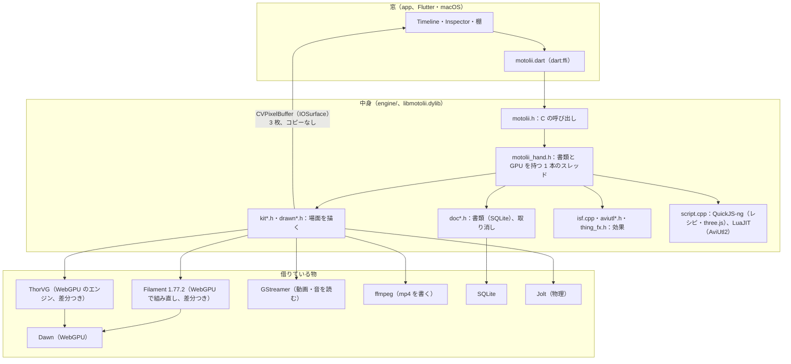

# 作り（Architecture）

*How Motolii is built, for someone about to read or change the code. A Flutter window drives a C++ engine through a small C API (`engine/library/motolii.h`). One engine thread owns the document (SQLite) and the GPU: Filament, built from source with its WebGPU (Dawn) backend and a few patches, draws the 3D scene and composites; ThorVG's WebGPU engine draws 2D and text on the same Dawn device; GStreamer reads films and ffmpeg writes them. Shared effects are compiled to WGSL with the toolchain Filament already ships (glslang → SPIR-V → Tint). The finished picture reaches the window without a copy through IOSurface-backed CVPixelBuffers.*

## 言葉（Words）

*House words → the term an After Effects / Blender / Filament / Flutter user knows → where the code defines it. The code is not renamed; read it through this table.*

コードと文書は独自の言葉で書かれている。AE などの言葉に引き直す表。名前は変えていないので、この表を通して読む。

| コード・文書の言葉 | ふつうの言い方 | 決めている所 |
|---|---|---|
| thing（物） | layer（After Effects のレイヤー、Blender の object） | 表 `thing`：[`doc_steps.h:36`](../engine/document/doc_steps.h#L36)。描くための中身は `Doc::Shown` [`doc_kinds.h:118`](../engine/document/doc_kinds.h#L118)。足すのは `motolii_add` [`motolii.h:70`](../engine/library/motolii.h#L70) |
| layer | 同じ物を窓（app）の側で呼ぶ名前：タイムラインの 1 行 | `WsLayer` [`ws.dart:109`](../app/lib/workspace/ws.dart#L109)（窓では layer、中身では thing） |
| fact | keyframe と property value（AE のキーフレームと値）。コードに keyframe がほとんど出ないのはこのため | 表 `fact(thing, name, at, value, way)`：[`doc_steps.h:33`](../engine/document/doc_steps.h#L33)。`at` のある行が 1 つのキー。読んだキーの時刻は `Doc::keyed` [`doc_kinds.h:116`](../engine/document/doc_kinds.h#L116)、窓では `keyMoments` |
| way | keyframe interpolation / easing（AE のキーフレーム補間、Blender の F-Curve の interpolation） | 表 `way(name, goes)`：[`doc_steps.h:34`](../engine/document/doc_steps.h#L34)。`goes` は SQLite の式で、`Doc::named`・`goes` [`doc_kinds.h:117`](../engine/document/doc_kinds.h#L117) に用意される |
| step | undo の 1 歩（AE の History の 1 行） | 表 `step`：[`doc_steps.h:35`](../engine/document/doc_steps.h#L35) |
| film | 2 つ：(1) 動画のレイヤー（AE の footage）、種類 `film`。(2) 書き出した動画（render output） | (1) `Doc::Shown::film`（`Video*`）[`doc_kinds.h:118`](../engine/document/doc_kinds.h#L118)、見える種類の一覧 [`doc_kinds.h:146`](../engine/document/doc_kinds.h#L146)。(2) `motolii_write` [`motolii.h:222`](../engine/library/motolii.h#L222) |
| picture | 3 つ：(1) 画像のレイヤー（種類 `picture`）。(2) 描いた 1 コマ（frame）。(3) 窓が読む書類の写し（BRIDGE の D・M、Flutter に渡す snapshot） | (1) [`doc_kinds.h:146`](../engine/document/doc_kinds.h#L146)。(3) [`picture.h:1`](../engine/stage/picture.h#L1)、`motolii_picture` [`motolii.h:224`](../engine/library/motolii.h#L224) |
| drawn | 2 つ：(1) ThorVG が描く平らな板（Lottie・SVG・文字を Filament の場面に貼る 2D の層）。(2) `doc_drawn`：目に見える種類の一覧 | (1) `struct Drawn` [`drawn_kept.h:50`](../engine/stage/drawn/drawn_kept.h#L50)、説明は [`drawn.h:1`](../engine/stage/drawn/drawn.h#L1)。(2) [`doc_kinds.h:146`](../engine/document/doc_kinds.h#L146) |
| made | 場面に置かれた描ける物 1 つ（Filament の renderable entity と mesh の instance）。レシピから作った新しい物にも使う | `Stage::Made` [`kit_stage.h:128`](../engine/stage/kit/kit_stage.h#L128)、その一覧 `Stage::made` [`kit_stage.h:140`](../engine/stage/kit/kit_stage.h#L140)。レシピ：`motolii_make` [`motolii.h:175`](../engine/library/motolii.h#L175) |
| kept | cache。主に、再生のためにディスクに置いた描き済みのコマ（AE の disk cache、Final Cut Pro の background render）。ほかは「一度求めて覚えておいた物」の一般の言い方 | `StageKept` [`stage_kept.h:15`](../engine/stage/stage_kept.h#L15)、`motolii_kept` [`motolii.h:253`](../engine/library/motolii.h#L253)。一般の例：[`doc_place.h:15`](../engine/document/doc_place.h#L15) |
| told / tell | 2 つ：(1) 知らせ（callback、Flutter の listener）。(2) 場面にその時刻を「言う」＝時刻 t で値を求めて場面を組む（AE の evaluate at time） | (1) `motolii_tell` [`motolii.h:225`](../engine/library/motolii.h#L225)、窓の `Motolii.told` [`motolii.dart:185`](../app/lib/bridge/motolii.dart#L185)。(2) `doc_moment` [`doc_moment.h:3`](../engine/document/doc_moment.h#L3)、その最中の印 `Doc::telling` [`doc_kinds.h:113`](../engine/document/doc_kinds.h#L113) |
| hand（手） | 2 つ：(1) 書類と GPU を持つ中身のスレッド 1 本（render thread）。(2) 使う人のポインター：hold・carry・let go が drag | (1) `Motolii::hand` [`motolii_hand.h:38`](../engine/library/motolii_hand.h#L38)、そのスレッドで走らせる `by_hand` [`motolii_hand.h:180`](../engine/library/motolii_hand.h#L180)。(2) [`motolii.h:78`](../engine/library/motolii.h#L78) |
| door（扉） | adapter / shim：人のコードとの境目を 1 か所に閉じ込めたファイル（[`engine/README.md`](../engine/README.md) の定義）。2 か所で使う：(1) ネットのコードを生まれた場所の形のまま走らせる口（p5.js・Shadertoy・Dwitter など）。(2) Filament の公開されていない中身に触る口（WebGPU の装置を ThorVG に貸す interop） | (1) `community/door*.h`・`document/doc_door.h`。形を見分ける `door_form` [`door.h:29`](../engine/community/door.h#L29)、名前の一覧 [`door.h:23`](../engine/community/door.h#L23)。(2) `gpu/*_door.*`：[`gpu_door.h:1`](../engine/gpu/gpu_door.h#L1) |
| seat | 窓のパネルの席（dock の pane、Flutter の widget 1 つ） | `WsSeat` [`ws_header.dart:30`](../app/lib/workspace/ws_header.dart#L30)、Inspector の席 [`workspace_seat.dart:1`](../app/lib/workspace/workspace_seat.dart#L1) |
| kit | 2 つ：(1) 中身の Filament の場面の層（stage・mesh・描く・書き出す）。組み立ての `gpu/kit_wgpu.sh` と出来た物の `out/wgpu_kit/` もこの名前。(2) 窓の desk が共有する小さな部品 | (1) `struct Stage` [`kit_stage.h:95`](../engine/stage/kit/kit_stage.h#L95)、[`kit.h:1`](../engine/stage/kit/kit.h#L1)、[`kit_wgpu.sh:2`](../engine/gpu/kit_wgpu.sh#L2)。(2) [`desk_kit.dart:1`](../app/lib/workspace/desk/desk_kit.dart#L1) |
| keyframe | 上の fact の `at` のある行。コードでは key（`keyMoments`・`keyed`）と言う | [`doc_steps.h:33`](../engine/document/doc_steps.h#L33) |
| 窓 / 中身 | app（UI、Flutter） / engine（`libmotolii.dylib`） | `app/`、`engine/` |
| 場面・舞台・Stage | composition（AE のコンポジション）。描かれる画面 | `struct Stage` [`kit_stage.h:95`](../engine/stage/kit/kit_stage.h#L95) |
| 書類 | project file（`.motolii`、中身は SQLite） | `struct Doc` [`doc_kinds.h:37`](../engine/document/doc_kinds.h#L37)、表は [`doc_steps.h:33`](../engine/document/doc_steps.h#L33)〜36 |
| 棚 | 効果・レシピなどの一覧（AE の Effects & Presets パネル） | `shelves/`、窓は `app/lib/workspace/dock/` |
| レシピ | 1 回で物と値を作るスクリプト（AE の animation preset に近い） | `shelves/recipes/` |

## 全体

## 境目

| 境目 | どこ | 決まり |
|---|---|---|
| 窓の入口 | `app/lib/main.dart` → `app/lib/workspace/workspace.dart`（`Workspace`：窓の全体、書類を開く、メニュー）。窓の状態は `app/lib/workspace/ws_state.dart`（`Ws`） | 窓のファイルの地図は [`app/README.md`](../app/README.md)。パネルを足すのは `Workspace` の `extra`（`WsPane` の並び） |
| 窓 → 中身 | `engine/library/motolii.h`（約 260 行）、Dart 側は `app/lib/bridge/motolii.dart` と ffigen が作る `motolii_bindings.dart` | 窓は値を持たない。読むのも変えるのも C の呼び出しで、書類が正（窓と中身の境目の決まりは [`docs/app/BRIDGE.md`](../docs/app/BRIDGE.md)） |
| 中身の中 | `engine/library/motolii_hand.h` | 書類と GPU に触るのは 1 本のスレッドだけ。窓はこのスレッドを待たない：書きは列に積んで戻り、読むのはこのスレッドが作った写し（[`docs/app/BRIDGE.md`](app/BRIDGE.md) の決まり 1・3・6）。待つ呼び出し（`by_hand`）は試験と C の確かめの道具だけ |
| 中身 → 窓（絵） | `engine/stage/live.h` | 場面は IOSurface の上の CVPixelBuffer 3 枚に描き、それを Dawn のテクスチャとして Filament の描き先にする。窓（Flutter の外部テクスチャ、`app/macos/Runner/MainFlutterWindow.swift`）は同じ物を読む |
| 借りた物 | `engine/deps/patches/<ライブラリ>/` | 人のコードは直接いじらず、版を固定して取ってきて差分を当てる（[`THIRD_PARTY_NOTICES.md`](../THIRD_PARTY_NOTICES.md) の 2 節） |

## 描く

- **Filament** を v1.77.2 のソースから WebGPU（Dawn）の口で組む（`engine/gpu/build.sh`）。配られている SDK には WebGPU が無いため。当てる差分：計算（compute）の口、Dawn の装置を外に貸す口、外のテクスチャを受ける `Texture::Builder::import`（`filament_dawn_compute.patch`）、AviUtl2 の HLSL のために glslang の HLSL の読み手を入れる（`glslang_hlsl.patch`）。
- **ThorVG** は WebGPU のエンジンを、Filament と同じ Dawn の装置の上で動かす（`engine/gpu/tvg_on_dawn.sh`、`drawn.h`）。描いた絵は Filament の場面の中の板になる（切り抜き・ガラス越し・キーが効く）。
- 形の足し引きは **Skia** のパスの部分だけ（`engine/deps/skia.sh`）、平らな形の三角形分けは **libtess2**。
- 画面の拍子は Thermion の FrameScheduler（CVDisplayLink、`engine/third_party/thermion_frame/`）。

## 効果の道

| 置く物 | 道 | どこ |
|---|---|---|
| ISF（`.fs`、GLSL） | glslang → SPIR-V → Tint → WGSL。Filament の組み立てに入っている物をそのまま使う | `engine/community/shaders/isf.cpp` |
| WGSL（`.wgsl`） | そのまま。頭に AviUtl2 式のつまみの行。横に置いた絵は `--image@名前:ファイル` で ThorVG が 1 回読む | `engine/stage/screen.h`、`thing_fx.h` |
| AviUtl2（`.anm2`・`.obj2`） | Lua は LuaJIT（AviUtl2 と同じ）で走らせ、`obj` の呼び出しを中身の物で受ける。中の HLSL は glslang の HLSL の読み手 → SPIR-V → Tint → WGSL | `engine/community/aviutl/aviutl.cpp`、`aviutl_fx.h` |
| three.js の形（`shelves/solids/*.js`） | QuickJS-ng で three.js を動かし、BufferGeometry を受け取る | `engine/community/js/solid_three.cpp` |
| レシピ（`shelves/recipes/*/*.js`） | QuickJS-ng。1 回で物と値を作る | `engine/community/js/script.cpp` |
| TSL | three.js 自身の WGSLNodeBuilder を QuickJS で（道具。棚に載せるのは出来上がった `.wgsl` だけ） | `engine/community/three_tsl/`、`shelves/effects/<傾向>/` の `sl_*.wgsl`・`tt_*.wgsl`・`nf_*.wgsl`・`tf_*.wgsl` |

## 書類

- 1 つの `.motolii` は SQLite のファイル。物・値・キー・キーの間の動き方（式、SQLite の関数 `bezier()`・`anime()`）を表に持つ（`engine/document/doc*.h`）。
- 取り消しは、変更を `step` の表に積む（`doc_steps.h`）。
- 物の種類：film・picture・text・solid・shape・camera・light・behaviour（`edit.cpp` の `help`）。

## 動画・音・書き出し

- 動画は **GStreamer** が読み（何の形式でも、GStreamer が部品を選ぶ）、絵を板に貼る（`engine/media/video.h`、`gst_read.h`）。
- 作業中の音は GStreamer の playbin（`sound.h`）。
- 書き出しは、場面を 1 秒 60 枚描いて **ffmpeg** に渡し、物の音も ffmpeg で混ぜる（`engine/stage/kit/kit_draw.h` の `film`）。
