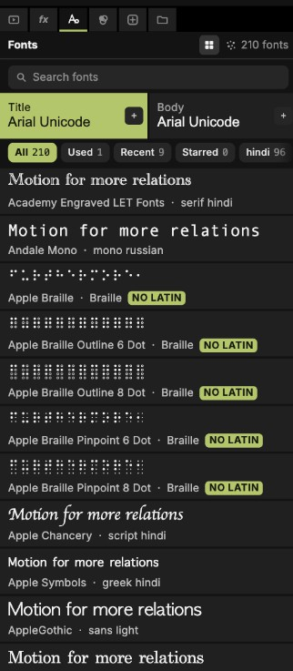
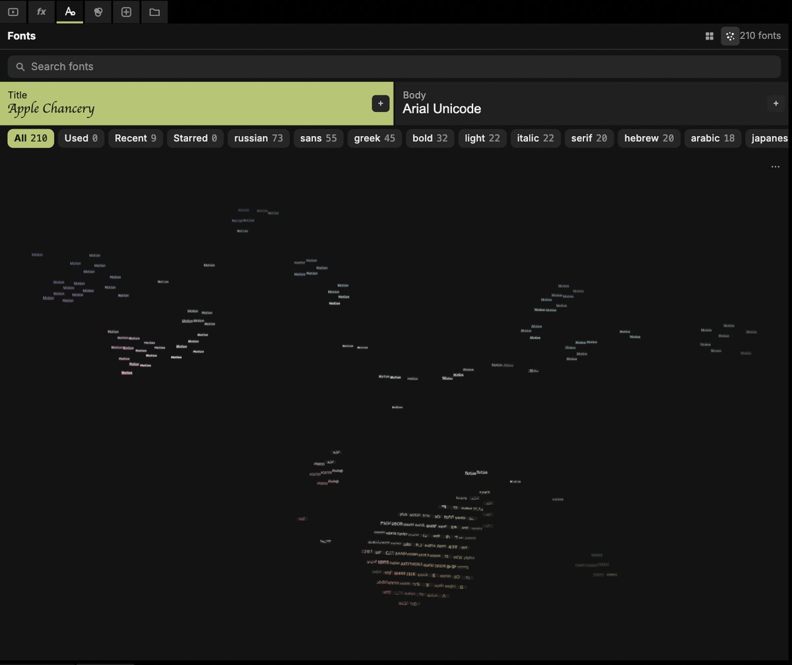
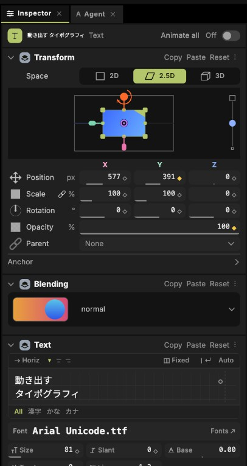
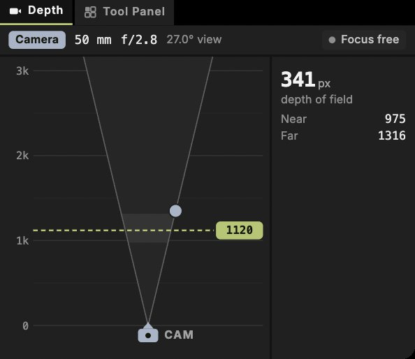
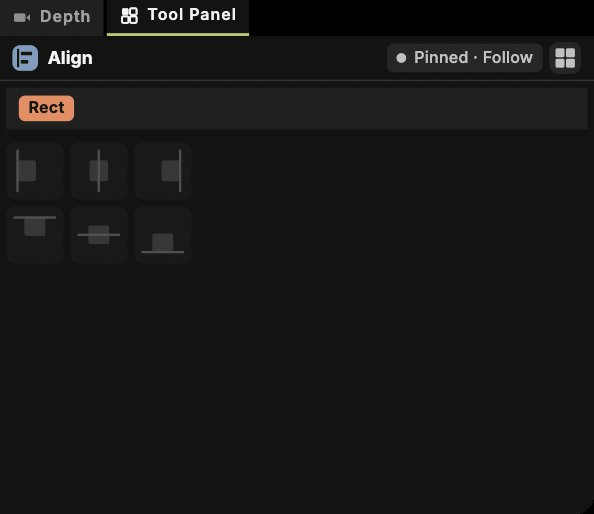

# タブごとの紹介

[English](TABS.md)

Motolii のすべてのタブと、そこでできること。画像は各言語で共通（画像に文字は入れていない）。

| 場所 | タブ |
|---|---|
| 左：棚 | [Media](#media) · [Effects](#effects) · [Fonts](#fonts) · [Colors](#colors) · [Create](#create) · [Looks](#looks) |
| 真ん中 | [Stage](#stage) · [Camera View](#camera-view) |
| 下 | [Timeline](#timeline) · [Code](#code) · [Ease](#ease) |
| 右 | [Inspector](#inspector) · [Agent](#agent) · [Depth](#depth) · [Tool Panel](#tool-panel)（[Blend](#blend)・[Align](#align)） |
| そのまわり | [トップバー](#トップバー) · [ワークスペース](#ワークスペース) · [ホーム](#ホーム) |

どのタブもドラッグで別の場所や別のタブの隣へ動かせる。棚はどれも同じ作りで、検索欄・絞り込みのチップ・選んだ物の操作が並ぶフッターがある。タイルにマウスを乗せるとプレビューが動く。検索に何も当たらない時は、近い物を 5 つ出す。

---

## 棚

### Media

プロジェクトのフォルダとディスク全体のファイルブラウザ。

- フォルダのツリーを中身の横か上に。サムネイルか一覧、パンくず。
- フッターから **Place**（置く）・**Replace**（差し替え）・**Fill shape**（図形を塗る）。複数選ぶと順に並べて置く。
- 種類で絞り込むチップ：フォルダ・3D・音声・フォント など。
- XDTS タイムシート（CLIP STUDIO・OpenToonz）を読み、作画のレベルごとにレイヤーにする。

 

### Effects

エンジンがかけられるエフェクトの全部。1,300 以上を同梱し、`effects/` フォルダに `.fs` や `.wgsl` を置いたり、`ae_plugins/` に手持ちの After Effects プラグイン（`.plugin` / `.aex`）を置いたり（シンボリックリンク可）すれば、再起動しなくてもここに出る。

- **乗せて試す。** 画面全体にかかるエフェクトは、マウスを乗せるだけで Stage の上で試せる。かける前に結果が見える。
- **場所：** All・Recent（最近）・Favorites（お気に入り）・In This Video（この動画で使用中）・Mine（自作）・自分のデッキ・パック。
- **デッキ：** タイルをデッキにドラッグしてまとめる。表紙は 2×2。デッキはコードとして貼って渡せる。
- `#time`・`#generator`・`#multipass`・`#feedback`・`#sound`・`#ae`・`#cpu`・`#gpu` などのタグで絞り込み。
- 音が要る・動画が要る・2 レイヤー要る・未対応、といった事情はバッジで出る。
- ダブルクリックか、Stage へのドラッグでかける。

 

#### マップ

棚をグリッドから**マップ**に切り替えると、見た目の似たエフェクトが近くに集まる。タイルの絵をベクトルにし（CLIP のモデルがあれば CLIP、無ければ色から）、エンジンが t-SNE で並べる。名前ではなく、仕上がりの見た目で探せる。

### Fonts

フォントを、そのフォント自身の字形で並べる。

- 上に **Title**（見出し）と **Body**（本文）：プロジェクトのテーマフォント 2 つ。テキストレイヤーを選んでいれば役割を押すとそのフォントがかかり、**+** でそのフォントの新しいテキストを作る。
- フォントを押すと、選んだテキストレイヤーにかかる。選んでいなければ新しいテキストレイヤーができる。
- チップ：Used（使用中）・Recent・Starred、それに書体や対応文字（sans・serif・bold・greek・arabic・japanese など）。
- ラテン文字の無いフォントにはバッジ。
- グリッド・一覧・**マップ**。マップは似たフォントを近くに集める（FontCLIP のモデルがあればそれで、無ければ描いた字形から）。

 

### Colors

選んだレイヤーの塗りと線の色、パレット、グラデーション。

- 色相リングと、彩度・明度の四角。16 進の入力欄。
- **Sample**：Mac 標準のスポイトで、画面のどこからでも色を拾う。
- **Photo**：Media で選んだ画像からパレットを作る。
- パレットはグリッドか、図形を敷き詰めた**ベント**で。振り直しもできる。
- 単色・グラデーション（色の止まりと、その間の混ぜ方）・なし。
- テキストレイヤーでは、選んだ文字だけに色を付ける。

 

### Create

新しい物を作るタイル。

- **レイヤー：** Text・Camera・Adjustment。**図形。** **立体：** Ring・Gem・Cube・Floor。**ライト：** Sun・Point・Spot。
- **マテリアル：** Lit・Cloth・Glass・Lacquer・Bubble など。球で見本を見せる。
- **レシピ：** レイヤーと値を一式で。
- **式：** 式のタイルを複数のレイヤーにかけると、レイヤー同士の**リレーション**になる。
- 貼り付けたコードもタイルとして残る。

 

### Looks

レイヤーから保存した「見た目」：エフェクトと値のひとまとまり。ダブルクリックで別のレイヤーにかける。Gold・Brass・Neon Edges・Long Shadow などを同梱し、自分で保存したルックもここに出る。

 

---

## 真ん中

### Stage

今のフレームを、直接つかんで編集する。

- **ツール：** 選択（V）・移動（M）・矩形（R）・楕円（E）・ペン（P）・テキスト（T）・ブラシ（B）・カメラ（C）。何も無い所をドラッグすると投げ縄で選択。
- **ブラシ**はペンの筆圧に応じ、Brush・Pen・Fill・Eraser が選べる。
- Fit / 50% / 100%、セーフエリア、グリッド、**Snapshot**（取っておいたフレームと押している間だけ見比べる）。
- ルーラーから引き出すガイド。端とガイドへのスナップ。
- 選んだレイヤーの動きの軌跡、ナビゲーター、カメラのギズモ（回り込み・寄り引き・フレームの大きさ）。
- 絵の下のオプション帯：選んだレイヤーの塗り・線・角丸・フォント・位置。

### Camera View

いまのカメラから見た絵を、編集用の印なしで。Stage で編集しながら、3D シーンをレンズ越しに確かめられる。

---

## 下

### Timeline

- レイヤーはバー：動かす・切る・並べ替える。非表示・ソロ・ロック。
- キーフレームと、その間のイージングカーブをバーの上に描く。動画のコマと音声の波形も行に出る。
- **BPM** と **Tap**：曲に合わせて叩けばテンポが決まり、ルーラーに拍のグリッドが出て、編集が拍にスナップする。
- レイヤーの端・キーフレーム・マーカー・再生位置・作業範囲へのスナップ。
- マーカーはその場でドラッグ・改名。
- 切った動画の**スリップ編集**：素材の使っていない部分が薄いバーで見える。
- ルーラーの下にキャッシュ済みのフレーム、全長を見渡す帯。

### Code

選んだレイヤーのコード。コードを持つカードごとに 1 セル、絵にかかる順に並ぶ。

- セルと Inspector のカードは同じテキスト。セルで打つとスライダーと絵が動く。カードの「Edit code」でそのセルが開く。
- AE の式は、セルの下に再生位置での値が出る。間違っていれば「Error at line 3: ReferenceError: amp is not defined」のように行と理由が出る。
- 打っている途中で名前を補完し、それぞれの説明も出る。横の **Functions** は AE と同じ分け方（Layer・Property・Comp…）の一覧で、押すとカーソルの位置に入る。リファレンスは AE のもの。Motolii でまだ動かない名前には印が付く（エンジンに毎回聞いているので一覧と実際はずれない）。
- セルはカードそのもの。見出しのドラッグでエフェクトの順番を変える、目のアイコンでオフ、ゴミ箱で削除、折り畳み、下端で高さ。名前を 2 回押すと改名。
- **+ New expression** で空の式から。**Add to shelf** で棚のタイルにして使い回せる。
- 何で書いたか（AE の式・Cavalry・JavaScript・ISF・WGSL など）は見出しに出る。

### Ease

2 つのキーフレームの間のイージング。

- ハンドルをドラッグするベジェのグラフ。必要なら正確な数値で。
- **重ねるイージング：** カードごとに、上のカードの結果にさらにかかる。
- グラフにドラッグするプリセットの形と、横から出てくる保存したイージングの棚。
- プリセットにマウスを乗せると、選ぶ前に動きを再生して見せる。
- カーブのコピー、前後の区間への移動、区間の端の値を横のバーでドラッグ。
- イージングのプリセットは `ease/` フォルダの 1 行の式のファイル（`a + (b - a) * bezier(u, …)`）。

 

---

## 右

### Inspector

選んだレイヤーの値の全部を、カードで並べる。Transform・Text・Fill・Blending・Paths・Media・Play・Time Remap・Camera・Light、3D の質感（Shine・Surface・Glass・Lacquer・Bubble・Bevel など）、エフェクトごとのカード、Script、Relation・Falloff。どれもエンジンが宣言し、アプリは「値のカード」1 つの部品で全部を描く。手書きのカードは無い。新しいエフェクトや新しい種類のレイヤーにも、画面のコードを足さずにカードが付く。

 

#### 値は「行」ではなく「ブロック」

左に名前、右にスライダーの「プロパティ行」は、パネルを広げても横に伸びるだけで見える量は増えない。Motolii の値はブロック。上に名前、下に大きく数字、角に値の小さな絵（角度は目盛り、量はゲージ、位置はパッド）。ブロックはタイル状に敷き詰め、ふつうの幅で 3 列、広げると列が増える。値が 30 個あってもカードは短い。位置・大きさ・選択肢は 2 列ぶん。どのブロックも数字の入力と横ドラッグが効く。

#### 効く値に色

値が 8 個並んでも、どれが効くかは見ただけでは分からない。同梱エフェクト約 1,280 本は、値を 1 つずつ動かして絵の変わり方を 0〜10 で調べてある（`app/assets/effect_parameter_weights.json`）。Inspector はそれを色にする。いちばん効く値が浅黄、次が撫子、次が青磁。ほとんど変わらない値はグレー。棚のタイルが何を動かして見せるかも、同じ表で決めている。

#### カードごとに

- **Transform** はドラッグできる小さなキャンバスと 27 点のアンカーボックス。**Text** は文字の範囲ごとのスタイル。**Fill** は線も 1 枚に。**Blending** はプレビュー付き。
- 作者とライセンス（上の画像なら *by VIDVOX*）と、編集できるタグ。
- 値ごとのキーフレームの印。カードごとに Copy / Paste / Reset。
- そのレイヤーが入っているリレーションは一番上に出る。

### Agent

レイヤーを選び、やりたいことを書いて頼む。エージェントがエフェクトや式を書き、保存したところで絵が変わる。

- 一覧は ACP（Agent Client Protocol）のレジストリ。Zed や JetBrains が読むのと同じもの。Claude Agent・Codex・Gemini CLI・Cursor・Cline・Google Antigravity など、扱いはどれも同じ。棚と同じく検索して選ぶと、`npx`・`uvx`・それぞれのバイナリで起動する。一覧は手元にも残すのでオフラインでも開ける。サインインはエージェント側の方法で。
- 頼むたびに渡すもの：Inspector の全カードと今の値、各カードのコード、Timeline で選んだキーフレームの区間、Motolii で動く名前の印が付いた AE の式のリファレンス。ファイルは Zed の `@` と同じリンクの形。
- コードは頼む前にレイヤー専用の写しになる。棚の元ファイルは書き換わらない。新しく作られた物は新しいカードとしてレイヤーに付き、既にあるコードは頼んだ時だけ変わる。
- 道具の呼び出しは 1 行ずつ、状態・触ったファイル・消した行と足した行付きで並ぶ。許可を求められたら、その選択肢がボタンで出る。
- モデル・effort・モードは、エージェントが申告したものを 1 つのボタンに出す。Motolii はモデルの一覧を持たない。コンテキストの使用量は小さな輪、5 時間・7 日の利用上限はメニューで見える。
- 返事は Markdown。タブを動かしても会話は残る。アイコンのカササギは Motolii のマスコット。

 

### Depth

カメラのレンズを上から見た図。レイヤーは、その奥行きに置いた板で表す。

- ピントの線や被写界深度の帯をドラッグ。板を押すとそこにピントが合う。
- 横にドラッグすると焦点距離が変わる。
- 焦点距離・絞り・被写界深度・手前と奥の限界がひと目で。

 

### Tool Panel

道具の棚。開いた道具はパネルに留まる。自分のパネルも Dart 数行で足せる（[`app/lib/workspace/README.md`](../app/lib/workspace/README.md)）。

 

#### Blend

レイヤーの重なりと、それぞれの合成モードを、重なる円で描いた一覧。行を開くと全モードと、そのレイヤーの Blending カードが出る。

 

#### Align

選んだレイヤーを、キャンバスの端や中央に揃える。見えている部分の大きさで揃える。

 

---

## タブのまわり

### トップバー

- Motolii のマークでホームへ。Undo / Redo には取り消す操作の名前が出る。
- サイズのチップ：フレームの大きさをドラッグか入力で、またはよくある形と解像度から選択。
- **Standard / Code** のワークスペース（下記）。
- ウィンドウの拡大率、ライト／ダーク、CPU と GPU の負荷、重いフレームやエンジンのエラーを知らせる点、最後に保存した時刻。
- **Render：** MP4（H.264）・HEVC の `.mov`・GIF・PNG 連番・JPEG 連番。解像度・フレームレート・画質・モーションブラー・背景。ディスクの空きも出る。

### ワークスペース

同じタブの 2 通りの並べ方を、トップバーで切り替える。どちらも、自分で並べ替えた形を覚えている。

- **Standard：** 左に棚、Stage の下に Timeline、その横に Ease、右に Inspector と Depth。
- **Code：** コードを書くための並び。真ん中に Code、隣に Stage、下に Timeline。書いている行と絵と再生位置が同時に見える。左の列には棚と一緒に Inspector と Agent。頼む・セルで読む・Stage で見る、がタブを替えずにできる。右下に Ease・Depth・Tool Panel。初めて開いた時は Agent と Ease が手前。

  

  並びはコードではなく、タブをドラッグして作ったファイル [`shelves/workspaces/code.layout`](../shelves/workspaces/code.layout)。並べ替えれば、その形を覚えている。

### ホーム

- 前回のプロジェクトを大きく出し、**Continue editing** で続きから。
- プロジェクトはカードで、日付順か名前順。横に検索と最近の一覧。
- カードから開く・複製・書き出し・ゴミ箱へ。複数選んでまとめて書き出しも。
- **New Project** と、プロジェクトを置くフォルダを変える **Change folder**（最初は `~/Movies/Motolii`）。
