# タブ・パネル一覧

[English](TABS.md)

Motolii のすべてのタブとパネルの機能紹介です。スクリーンショットは言語非依存で共通のものを使用しています。

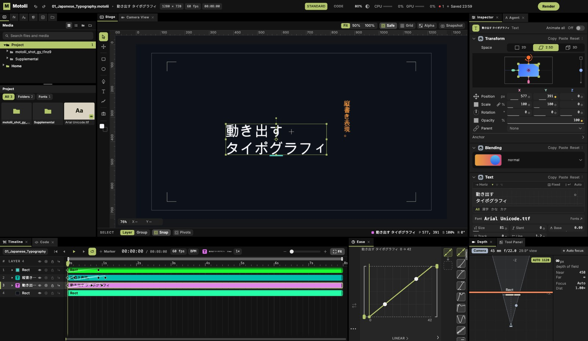

| エリア | タブ |
|---|---|
| 左（棚） | [Media](#media) · [Effects](#effects) · [Fonts](#fonts) · [Colors](#colors) · [Create](#create) · [Looks](#looks) |
| 中央 | [Stage](#stage) · [Camera View](#camera-view) |
| 下 | [Timeline](#timeline) · [Code](#code) · [Ease](#ease) |
| 右 | [Inspector](#inspector) · [Agent](#agent) · [Depth](#depth) · [Tool Panel](#tool-panel)（[Blend](#blend)・[Align](#align)） |
| 周辺 UI | [トップバー](#トップバー) · [ワークスペース](#ワークスペース) · [ホーム](#ホーム) |

すべてのタブはドラッグで別エリアや別タブの隣にドッキングできます。各棚は検索バー・絞り込みチップ・選択アイテムの操作フッターで統一されており、タイルにカーソルを乗せるとプレビューが再生されます。検索に完全一致する項目がない場合は、近い候補を 5 件提案します。

---

## 棚（Shelves）

### Media

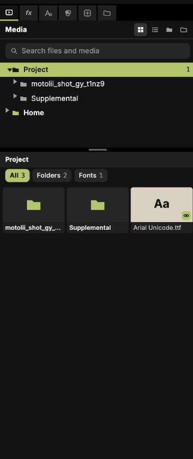

プロジェクトフォルダおよびディスク全体を閲覧できるファイルブラウザです。

- フォルダツリー（横または上配置）、サムネイル／リスト切替、パンくずリスト。
- フッターから **Place**（配置）・**Replace**（差し替え）・**Fill shape**（シェイプの塗りつぶし）を実行可能。複数選択したファイルは順番に配置されます。
- 種別チップによる絞り込み（フォルダ・3D モデル・音声・フォントなど）。
- XDTS タイムシート（CLIP STUDIO PAINT・OpenToonz）を読み込み、セルのレベルごとにレイヤーを生成できます。

 

### Effects

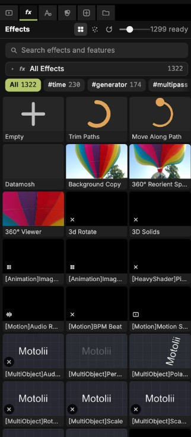

エンジンが適用できる全エフェクトの一覧です。1,300 以上の同梱エフェクトに加え、`effects/` フォルダに配置した `.fs` / `.wgsl` や、`ae_plugins/` に配置・シンボリックリンクした After Effects プラグイン（`.plugin` / `.aex`）が再起動なしで表示されます。

- **ホバープレビュー：** 画面全体系エフェクトはカーソルを乗せるだけで Stage 上に仮適用して結果を確認できます。
- **場所フィルター：** All・Recent・Favorites・In This Video・Mine・カスタムデッキ・エフェクトパック。
- **デッキ：** タイルをデッキへドラッグして整理できます。2×2 のカバー画像が自動生成され、デッキコードとしてコピー＆ペーストで共有可能です。
- **タグ絞り込み：** `#time`・`#generator`・`#multipass`・`#feedback`・`#sound`・`#ae`・`#cpu`・`#gpu` などの自動タグおよびユーザータグで絞り込めます。
- **条件バッジ：** 音声・動画・2 レイヤー目が必要なエフェクトや未対応項目をバッジで明示します。
- ダブルクリックまたは Stage へのドラッグ＆ドロップで適用します。

 

#### マップ表示

グリッドから**マップ**へ切り替えると、見た目の近いエフェクト同士が近くに配置されます。プレビュー画像をベクトル化（CLIP モデル導入時は CLIP、未導入時は色特徴量）し、エンジン側で t-SNE 配置を計算します。

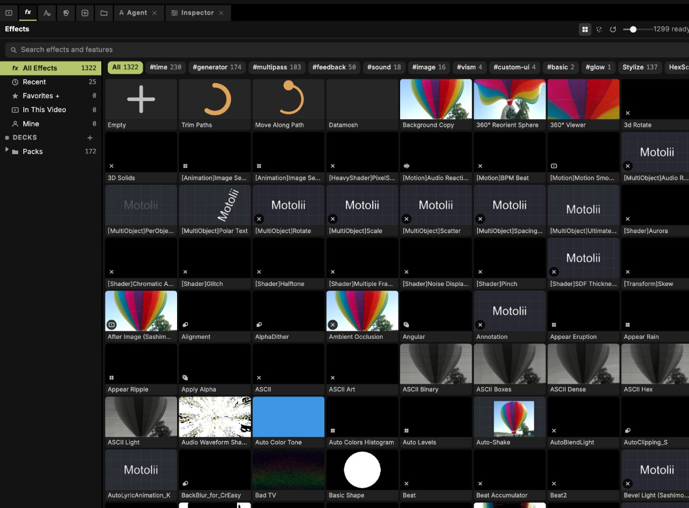
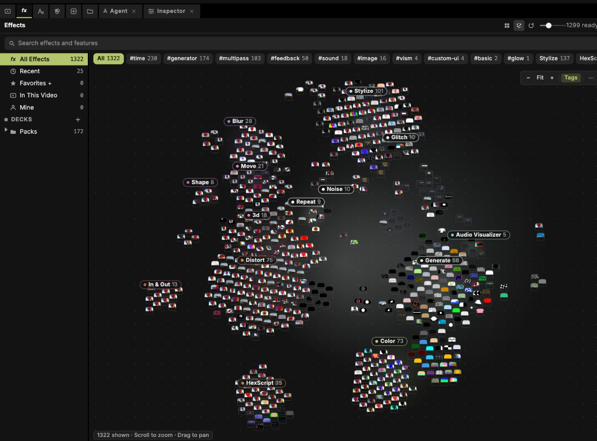

### Fonts

インストール済みフォントを各書体そのもののプレビューで閲覧できます。

- 上部の **Title**（見出し）と **Body**（本文）はプロジェクトのテーマフォントです。テキストレイヤー選択中はクリックで適用、**+** でそのフォントのテキストレイヤーを新規作成します。
- フォントをクリックすると選択中テキストレイヤーへ適用され、未選択時は新規テキストレイヤーを作成します。
- チップ絞り込み：Used・Recent・Starred、および書体・文字種（`sans`・`serif`・`bold`・`greek`・`arabic`・`japanese` など）。
- ラテン文字を含まないフォントにはバッジが表示されます。
- グリッド・リスト・**マップ**表示に対応（マップは FontCLIP モデル導入時は FontCLIP、未導入時は描画字形の特徴量でクラスタリング）。

 

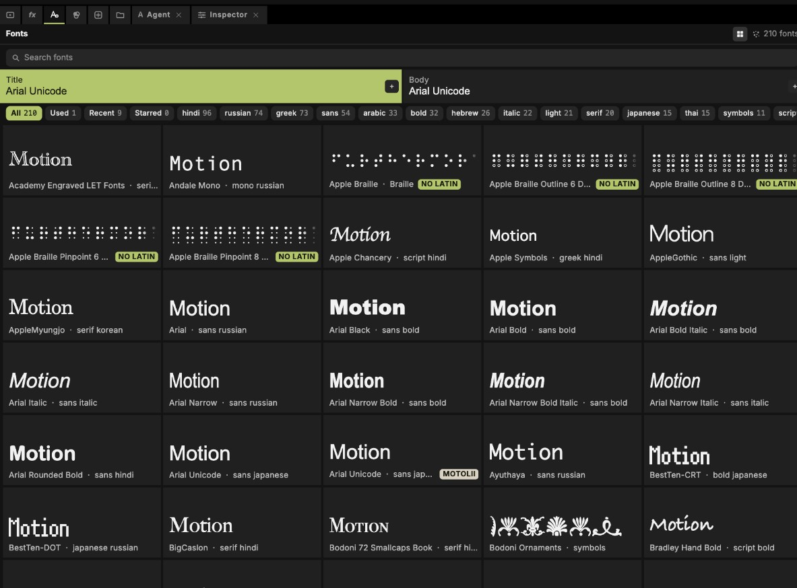

### Colors

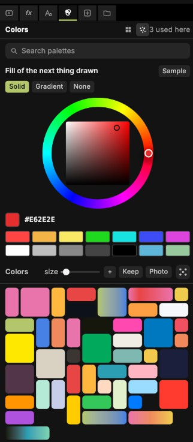

選択レイヤーの塗り・線の色、カラーパレット、グラデーションを設定します。

- 色相リング＋彩度・明度スクエア、16 進カラーコード入力。
- **Sample：** macOS 標準スポイトで画面上のあらゆる場所から色を採取。
- **Photo：** Media タブで選択した画像からパレットを自動抽出。
- パレットはグリッド表示と、再生成可能な**ベント（Bento）**レイアウトに対応。
- 単色・グラデーション（カラーストップと補間方式）・なしの切替。
- テキストレイヤーでは選択範囲の文字だけに色を適用できます。

 

### Create

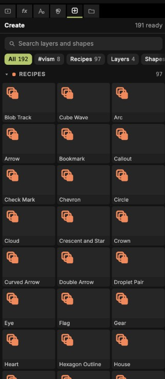

レイヤー・テンプレート・コードを新規作成するための棚です。

- **レイヤー：** Text・Camera・Adjustment。**図形（Shapes）。** **3D 立体（Solids）：** Ring・Gem・Cube・Floor。**ライト：** Sun・Point・Spot・**Environment**（HDR 照明・回転・背景をタイムライン上で制御）。
- **マテリアル：** Lit・Cloth・Glass・Lacquer・Bubble などを球体プレビューで選択。
- **レシピ：** レイヤーと初期パラメータ一式をワンクリックで生成。
- **エクスプレッション：** 複数の選択レイヤーへ適用すると、レイヤー間を連動させる**リレーション**になります。
- 貼り付けた外部コードも再利用可能なタイルとして保存されます。

 

### Looks

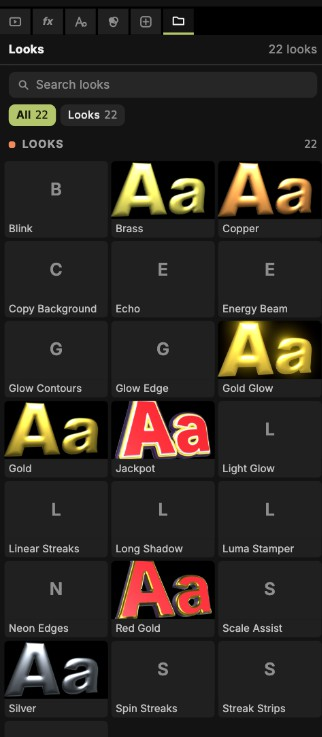

レイヤーのエフェクトとパラメータ値一式を保存したプリセット（ルック）です。ダブルクリックで別レイヤーへ適用できます。Gold・Brass・Neon Edges・Long Shadow などの同梱ルックと自作ルックが並びます。

 

---

## 中央エリア

### Stage

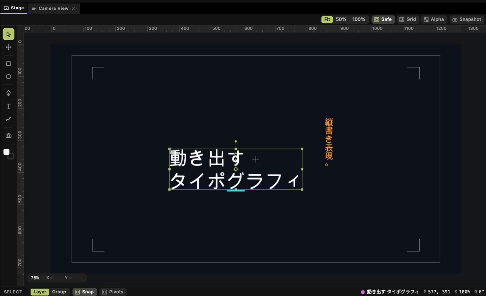

現在のフレームを直接操作できるプレビュービューポートです。

- **ツール：** 選択（`V`）・移動（`M`）・矩形（`R`）・楕円（`E`）・ペン（`P`）・テキスト（`T`）・ブラシ（`B`）・カメラ（`C`）。空き領域ドラッグで範囲選択。
- **ブラシ：** 筆圧対応の Brush・Pen・Fill・Eraser モード（手ブレ補正 `Smooth: Off / Low / Med / High` 調整付き）。
- Fit / 50% / 100% ズーム、セーフエリア、グリッド、**Alpha**（透過チェッカーボード表示）、**Snapshot**（押している間、保存フレームと比較表示）。
- ルーラーからのガイド引き出しと、端・ガイドへのスナップ。
- 選択レイヤーのモーションパス、ナビゲーター、3D カメラギズモ（オービット・ドリー・フレーム調整）。
- 下部のオプションバーから塗り・線・角丸・フォント・位置を即座に調整可能。

### Camera View

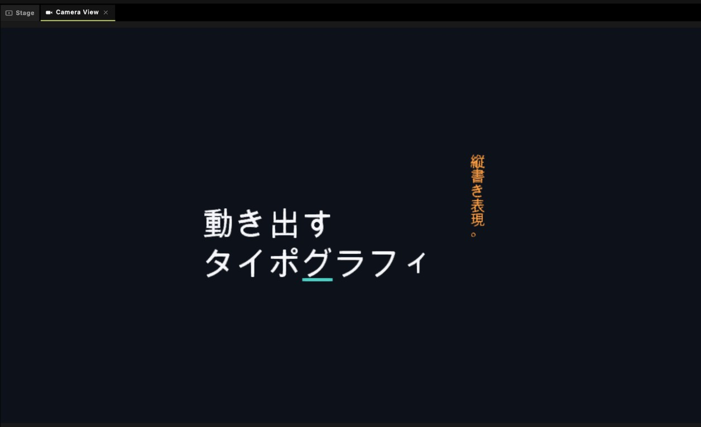

ギズモや選択枠なしの純粋なカメラ出力プレビューです。Stage で操作しながら、最終的な画角を別タブで常時確認できます。

---

## 下エリア

### Timeline

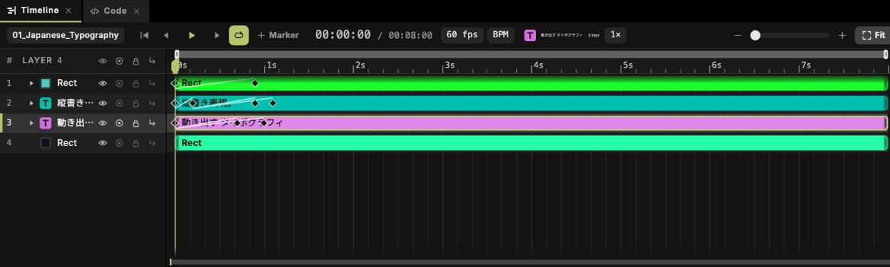

- レイヤーバーによる移動・トリム・並び替え・非表示・ソロ・ロック操作。
- バー上にキーフレームとイージングカーブを直接描画し、動画のサムネイル列や音声波形も表示。
- **BPM** と **Tap** テンポ：音楽に合わせてタップするとルーラーに拍グリッドが表示され、拍単位でスナップ編集できます。
- レイヤー端・キーフレーム・マーカー・再生ヘッド・ワークエリアへのスナップ。
- マーカーのドラッグ移動とインライン改名。
- トリム済み動画の**スリップ編集**（未使用区間を半透明バーで可視化）。
- ルーラー下のフレームキャッシュ表示と全体オーバービュー帯。

### Code

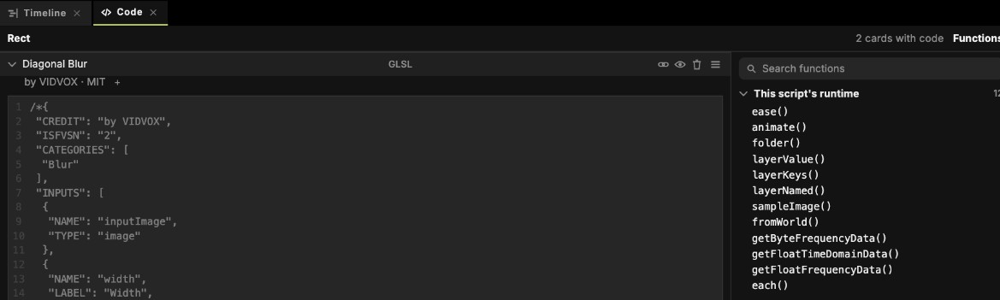

選択レイヤーのコードをノートブック形式のセルで編集できます。適用順に 1 カード＝1 セルで並びます。

- セルと Inspector のカードは同一ソースに同期しており、コードを編集するとスライダーと Stage が即座に更新されます。カードの「Edit code」から該当セルを開けます。
- After Effects エクスプレッションは再生ヘッド位置での評価値をセル下にリアルタイム表示し、エラー時は行番号と原因を表示します（例：`Error at line 3: ReferenceError: amp is not defined`）。
- VS Code 相当の入力補完とドキュメント表示に加え、AE 準拠のカテゴリ別（`Layer`・`Property`・`Comp` など）**Functions** リストを搭載。エンジンに問い合わせて未対応シンボルにマークを付け、クリックでカーソル位置へ挿入できます。
- 各セルはカードと同様にヘッダドラッグで順序変更・目のアイコンで無効化・削除・折り畳み・高さ変更・ダブルクリックで改名が可能。
- **+ New expression** で空の式を作成、**Add to shelf** で棚のタイルとして再利用可能。
- ヘッダにソース言語（AE Expression・Cavalry・JavaScript・ISF・WGSL など）を表示します。

### Ease

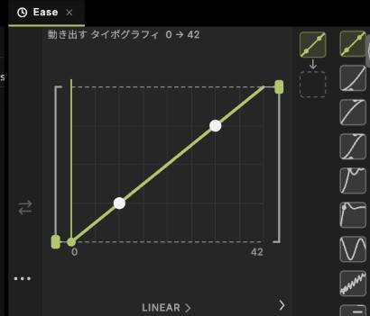

キーフレーム間のイージングカーブを編集するパネルです。

- ハンドル操作対応の 3 次ベジェグラフと数値入力。
- **スタック可能なイージング：** 複数のイージングカードを順に重ねて合成できます。
- グラフへドラッグできるプリセット形状と、スライド式で開く保存済みイージング棚。
- プリセットにホバーすると適用前に動きを再生して確認可能。
- カーブのコピー、前後区間へのステップ移動、サイドバーでの区間端点ドラッグに対応。
- プリセットは `ease/` フォルダの 1 行数式ファイル（`a + (b - a) * bezier(u, …)`）です。

 

---

## 右エリア

### Inspector

選択レイヤーの全プロパティをカード単位で表示します（Transform・Text・Fill・Blending・Paths・Media・Play・Time Remap・Camera・Light、各種 3D マテリアル、エフェクトカード、Script、Relation・Falloff）。すべてのカードはエンジン宣言から共通ウィジェット（`ValuesCard`）で自動生成されるため、新しいエフェクトやレイヤー種別を追加しても専用 UI コードは不要です。

 

#### 行ではなくブロック配置

従来の「左にラベル・右にスライダー」の行レイアウトは、パネルを広げても余白が増えるだけです。Motolii では各パラメータをコンパクトな**ブロック**（上にラベル、下に大きく数値、角に角度ダイヤル・ゲージ・2D パッド等のミニビジュアル）としてタイル状に配置します。標準幅で 3 列、パネルを広げると自動で列数が増えるため、30 パラメータあるエフェクトでも縦長になりません。座標や選択肢など幅が必要な項目は 2 列分を使い、全ブロックで数値直接入力と横スクラブが使えます。

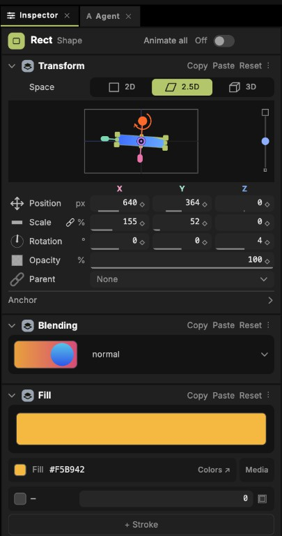
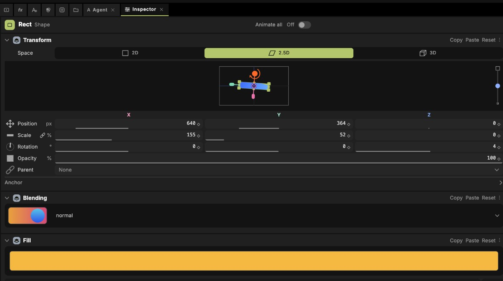

#### 影響度によるカラーハイライト

多数のパラメータが並ぶエフェクトでも効きの強い項目がすぐ分かるよう、同梱エフェクト約 1,280 本の全パラメータについて視覚的変化量を 0〜10 で事前評価しています（`app/assets/effect_parameter_weights.json`）。影響度の高い順に浅黄（うすき）・撫子（なでしこ）・青磁（せいじ）で色付けし、変化の小さい項目はグレーのまま表示します。棚タイルのプレビューアニメーションで動かすパラメータ選定にも同じデータを使っています。

#### 各カードの共通機能

- **Transform** にドラッグ可能なミニキャンバスと 27 点アンカーボックス、**Text** に選択文字単位のスタイリング、**Fill** に Stroke 統合、**Blending** にライブプレビューを搭載。
- 作者クレジット（例：*by VIDVOX*）と編集可能なユーザータグを表示。
- パラメータごとのキーフレーム打鍵と、カード単位の Copy / Paste / Reset。
- 所属中のリレーションを上部に一覧表示。

### Agent

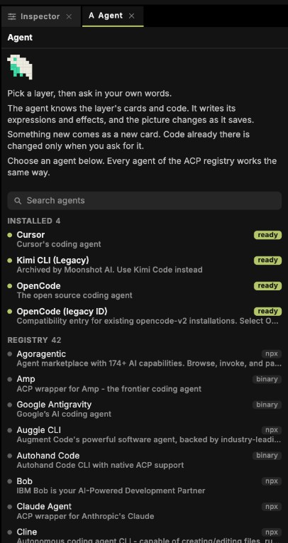

レイヤーを選んで作りたい表現を伝えるだけで、AI エージェントがエフェクトやエクスプレッションを記述・編集し、保存と同時に Stage に反映します。

- Zed や JetBrains と共通の [ACP（Agent Client Protocol）](https://github.com/anthropics/agent-client-protocol) レジストリに対応。Claude Agent・Codex・Gemini CLI・Cursor・Cline・Google Antigravity などを対等に選択し、`npx`・`uvx`・ローカルバイナリ経由で起動できます。レジストリはローカルキャッシュされるためオフラインでも開け、認証は各エージェント自身のログイン方式に従います。
- リクエストごとに、Inspector の全カード・現在値・各カードのコード・Timeline の選択キーフレーム区間・Motolii 対応状況付き AE エクスプレッションリファレンスを自動添付します。ファイルは Zed と同じ `@` リンク形式で渡されます。
- 編集前に棚のファイルはレイヤー専用のローカルコピーへ複製されるため、元の棚ファイルは壊れません。新規作成された表現は**新しいカード**として追加され、既存コードは明示的に指示したときだけ変更されます。
- ツール呼び出しは実行状態・変更ファイル・増減行数付きでインライン表示され、権限確認もボタンで応答できます。
- モデル・推論強度（effort）・モードは接続先エージェントが宣言した選択肢を動的に表示します。コンテキスト使用率リングと 5 時間／7 日間の利用上限も確認可能です。
- 応答は Markdown で表示され、タブ移動後も会話が保持されます。アイコンのカササギは Motolii のマスコットです。

 

### Depth

カメラの視錐台を真上から見下ろした図で、各レイヤーの奥行き（Z 位置）を板として可視化します。

- ピント面や被写界深度の帯をドラッグ、またはレイヤーの板をクリックして直接ピント合わせ。
- 横ドラッグで焦点距離を変更。
- 焦点距離・絞り・被写界深度・近遠リミットをひと目で把握できます。

 

### Tool Panel

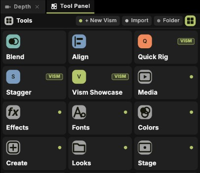

ドッキング可能なユーティリティ・標準パネル・**Vism カスタムパネル**のランチャーです。上部の **`+ New Vism`** から 1 クリックで JS 製の独自パネルを作り始められ、**`Import`** で `.vism` パックを導入、**`Folder`** で配置先フォルダを開けます（[Vism クイックスタート](VISM_QUICKSTART.ja.md)）。

 

#### Blend

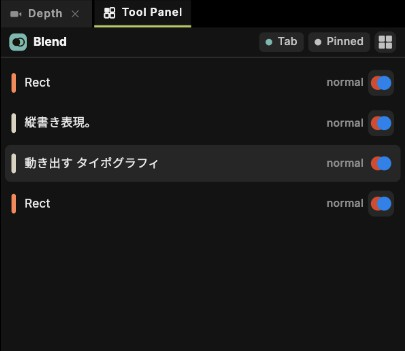

各レイヤーの合成モードを重なり合う円で一覧表示します。行を展開すると全ブレンドモードと該当レイヤーの Blending 設定を開けます。

 

#### Align

選択した複数レイヤーを、実際に描画されている領域を基準にキャンバス端・中央へ整列します。

 

---

## 周辺 UI

### トップバー

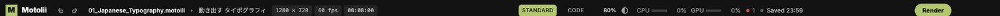

- Motolii ロゴからホーム画面へ移動。Undo / Redo ボタンには直前の操作名が表示されます。
- サイズチップ：ドラッグ・数値入力・プリセットからコンポジション解像度を変更。
- **Standard / Code** ワークスペース切替（下記）。
- ウィンドウ倍率、ライト／ダークテーマ、CPU・GPU 負荷メーター、遅延フレーム／エンジンエラーインジケーター、最終保存時刻。
- **Render：** MP4（H.264）・HEVC `.mov`・GIF・PNG 連番・JPEG 連番の書き出し。解像度・フレームレート・画質・モーションブラー・背景設定、および空きディスク容量を表示。

### ワークスペース

同じタブ群の 2 種類のレイアウトプリセットをトップバーから切り替えられます。手動で調整した配置はワークスペースごとに記憶されます。

- **Standard：** 左に棚、中央上に Stage、中央下に Timeline と Ease、右に Inspector と Depth。
- **Code：** コーディング特化レイアウト。中央に Code、右に Stage、下に Timeline を配置し、左カラムに棚と並べて Inspector と Agent をドッキング。タブを切り替えずに「依頼 → コード確認 → プレビュー確認」を同時に行えます。右下に Ease・Depth・Tool Panel を配置。

  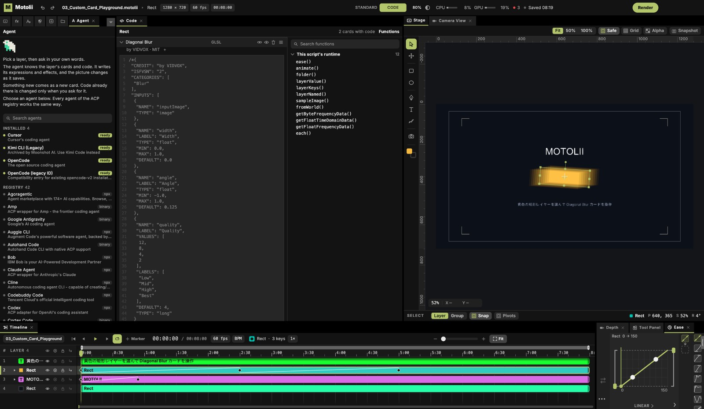

  レイアウト定義はコードではなく [`shelves/workspaces/code.layout`](../shelves/workspaces/code.layout) として保存されます。

### ホーム

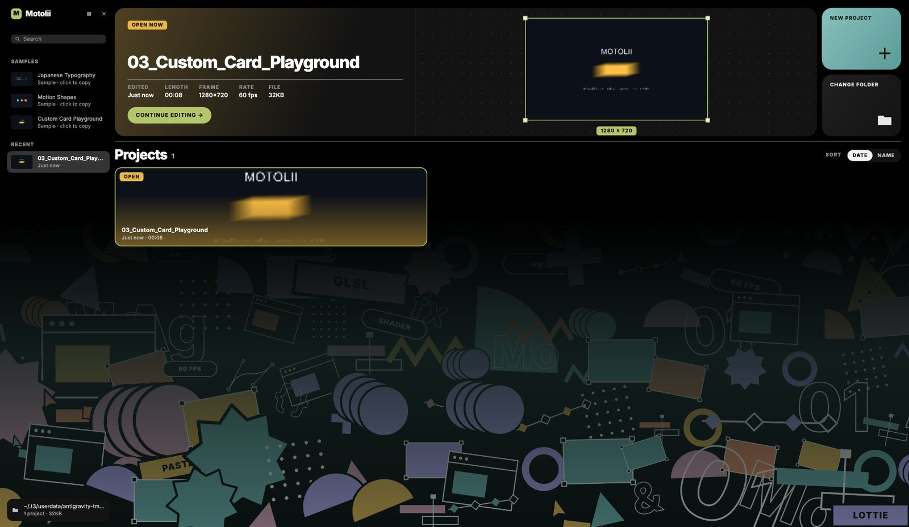

- 直近のプロジェクトを大きく表示し、**Continue editing** からすぐ再開可能。
- 更新日順／名前順のプロジェクトカード一覧、検索、最近開いた一覧。
- カードごとの開く・複製・書き出し・ゴミ箱移動、および複数選択による一括書き出し。
- **New Project** と、プロジェクト保存先を変更する **Change folder**（初期値：`~/Movies/Motolii`）。
