# The window, tab by tab

[日本語](TABS.ja.md)

Every tab of Motolii and what you can do in it. The pictures are shared by every language and carry no words of their own.

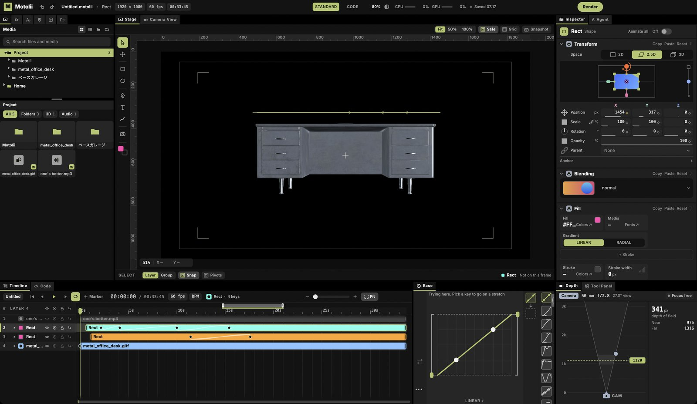

| Where | Tabs |
|---|---|
| Left: the shelves | [Media](#media) · [Effects](#effects) · [Fonts](#fonts) · [Colors](#colors) · [Create](#create) · [Looks](#looks) |
| Middle | [Stage](#stage) · [Camera View](#camera-view) |
| Bottom | [Timeline](#timeline) · [Code](#code) · [Ease](#ease) |
| Right | [Inspector](#inspector) · [Agent](#agent) · [Depth](#depth) · [Tool Panel](#tool-panel) ([Blend](#blend), [Align](#align)) |
| Around them | [Top bar](#top-bar) · [Workspaces](#workspaces) · [Home](#home) |

Every tab can be dragged to another place or beside another tab. Every shelf has the same frame: a search field, filter chips, and a footer for the item you picked. Hover a tile to play its preview. When nothing matches a search, the five nearest items are shown.

---

## The shelves

### Media

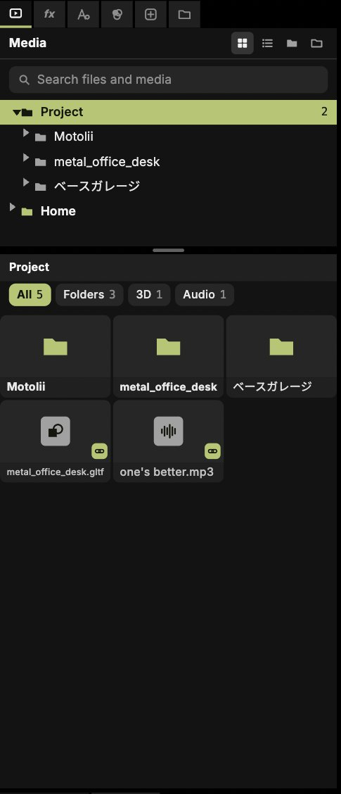

A file browser for the project folder and the whole disk.

- A folder tree beside or above the contents; thumbnails or a list; breadcrumbs.
- **Place**, **Replace** or **Fill shape** from the footer. Several picked files are placed in order.
- Filter chips by kind: folders, 3D, audio, fonts, …
- Reads XDTS timesheets (CLIP STUDIO, OpenToonz) and places each drawing level on its own layer.

 

### Effects

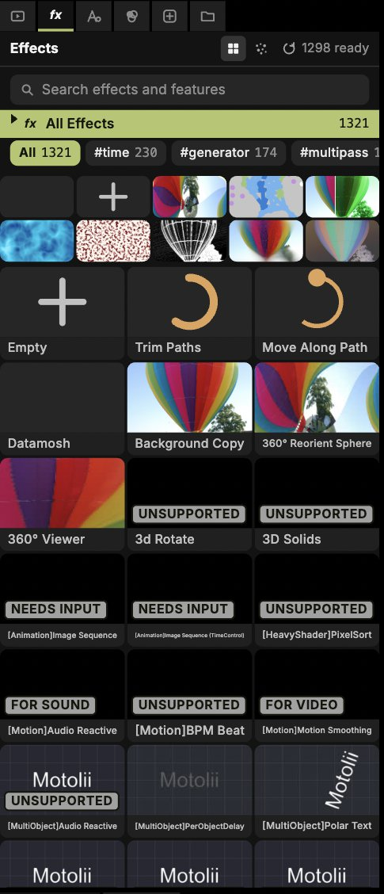

Every effect the engine can apply: over 1,300 ship with Motolii, and an `.fs` or `.wgsl` file dropped in your effects folder appears here without a restart.

- Hovering a whole-picture effect tries it on the Stage before you apply it.
- **Places:** All, Recent, Favorites, In This Video, Mine, your decks, and packs.
- **Decks:** drag tiles onto a deck to group them; a deck shows a 2×2 cover, and can be shared as a deck code you paste.
- Tags such as `#time`, `#generator`, `#multipass`, `#feedback` and `#sound` filter the shelf.
- A badge says when an effect needs a sound, a video, two layers or something not supported yet.
- Double-click or drag a tile onto the Stage to apply it.

 

#### The map

Switch the shelf from the grid to the **map** and effects that look alike sit near each other. Each tile's picture becomes a vector (from CLIP when its model is installed, otherwise from its colours), and the engine lays them out with t-SNE.

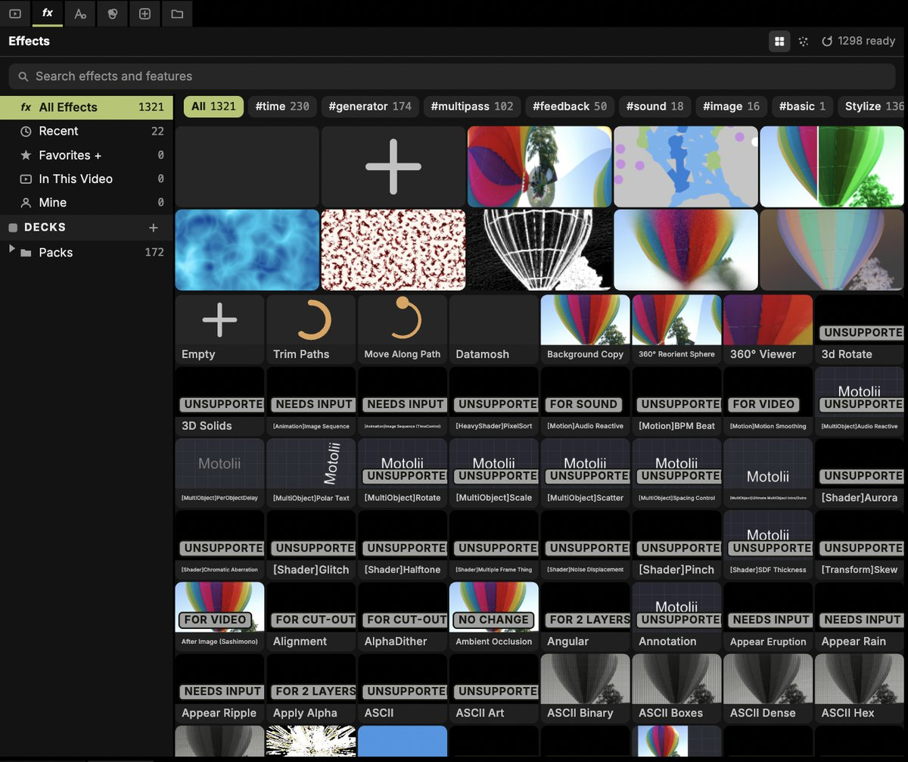
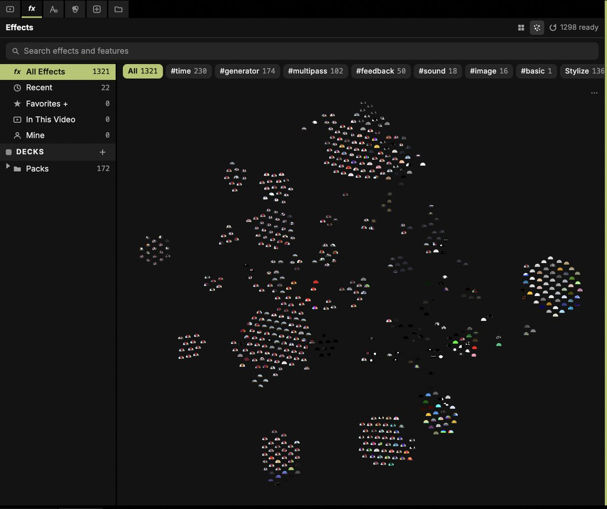

### Fonts

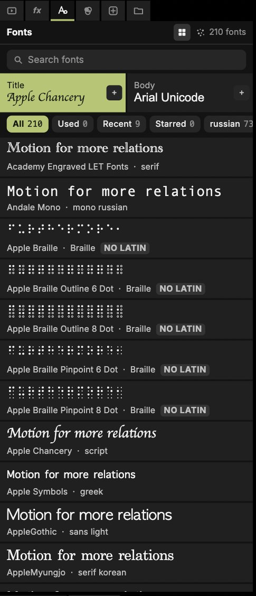

Each font is shown in its own face.

- **Title** and **Body** at the top: the project's two theme fonts. With a text layer selected, a role applies its font; **+** adds a new text in it.
- Clicking a font sets it on the selected text layer, or makes a new text layer.
- Chips: Used, Recent, Starred, and the scripts and styles the font covers (sans, serif, bold, greek, arabic, japanese, …).
- A badge marks fonts with no Latin letters.
- Grid, list or **map**. The map places similar fonts together (with FontCLIP when its model is installed, otherwise from the rendered letters).

 

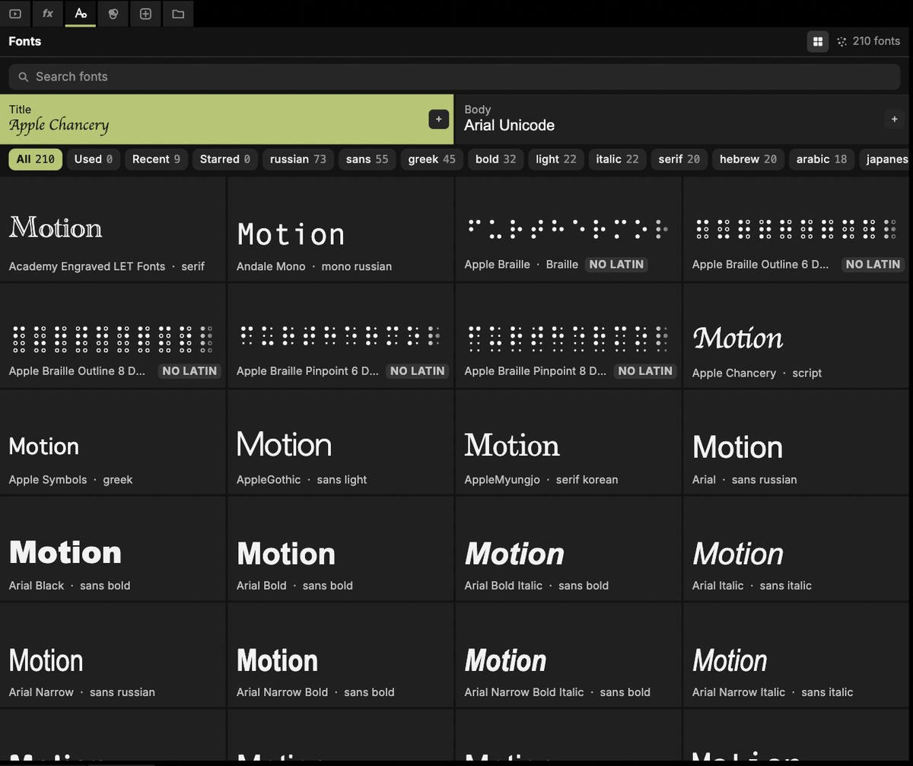
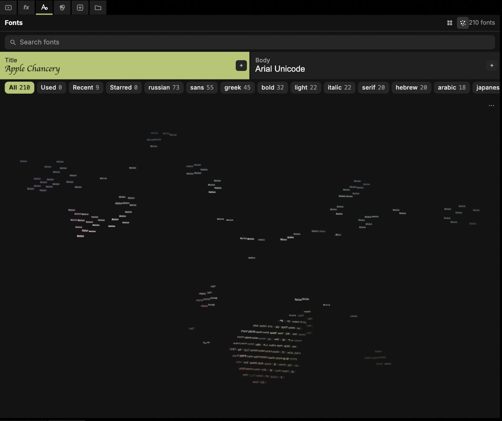

### Colors

Picking colors, palettes and gradients for the selected layer's fill or stroke.

- A hue ring around a saturation and brightness square, and a hex field.
- **Sample**: the Mac's own eyedropper picks a color from anywhere on the screen.
- **Photo**: a palette taken from the image picked in Media.
- Palettes as a grid or a **bento** of shapes, thrown again on request.
- Solid, Gradient (stops, with the way colors mix between them) or None.
- On a text layer, colors only the letters you selected.

 

### Create

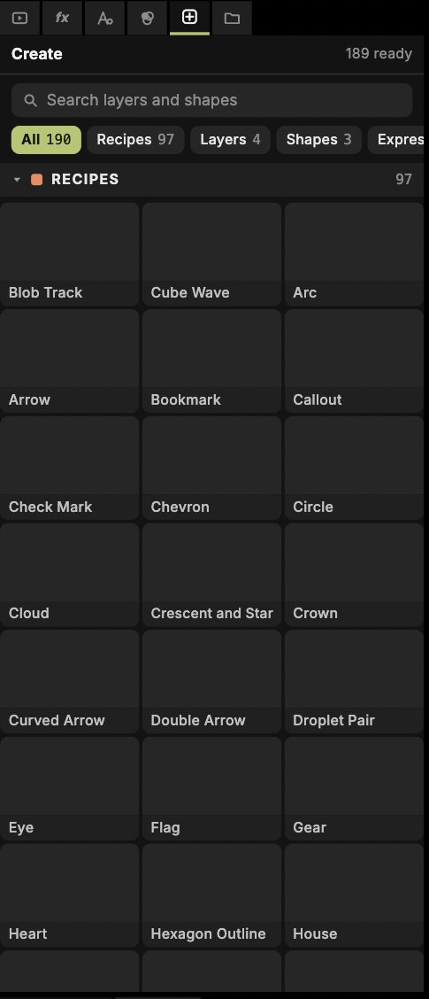

Tiles that make something new.

- **Layers:** Text, Camera, Adjustment. **Shapes.** **Solids:** Ring, Gem, Cube, Floor. **Lights:** Sun, Point, Spot.
- **Materials:** Lit, Cloth, Glass, Lacquer, Bubble, …, each previewed on a ball.
- **Recipes:** a layer and its values in one go.
- **Expressions:** an expression tile applied to several selected layers makes a *relation* between them.
- Code you pasted is kept here as a tile.

 

### Looks

Looks saved from a layer: its effects and values together, applied to another layer by a double-click. Gold, Brass, Neon Edges, Long Shadow and others ship with Motolii, and a look you save appears here.

 

---

## The middle

### Stage

The current frame, edited directly.

- **Tools:** Select (V), Move (M), Rectangle (R), Ellipse (E), Pen (P), Text (T), Brush (B), Camera (C). Dragging on empty space draws a lasso selection.
- **Brush** strokes respond to pen pressure, as Brush, Pen, Fill or Eraser.
- Fit / 50% / 100%, Safe areas, Grid, and **Snapshot** (hold to compare with the frame you kept).
- Rulers with guides pulled out of them; snapping to edges and guides.
- The selected layer's motion path, a navigator, and a camera gizmo to orbit, dolly and resize the frame.
- An options strip under the picture: fill, stroke, corner radius, font and position of the selected layer.

### Camera View

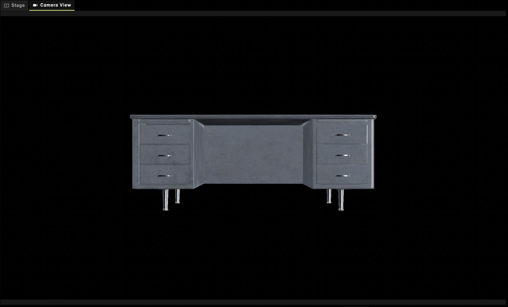

What the active camera sees, without the editing marks: look at the 3D scene through the lens while you edit on the Stage.

---

## The bottom

### Timeline

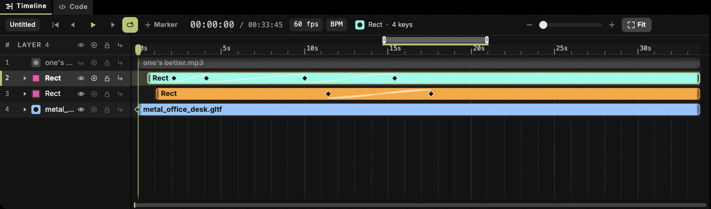

- Layers as bars: move, trim, reorder; hide, solo and lock.
- Keyframes, and the easing curve between them, drawn on the bar. Video frames and audio waveforms in the rows.
- **BPM** with **Tap** tempo: tap along with the music; the beat grid appears on the ruler and edits snap to beats.
- Snapping to layer ends, keyframes, markers, the playhead and the work area.
- Markers you drag and rename in place.
- **Slip edit** on trimmed video: the unused part of the source shows as a pale bar.
- A line under the ruler shows which frames are cached; an overview strip shows the whole length.

### Code

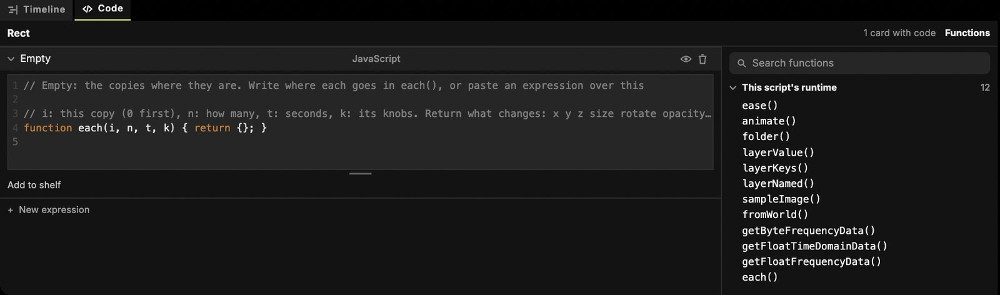

The selected layer's code, laid out like a notebook: one cell for each card that has code, in the order the cards act on the picture.

- A cell and its card in the Inspector are the same code. Type in the cell and the card's sliders move, and the picture follows. "Edit code" on a card opens its cell.
- Under an After Effects expression, a line shows what it gives at the playhead, or the error and its line ("Error at line 3: ReferenceError: amp is not defined").
- Names are completed as you type, as in VS Code, each with what it does. Beside the cells, the **Functions** list shows every name the code may use, grouped as After Effects groups them (Layer, Property, Comp, …). The reference is After Effects' own, read from type declarations, and the engine is asked which names really run here; a name that does not run yet is marked. Press a name to write it at the cursor.
- A cell is a card: drag its head to move the effect up or down the stack, switch it off with the eye, remove it, fold it, drag its bottom edge to make it taller. Press its name twice to rename it; the name is kept in the code's first line.
- **+ New expression** starts an empty one, and **Add to shelf** keeps the code as a tile you can use again.
- Whatever the code is written in (AE expression, Cavalry, JavaScript, ISF, WGSL, …), the cell says so in its head.

### Ease

The easing between two keyframes.

- A graph with bezier handles you drag; exact numbers when you need them.
- **Stacked easings:** each card works on the result of the one above.
- Preset shapes you drag onto the graph, and a shelf of saved easings that slides out.
- Hover a preset to see it played before you pick it.
- Copy a curve, step to the previous or next span, drag a span's end values on the side bars.
- An ease preset is a one-line formula file (`a + (b - a) * bezier(u, …)`) in the `ease/` folder.

 

---

## The right

### Inspector

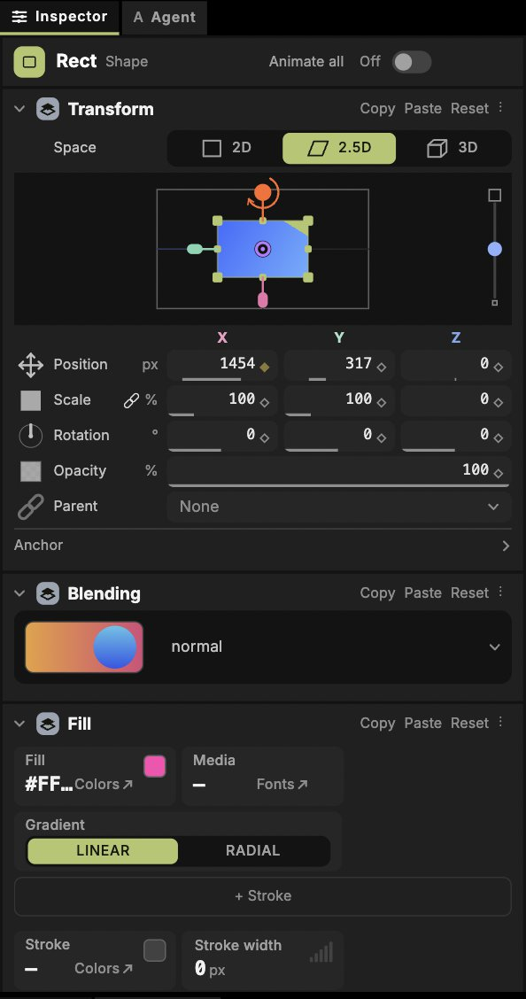

Every value of the selected layer, in cards. Transform, Text, Fill, Blending, Paths, Media, Play, Time Remap, Camera, Light, the 3D material cards (Shine, Surface, Glass, Lacquer, Bubble, Bevel, …), a card per effect, Script, Relation and Falloff: the engine declares them all, and one piece of the app, the values card, draws every one the same way. No card is drawn by hand, so a new effect or a new kind of layer gets its card without a line of UI code.

 

#### Values as blocks, not rows

A property row (a name on the left, a slider on the right) wastes the panel: make the panel wider and the rows only get longer and emptier. So a value is a **block**: its name on top, the number large under it, a small picture of the value in the corner (a dial for an angle, a gauge for an amount, a pad for a point). Blocks fill the width like tiles: three across in a normal panel, more as you widen it, so an effect with thirty values stays a short card. A value that needs room (a point, a size, a choice) takes two columns. Every block still takes typing and sideways scrubbing.

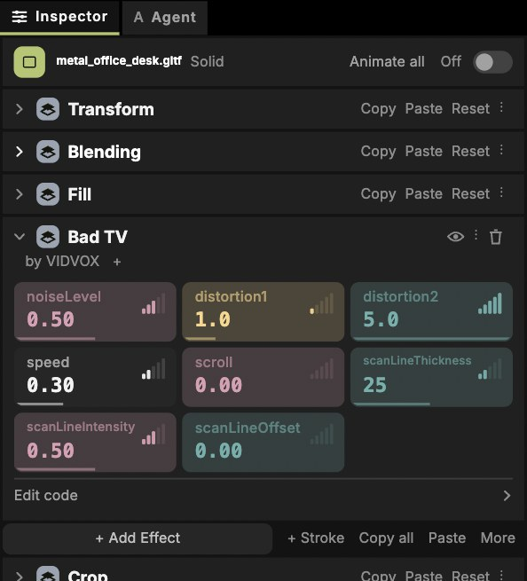
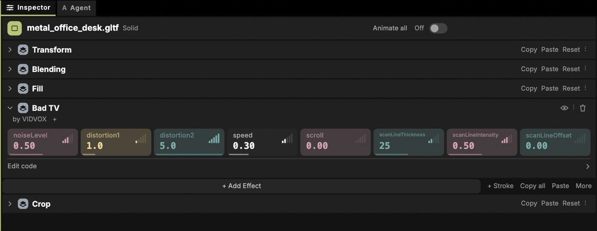

#### Colour on the values that matter

Eight values in a row do not say which one matters. Every effect that ships with Motolii (about 1,280 of them) was reviewed value by value: how much does moving this one alone change the picture, from 0 to 10. The Inspector shows the answer as colour. The values that change the picture most are tinted 浅黄 (*usuki*, pale yellow), the next 撫子 (*nadeshiko*, pink), then 青磁 (*seiji*, celadon); the ones that barely show stay grey. The same review picks what an effect's tile moves on the shelf.

#### More on every card

- **Transform** with a small canvas you drag, and an anchor box of 27 points. **Text** styles a range of letters. **Fill** has the stroke folded in. **Blending** shows a preview.
- Every card shows its author and licence (here, *by VIDVOX*), and tags you can edit.
- A keyframe mark beside every value; Copy / Paste / Reset on every card.
- The relations a layer belongs to are listed at the top.

### Agent

Pick a layer and say what you want. The agent writes the layer's effects and expressions; the picture changes when it saves.

- The list is the ACP (Agent Client Protocol) registry, the same one Zed and JetBrains read: Claude Agent, Codex, Gemini CLI, Cursor, Cline, Google Antigravity and many more, all equal. Search it like a shelf and pick one; it starts through `npx`, `uvx` or its own binary. A copy of the list is kept, so it opens offline. Signing in uses the ways the agent itself offers.
- A request carries every card of the Inspector with its values now, the code of each card, the stretch between keyframes you picked in the Timeline, and the After Effects expression reference with the names that run here. Files go as links, the way Zed sends a file mentioned with `@`.
- Before a request, each code file is made the layer's own copy, so the agent never touches the shelf's original. Something new goes in a fresh folder and arrives on the layer as a **new card**; code already there changes only when you ask for it.
- Each tool call is a row with its state, the files it touched and the lines it took out and put in. When the agent asks for leave to do something, its own choices appear as buttons.
- Model, effort and mode are whatever the agent declares, in one button; Motolii keeps no list of models. A ring shows how much of the context is in use, and the menu gives the usage limits (5-hour, 7-day) the agent reports.
- Replies are laid out as Markdown, and the conversation stays when you move the tab. The magpie is Motolii's mascot, and the agent's face.

 

### Depth

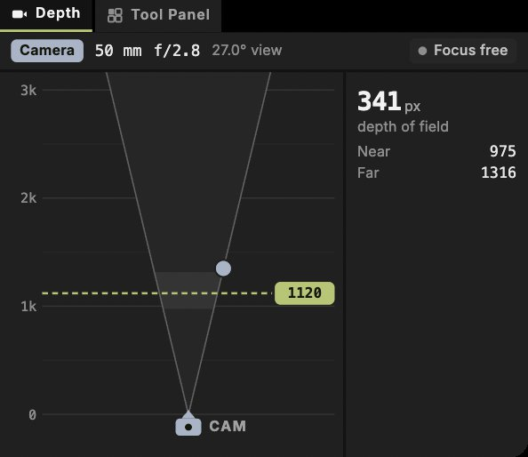

The camera's lens from above, with each layer as a slab at its depth.

- Drag the focus line or the depth-of-field band; click a slab to focus on it.
- Drag sideways to change the focal length.
- Focal length, aperture, depth of field, near and far at a glance.

 

### Tool Panel

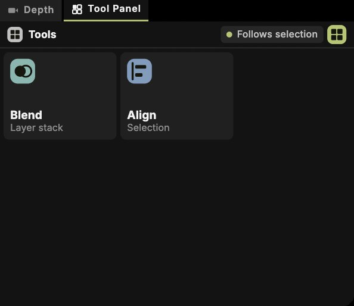

A shelf of tools. A tool you open stays pinned in the panel. A panel of your own can be added here in a few lines of Dart (see [`app/lib/workspace/README.md`](../app/lib/workspace/README.md)).

 

#### Blend

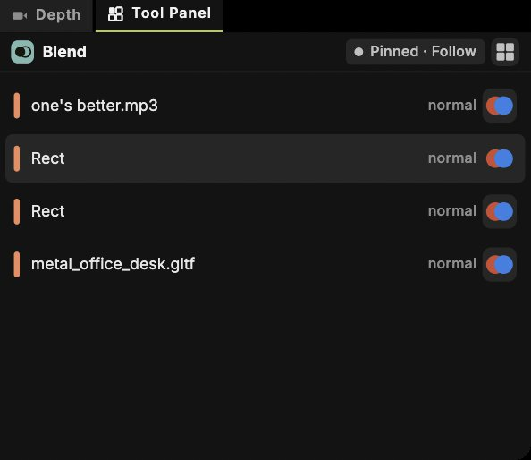

The layer stack with each layer's blend mode, drawn as overlapping discs. Open a row for every mode and the layer's Blending card.

 

#### Align

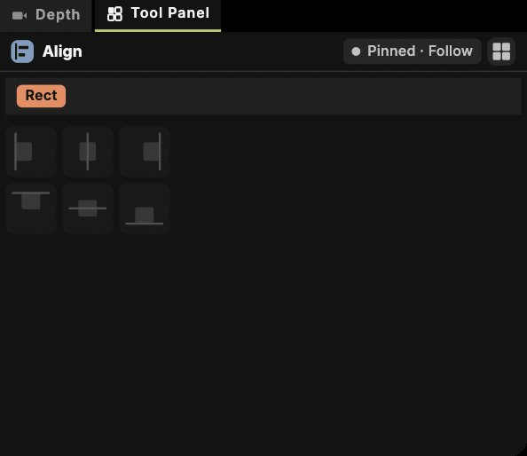

Align the selected layers to the canvas edges and centres, by what is visible of them.

 

---

## Around the tabs

### Top bar

- The Motolii mark opens Home. Undo and Redo name the step they undo.
- The size chip: drag or type the frame size, or pick a common shape or resolution.
- **Standard / Code** workspaces (below).
- Window zoom, light or dark, a CPU and GPU meter, a dot for slow frames and engine errors, and when the project was last saved.
- **Render:** MP4 (H.264), HEVC `.mov`, GIF, PNG sequence or JPEG sequence; resolution, rate, quality, motion blur and background; the free disk space is shown.

### Workspaces

Two arrangements of the same tabs, switched in the top bar. Each keeps what you made of it.

- **Standard:** shelves on the left, Stage over Timeline, Ease beside the Timeline, Inspector and Depth on the right.
- **Code:** the window rearranged for writing code. The Code tab takes the middle, the Stage sits beside it, and the Timeline runs underneath, so the line you write, the picture it makes and the playhead are all in sight at once. Inspector and Agent share the left column with the shelves: ask the agent, read its change in the cell, see it on the Stage, without switching tabs. Ease, Depth and Tool Panel wait at the bottom right. The first time you open it, Agent and Ease come to the front.

  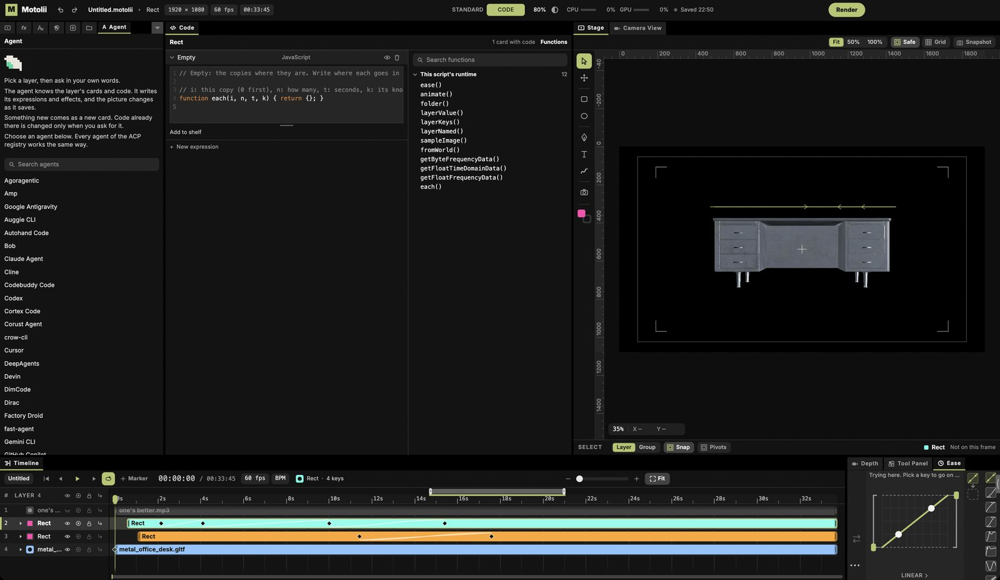

  The arrangement is not written in code: it is the file [`shelves/workspaces/code.layout`](../shelves/workspaces/code.layout), made by dragging the tabs in the window. Rearrange it as you like; Motolii remembers each workspace as you left it.

### Home

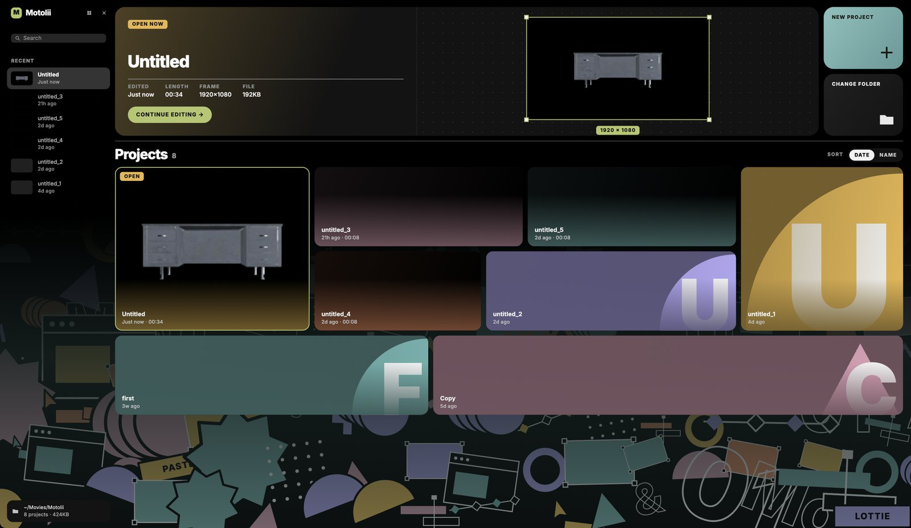

- **Continue editing** the last project, shown large.
- Every project as a card, sorted by date or name; search and a recent list on the side.
- Open, Duplicate, Export or move a project to the Trash from its card; select several to export them together.
- **New Project**, and **Change folder** for where projects are kept (`~/Movies/Motolii` at first).
