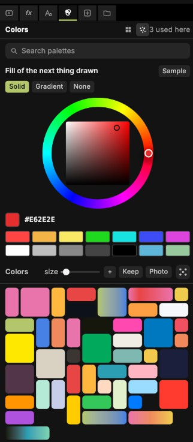
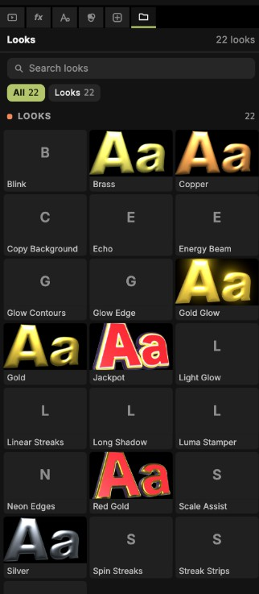
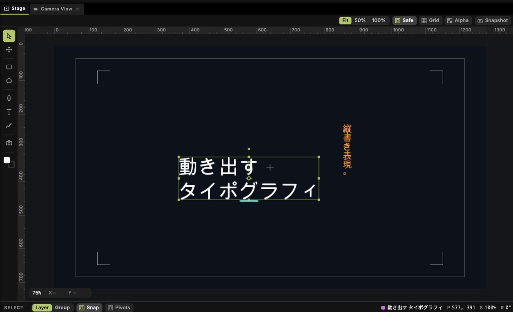
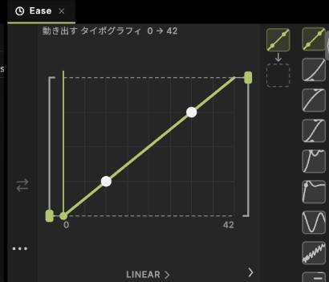
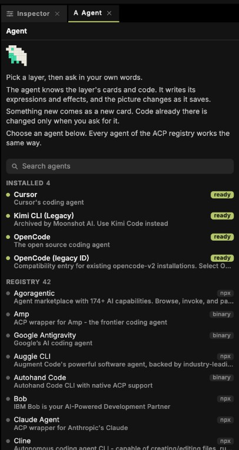

# Tabs & Panels

[日本語](TABS.ja.md)

A visual guide to every tab and panel in Motolii. Screenshots are language-neutral and shared across docs.

| Area | Tabs |
|---|---|
| Left (Shelves) | [Media](#media) · [Effects](#effects) · [Fonts](#fonts) · [Colors](#colors) · [Create](#create) · [Looks](#looks) |
| Center | [Stage](#stage) · [Camera View](#camera-view) |
| Bottom | [Timeline](#timeline) · [Code](#code) · [Ease](#ease) |
| Right | [Inspector](#inspector) · [Agent](#agent) · [Depth](#depth) · [Tool Panel](#tool-panel) ([Blend](#blend), [Align](#align)) |
| Chrome | [Top bar](#top-bar) · [Workspaces](#workspaces) · [Home](#home) |

Any tab can be dragged to dock elsewhere or alongside another tab. Every shelf shares the same structure: search bar, filter chips, and an action footer for the selected item. Hovering a tile plays its animated preview; when a search has no exact match, the five closest matches are suggested.

---

## Shelves

### Media

File browser for both your project directory and the rest of the filesystem.

- Folder tree beside or above the file list, thumbnail or list views, and breadcrumbs.
- Footer actions: **Place**, **Replace**, or **Fill shape**. Multi-selected files are placed in order.
- Filter chips by asset type: folders, 3D models, audio, fonts, etc.
- Imports XDTS exposure sheets (CLIP STUDIO PAINT, OpenToonz) and places each drawing cel level on its own layer.

 

### Effects

Every effect supported by the engine: 1,300+ bundled effects, plus any `.fs` / `.wgsl` shader placed in `effects/` or native After Effects plugin (`.plugin` / `.aex`) placed or symlinked in `ae_plugins/` — detected automatically without restarting.

- **Hover preview:** Hovering a whole-picture effect previews it live on the Stage before applying.
- **Places:** All, Recent, Favorites, In This Video, Mine, custom decks, and effect packs.
- **Decks:** Drag tiles onto a deck to organize collections; decks display a 2×2 cover and can be shared as pasteable deck codes.
- **Tag filters:** Filter by `#time`, `#generator`, `#multipass`, `#feedback`, `#sound`, `#ae`, `#cpu`, `#gpu`, and custom tags.
- **Requirement badges:** Indicates when an effect requires audio, video, a second layer, or an unsupported feature.
- Double-click a tile or drag it onto the Stage to apply.

 

#### Visual Map

Switch the Effects shelf from Grid to **Map** to browse effects arranged by visual similarity. Each preview thumbnail is embedded as a vector (using CLIP if installed, or color features otherwise) and laid out via t-SNE.

### Fonts

Browse installed fonts rendered in their own typefaces.

- **Title** and **Body** theme fonts at the top: click a role to apply it to the selected text layer, or click **+** to create a new text layer in that font.
- Clicking any font applies it to the selected text layer, or creates a new text layer if none is selected.
- Filter chips for Used, Recent, Starred, styles, and scripts (`sans`, `serif`, `bold`, `greek`, `arabic`, `japanese`, etc.).
- Badge indicator for fonts without Latin glyphs.
- Grid, List, and **Map** views (the map clusters similar typefaces using FontCLIP when available, or rendered glyph features otherwise).

 

### Colors

Color picker, palettes, and gradients for the selected layer's fill and stroke.

- Hue ring with saturation/brightness square and hex input.
- **Sample:** Native macOS eyedropper to pick colors from anywhere on screen.
- **Photo:** Extract a color palette from the image selected in Media.
- View palettes as a grid or a regeneratable **Bento** layout.
- Solid, Gradient (with color stops and interpolation modes), or None.
- On text layers, applies colors to the selected character range only.

 

### Create

Creation tiles for adding layers, presets, and code snippets.

- **Layers:** Text, Camera, Adjustment. **Shapes.** **3D Solids:** Ring, Gem, Cube, Floor. **Lights:** Sun, Point, Spot, and **Environment** (timeline-animated HDR room lighting, rotation, and skybox).
- **Materials:** Lit, Cloth, Glass, Lacquer, Bubble, etc., previewed on spheres.
- **Recipes:** Multi-layer templates created with preconfigured values in one click.
- **Expressions:** Applying an expression tile to multiple selected layers creates a **relation** between them.
- Pasted code snippets are saved here as reusable tiles.

 

### Looks

Reusable presets combining a layer's effects and parameter values. Double-click to apply to another layer. Ships with built-in looks (Gold, Brass, Neon Edges, Long Shadow, etc.) alongside your saved looks.

 

---

## Center

### Stage

Direct viewport manipulation for the current frame.

- **Tools:** Select (`V`), Move (`M`), Rectangle (`R`), Ellipse (`E`), Pen (`P`), Text (`T`), Brush (`B`), Camera (`C`). Dragging empty space starts a marquee selection.
- **Brush** supports pen pressure with Brush, Pen, Fill, and Eraser modes, plus adjustable stroke smoothing (`Smooth: Off / Low / Med / High`).
- Fit / 50% / 100% zoom, Safe Areas, Grid, **Alpha** (live checkerboard transparency preview), and **Snapshot** (hold to compare against a saved reference frame).
- Rulers with draggable guides and edge/guide snapping.
- Motion paths for the selected layer, mini navigator, and 3D camera gizmo (orbit, dolly, frame resize).
- Context options strip beneath the canvas for fill, stroke, corner radius, font, and position.

### Camera View

Clean preview through the active camera with no gizmos or selection overlays, letting you inspect the final framing while editing on the Stage.

---

## Bottom

### Timeline

- Layer bars supporting move, trim, reorder, hide, solo, and lock.
- Inline keyframe diamonds, easing curves, video filmstrips, and audio waveforms.
- **BPM** and **Tap** tempo: tap along with music to generate a beat grid with snap-to-beat editing.
- Snaps to layer edges, keyframes, markers, playhead, and work area bounds.
- Draggable markers with inline renaming.
- **Slip editing** on trimmed clips, showing unused source media as a dimmed bar.
- Frame cache indicator beneath the ruler and a full-timeline overview bar.

### Code

Notebook-style code editor for the selected layer: one cell per code-backed card, ordered top-to-bottom in execution order.

- Cells stay in sync with Inspector cards — editing code updates sliders and the Stage immediately. Click **Edit code** on any Inspector card to jump to its cell.
- After Effects expressions display the live evaluated value at the playhead, or an inline error with line number (e.g. `Error at line 3: ReferenceError: amp is not defined`).
- VS Code-style autocompletion with inline docs, plus a **Functions** sidebar grouped like After Effects (`Layer`, `Property`, `Comp`, etc.). Unsupported symbols are flagged dynamically by querying the engine; click any symbol to insert it at the cursor.
- Each cell behaves like a stackable card: drag headers to reorder, toggle visibility with the eye icon, delete, collapse, resize vertically, or double-click the title to rename.
- **+ New expression** creates a blank cell; **Add to shelf** saves the snippet for reuse.
- Cell headers indicate the source language (AE Expression, Cavalry, JavaScript, ISF, WGSL, etc.).

### Ease

Easing curve editor for spans between keyframes.

- Interactive cubic Bézier graph with optional numeric entry.
- **Stackable easings:** stack multiple easing cards sequentially on the same span.
- Draggable curve presets and a slide-out shelf of saved easings.
- Hovering any preset plays its motion live before you apply it.
- Copy curves, step between adjacent keyframe spans, and drag span endpoint values directly on the side bars.
- Each preset is a single-line formula file (`a + (b - a) * bezier(u, …)`) in `ease/`.

 

---

## Right

### Inspector

All properties of the selected layer organized into collapsible cards (`Transform`, `Text`, `Fill`, `Blending`, `Paths`, `Media`, `Play`, `Time Remap`, `Camera`, `Light`, 3D material cards, effect cards, `Script`, `Relation`, and `Falloff`). Every card is generated dynamically from engine declarations using a single unified card widget, so new effects and layer types appear automatically without custom UI code.

 

#### Block layout instead of rows

Traditional label-and-slider rows waste horizontal space as you widen the panel. Motolii displays each parameter as a compact **block**: label on top, large numeric readout below, and a visual indicator in the corner (dial for angles, gauge for scalars, 2D pad for points). Blocks flow into a multi-column grid (3 columns at default width, expanding automatically when widened), keeping even 30-parameter effects compact. Multi-value controls (points, sizes, dropdowns) span two columns. Every block supports direct typing and horizontal scrubbing.

#### Impact-based parameter highlighting

When an effect exposes many parameters, it is hard to tell which ones actually drive the look. Roughly 1,280 bundled effects were evaluated parameter-by-parameter for visual impact (0–10). The Inspector highlights high-impact controls using traditional Japanese tints — *usuki* (pale yellow), *nadeshiko* (pink), and *seiji* (celadon) — while low-impact controls remain neutral grey. The same scores determine which parameters animate in shelf preview tiles.

#### Card features

- **Transform** includes a draggable mini-canvas and a 27-point anchor grid; **Text** styles character ranges; **Fill** integrates stroke controls; **Blending** includes a live preview.
- Displays author attribution (e.g. *by VIDVOX*) and editable tags.
- Per-parameter keyframe toggles and per-card Copy / Paste / Reset actions.
- Active layer relations are listed at the top.

### Agent

Select a layer and describe the look or motion you want — an AI agent writes or edits effects and expressions, updating the Stage as soon as files are saved.

- Uses the [ACP (Agent Client Protocol)](https://github.com/anthropics/agent-client-protocol) registry shared with Zed and JetBrains, supporting Claude Agent, Codex, Gemini CLI, Cursor, Cline, Google Antigravity, and more via `npx`, `uvx`, or local binaries. The registry is cached locally for offline access, and authentication uses each agent's own login flow.
- Each prompt automatically includes all Inspector cards and current values, card source code, the selected Timeline keyframe span, and the live After Effects expression reference. Referenced files attach as `@`-style links.
- Before sending a request, shelf code is cloned into a layer-local copy so shelf originals are never modified. Newly created effects appear as **new cards**, while existing code is edited only when requested.
- Tool calls appear inline with status, touched files, diff line counts, and interactive permission prompts.
- Model, reasoning effort, and mode selectors are populated dynamically from the connected agent, alongside a context usage ring and 5-hour / 7-day usage limit readout.
- Responses render as Markdown and persist across tab switches. The magpie icon is Motolii's mascot.

 

### Depth

Top-down view of the camera frustum with each layer rendered as a slab at its Z depth.

- Drag the focus plane or depth-of-field band, or click any layer slab to focus directly on it.
- Drag horizontally to adjust focal length.
- Displays focal length, aperture, depth of field, and near/far limits at a glance.

 

### Tool Panel

Dockable launcher for built-in panels, utility tools, and **Vism custom panels**. Click **`+ New Vism`** to scaffold and open a JS-authored panel in seconds, **`Import`** to install `.vism` packages, or **`Folder`** to open the panels directory (see [Vism Specification](CUSTOM_CARDS.md)).

 

#### Blend

Visual overview of the layer stack's blend modes represented as overlapping circles. Expand any row to switch blend modes or open that layer's Blending controls.

 

#### Align

Align selected layers to canvas edges or centers based on their visible bounds.

 

---

## Chrome

### Top bar

- Motolii logo returns to Home; Undo / Redo buttons display the name of the action.
- Composition size chip: scrub, type dimensions, or choose standard aspect ratios and resolutions.
- **Standard / Code** workspace switcher (see below).
- Window zoom, light/dark theme toggle, CPU/GPU meter, slow-frame / engine-error indicator, and last-saved timestamp.
- **Render:** Export MP4 (H.264), HEVC `.mov`, GIF, PNG sequence, or JPEG sequence with resolution, frame rate, quality, motion blur, background options, and available disk space display.

### Workspaces

Two preset arrangements of the same tabs, switchable from the top bar. Any manual layout tweaks are remembered per workspace.

- **Standard:** Shelves on the left, Stage above Timeline, Ease beside Timeline, Inspector and Depth on the right.
- **Code:** Layout optimized for coding — Code in the center, Stage on the right, Timeline below, with Inspector and Agent docked alongside the shelves on the left so you can prompt, edit code, and watch the Stage simultaneously. Ease, Depth, and Tool Panel sit at the bottom right.

  

  Layout presets are stored as data files ([`shelves/workspaces/code.layout`](../shelves/workspaces/code.layout)) rather than hardcoded UI.

### Home

- Prominent **Continue editing** card for your most recent project.
- Project grid sorted by date or name, with search and recent filters.
- Per-project Open, Duplicate, Export, and Move to Trash actions, plus multi-select batch export.
- **New Project** and **Change folder** to switch the projects directory (default: `~/Movies/Motolii`).
