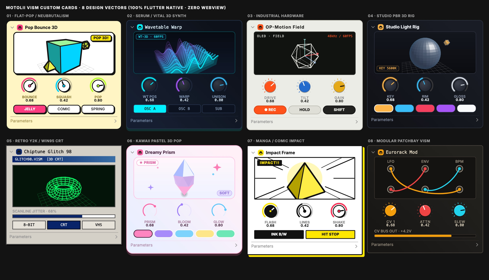
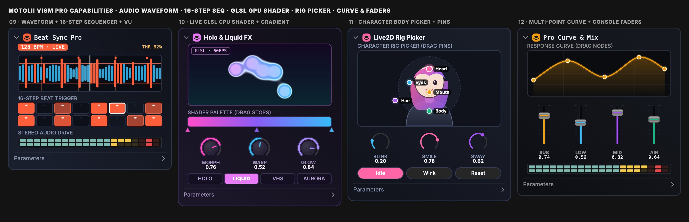

# Vism（ヴィズム）開発クイックスタート

**Vism** は、Motolii 用のカスタムパネル／カスタムインスペクターカードの独自規格です。  
HTML や WebView を一切使わず、**1 本の JavaScript（＋任意のアセット `.glb` / `.png`）**だけで、フラットポップ・3D オブジェクト・音声波形・16 ステップシーケンサー・GPU シェーダーを備えた独自デザインの道具を作って配布できます。

---

## 1. 10 秒で最初の Vism を動かす

1. Motolii を開き、**Tools** パネルを開く
2. 右上の **`+ New Vism`** をクリック
   - `~/Library/Application Support/Motolii/panels/My Vism.js` が自動生成され、**独立したドッキングタブとして即オープン**します
   - 同時に `jsconfig.json`・`motolii-ui.d.ts`・`motolii-host.d.ts` も自動配置され、外部エディタ（Cursor / VS Code / Zed）が開きます
3. エディタで色や 3D 形状（`cube` → `crystal` / `wavetable` 等）を書き換えて **保存（Cmd+S）**
   - 再起動不要、**約 80ms で即ホットリロード**されます

> タブ化したパネル下部の **`Edit`** からいつでもエディタを開き直せます。Tools パネルのタイルは、デフォルトタブもカスタム Vism もすべて平等にドラッグ＆ドロップで好きな位置へドッキングできます。

---

## 2. 2 つの作り方（パネル型 vs カード型）

| タイプ | 置き場所 | 用途 | 画面の出方 |
|---|---|---|---|
| **Vism パネル** | `panels/<名前>.js` | 複数レイヤー操作・リグ・シーケンサー・独立シンセ筐体 | **Tools** パネル（クリックまたは D&D でドッキングタブ化） |
| **Vism カード** | `effects/` または `expressions/` の `<名前>.ui.js` | 1 エフェクト／1 エクスプレッションの専用 UI | **Effects** / **Create** 棚（`VISM` バッジ・`#vism` タグ）から適用するとインスペクターのカードが Vism 化 |

---

## 3. 使える主要 UI プリミティブ（抜粋）

- **外装＆レイアウト**: `surface`（カード全体のフェイスプレート）、`ui.box`（背景グラデ・太枠・ハード／ソフト影）、`ui.stack`（バッジや SVG の重ね配置）、`ui.image`（相対パス PNG/WebP）
- **3D ＆ GPU ビジュアライザ**:
  - `ui.scene3d(height, { shape, model, look, yaw, pitch, ... })` — プリミティブ・3D ウェーブテーブル・同じフォルダの **`.glb` / `.obj`** 読み込み対応（`look`: `"studio"` / `"toon"` / `"wireframe"` / `"holo"` / `"clay"`）
  - `ui.shader(height, preset, { time, paramA, paramB, color, ... })` — Flutter ネイティブ GLSL（`holo` / `metaball` / `vhs` / `scope` / `aurora` / `grid`）
- **共通ホスト API**: エクスプレッションと同じ `layer()`・`stage`（`stage.fps` / `stage.beat` / `stage.layers`）・`audio`（`audio.bass` / `audio.rms`）が Vism パネル・カード内でもそのまま使えます（[expression_host_api.md](design/expression_host_api.md)）。
- **音声＆リズム**: `ctx.audio`（24 バンド FFT）・`ctx.waveform`（波形ピーク）・`ctx.strikes`（ビート打点）・`ctx.bpm` ＋ `ui.waveform` / `ui.sequencer` / `ui.vu`
- **触覚操作子**: `ui.knob`（`arc` / `pop` / `hardware` / `minimal`）、`ui.fader`、`ui.curve`、`ui.gradient`、`ui.picker`（キャラリグ用ボディピッカー）

詳細な API 仕様は [`CUSTOM_CARDS.ja.md`](CUSTOM_CARDS.ja.md) と [`shelves/motolii-ui.d.ts`](../shelves/motolii-ui.d.ts)、動作サンプルは [`shelves/panels/Vism Showcase.js`](../shelves/panels/Vism%20Showcase.js) を参照してください。

---

## 4. 配布・シェアする（`.vism` / 1 フォルダ D&D）

- **Motolii から書き出す**: パネルの **`Pack`** ボタンを押すと、本体＋同梱アセット（`.ui.js`, `.glb`, `.obj`, `.png`, `.frag` 等）をまとめた **`.vism`** ファイルを出力できます。
- **受け取った人の導入**: `.vism` ファイル（または `fx.js` + `fx.ui.js` + `.glb` / `.png` を入れた 1 フォルダ）を **Motolii のウィンドウへドラッグ＆ドロップするだけ**で自動インストールされ、その場で即オープン／適用されます。
- **統一 UI に戻したいユーザー向け**: `Settings → Appearance → Vism Card Faceplates` をオフにすると、機能を保ったまま Motolii 標準スキンへ揃えられます。
