# グループの仕様

経緯と、いつ誰が決めたかは、このファイルの git log にある。ここは仕様だけ。

<!-- いまの考え：ここから（.claude/hooks/concept.sh が、依頼のたびにこの間をそのまま出す。短く保つ） -->
## いまの考え（11/8、ユーザーの設計書と図 A〜D）

- グループタイムラインビューは、横が時間・縦が値のグラフ。個体の曲線を重ねる。両方のズレが 0 なら 1 本＝ふつうのアニメーション。数が多ければ束や密度で見せる（表示の手段で、配列のデータは置き換えない）。
- 配列の違いは 2 つだけ。値のズレ（縦に広がる）と時間のズレ（横に広がる）。独立していて、0 に戻せる。4 つのモードは作らない。
- 操作：区間を選ぶ → 3 つの箱（区間イージング／値のズレ／時間のズレ）→ いつもの Ease 机。値と時間のズレはグループの中だけに出る。
- ズレの量はキーに持たせる（11/8 決定）。キーは値と、値のズレの量・時間のズレの量を持つ。キー A で 0、キー B で 30 なら、あいだで束が少しずつ開く。3 つの箱はどれも「A から B へどう変わるか」を、いつもの Ease で曲げる。量はグラフの上でつまんで引く。新しい行は作らない。出典：After Effects のテキストアニメーター（量の Amount はキーで動かし、配り方は Shape で別に決める）。
- 配り方（誰を上・誰を下、誰が先・誰が後）は仮置き（11/8）：順番に等間隔。値のズレは白い線が真ん中（図 C）。時間のズレは先頭が白い線（キーの時に出発）で、あとの子は順に遅れる（11/8 ユーザー OK：真ん中だと、キーより先に動く子が出て「順番に登場」が作れない。出典：GSAP の stagger は先頭から、Ableton の Strum Low は一番下の音から）。あとで差し替えられる形にしておく。これ以外の配り方は勝手に足さない。
- Ease もほかの部品も借りるだけ。作り直さない。子の本物の値は書き換えない。
- 要らない物：Ease の上の切り替え、帯・扇・▸・専用の取っ手、Order、行全体へのズレ。下の「配る行の操作」「エンジンの式」は 11/8 より前の形。
- 図：https://www.tldraw.com/f/g-6ANHHLUspq7Oy10Pt_h
<!-- いまの考え：ここまで -->

## 土台

作るのはここだけ。下の「後で」は、土台ができるまで作らない。

出典はユーザーの言葉。時刻だけの物は 11/6 夜、「11/7 05:31」などは 11/7 早朝で、どちらも
`git show c61aef917:docs/notes/GROUP_FOCUS_new.md`（ユーザーの言葉と時刻だけの版）にある。
「11/7 午後」の物は、ユーザーの言葉をそのまま引いた。

### グループは何か

- グループは配列。中の子を行に並べない（11/6 18:30、20:33）。
- グループレイヤーはほかのレイヤーと同じ。仕組みをまるまる使う。違うのは「全体」と「配る」の「配る」だけ。
  「グループレイヤーはほかのレイヤーと一緒なんだから 2 はないよ、勝手に壁を作るのはダメですよ」
  「仕組みをまるまる使うんだ、違うところは？『全体』『配る』の『配る』だけなんだよ」（11/7 午後）
- グループのインスペクターは、ふつうのインスペクターと同じ見た目。
  「グループのインスペクターは普通のインスペクターと変わらない見た目にしておいた方がいい」（11/7 午後）

### インスペクターと TL ビューの分担（11/8 朝）

- **インスペクターは「何が・いくつ・どこに」、TL ビューは「いつ・どの順で」。** TL ビューには時間しか無い。
- Count はインスペクター。⌘G した瞬間に Copies のカードが出て、Count は子の数から始まる（「私は『インスペクター』とおもう、グループにした時点でインスペクターに追加される」11/8 06:27）。
  TL ビューの Count 行（2def96367）は外した。
- 割合も同じカードに出る：子の一覧と ×数（「割合も表示される」同）。子の値 `ratio`。配りは重み付きで、赤 ×7・青 ×2・黄 ×1 なら 7:2:1（下の「要素だけ入れて、3000 個に増やす」）。
- カードの形（11/8 07:26、画面に描いた絵）：写しの列の絵は出さない。1 段目は How many（複製の合計）。その下に子の縦のリスト、1 行に小さなサムネイル（タイムラインの行の頭の絵と同じ）・名前・右端に ×数。格子に並べない。
- 並べ方（Gap・Per row・Turn…）は別の札「Arrange」。頼まれるまで出ない：値を打つか、More で呼ぶ（Wave・Scatter と同じ決まり。「ユーザが任意的に出さないと出ない方がいい」11/8 07:58）。
  一度「Count が子の数を超えたら出る」にしたが、頼んでいない物が出るので外した。並べ方はインスペクターの物（「どこに」）で、時間で動かしたい時だけ TL ビューに落として行にする（土台 ①）。
  グループのインスペクターに「レイヤーとしての自分（Transform）」と「配列（Copies・Arrange）」の 2 つがあるのは、Figma のオートレイアウト（フレーム自身と中身の並べ方が同じパネル）と同じ。
  散らし（scatter）は配置の一語で時間を持たない。
  ずらし（stagger）は時間の一語で場所を持たない。Alight の Scatter Repeat はこの 2 つを 1 枚に混ぜていた（「私はおそらく scatter や stagger を混合していたんだ」11/8 06:12）。
- Count が子の数を超えた分の置き場（既定の並び）は未設計。今は要素の上に重なる。

### グループタイムラインビュー

- 上から下りてくる。Ableton Live のクリップビュー（11/6 20:54〜56、22:41）。
- 高さはハンドルで決める（22:53）。全体のタイムラインとは色で分かれる（22:55）。
- 数の上限が先に決まっているから、実体の無い物（配列のルール）も行にできる（21:42、21:02、20:53、20:24）。
  「グループタイムラインビューは、普通のタイムラインと違って配列要素の見えないルールも行として出せるはずだよね？だって上限が決まっているんだから」（11/7 午後）
- いちばん上の、グループそのものの行は「全体」。キーを打つと全員いっしょに動く（22:54、11/7 05:34）。
- 行の入口：インスペクターの値をつかんでビューに落とすと、その値の行ができる。行になるのは札ではなく値（21:46、21:47）。
  配る行は y の行（11/7 05:31）。
  「落とすやつじゃないとだめだよ。結局 alight は、トランスフォームの写だから」「インスペクターから持ってこれてる分こっちの方がいい」（11/7 午後）
- 起点はスライダー 1 本：最初から・真ん中から・おしりから（11/7 06:3x、コミット b945aaf22 の本文）。
- ズレは時間の上に見せる（下の ④）。「時間の上の方がいいよねぇ」（11/7 午後）
- 見本（プリセット）は作らない。「プリセットを使ってなかったんだよね、今は必要ない UX」（11/7 午後）

### 配る行の操作

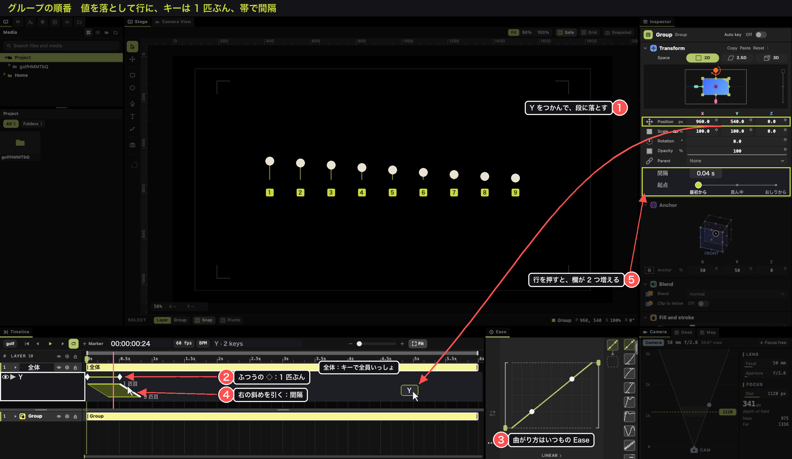

- ① インスペクターの値（例：Position Y）をつかんでビューに落とす → その値の行。
  （21:46・21:47、11/7 午後「落とすやつじゃないとだめだよ」）
- ② 行のキーは、その値の動き 1 匹ぶん。ふつうの ◇。
  （11/7 午後「仕組みをまるまる使うんだ」。1 匹ぶんなのは、下の式で全員が同じキーを読むから）
- ③ キーの間の曲がり方は、いつもの Ease の窓。
  （11/7 午後「仕組みをまるまる使うんだ」）
- ④ キーの下に斜めの帯。上の辺が 1 匹目、下の辺が最後の 1 匹。右の斜めを引くと間隔。
  （Ableton Live 12 の Strum の見え方：マニュアルの MIDI Tools、Strum Position の表示の上で引いて音を順にずらす。
  出典はコミット d974c5726。11/7 午後「時間の上の方がいいよねぇ」）
- ⑤ 行を押すと、インスペクターはふつうの見た目のまま、欄が 2 つ増える：間隔（秒）と、起点のスライダー。
  （11/7 午後「普通のインスペクターと変わらない見た目」、b945aaf22 のスライダー）

### エンジンの式

i 匹目は、同じキーを「間隔 × 順位」だけ前の時刻で読む。

    i 匹目が読むキーの時刻 = t − 間隔 × 順位(i)

順位は起点で決まる。n 匹、i は 0 から、m = (n − 1) / 2：

| 起点 | 順位(i) |
|---|---|
| start（最初から） | i |
| centre（真ん中から） | \|i − m\| |
| end（おしりから） | n − 1 − i |
| edges（両端から） | m − \|i − m\| |
| random | `seed` で振った順の中の、i の位置 |

重みは無い。量の違い（どれがどれだけ動くか）は並び（Copies・Wave・Field・Scatter）の仕事
（GROUP_INSPECTOR.md §7：量と順番を 1 つの図に混ぜて矛盾を踏んだので、分けたまま）。

出典：engine/doc_relations.h `doc_order_delay`（GSAP の stagger の `each` と `from`）。
読む所は engine/doc_place.h 14 行目 `now -= doc_delay(...)`（写しと文字）と、doc_relations.h `doc_above` の
`doc_group_delay`（グループの子）。

## 決まっていない事

- 行を押した時、Position Y の欄に何の数が出るか（グループの値か、行の動きの値か）。
- 起点を行ごとに持つか。スイミーの「先頭から泳ぎ出し、おしりから消える」には行ごとが要る。
  今のエンジンはグループに 1 つ（Order の行の `lag_from`、無ければグループの `stagger_from`：`doc_group_delay`）。
  GROUP_INSPECTOR.md §10 に「値ごとに分けたくなったら `<値>_stagger` に広げる」とある。
- 11/6 夜から残っている物：▸ はキーの物か行の物か（21:12）。近づいたら光る（21:12）のやり方。

## 今のコードとの違い

土台に関わる物：

| 土台 | 今のコード |
|---|---|
| 全体の行に順番は無い | ▸ が Group の行のキーに付いている（timeline_hand.dart `_grab` の `_spreadAt`） |
| 全体の行は全員いっしょ | 遅れ（engine/doc_relations.h `doc_group_delay`）が、グループの動きごと子を遅らせる（`doc_above` がグループの位置を遅れた時刻で読む） |
| ① 値をつかんでビューに落とすと、その値の行 | まだ無い。インスペクターの値をタイムラインに落とす手は無い。行は ▸ を引くと「Order」の行としてできる（timeline_hand.dart `_grab`） |
| ② 行は値の行（Y を落とせば Y の行）で、1 匹ぶんのキーを持つ | Order の行は `lag`・`lag_from`・`seed`・`strength` だけを持ち、値を持たない。`lag` はキーにならない（doc_values.h の Order、doc_paths.h） |
| ③ 曲がり方はいつもの Ease の窓 | Ease の窓はある（desk_ease_*）。配る行にキーが無いので、まだ使えない |
| ④ キーの下の斜めの帯、右の斜めで間隔。子ごとの物は出さない | 帯は無い。echo（timeline.dart `_echoesOf`）が子ごとのキーの時刻を 1 個ずつ菱形で描く。1000 匹で 1000 個。間隔は Group の行の ▸ を引いて Order の `lag` に書く |
| ⑤ 行を押すと、ふつうのインスペクターに間隔（秒）と起点のスライダー | Order の行を押すと Order のカード（`lag` 秒・`lag_from`・`seed`・`strength`）。起点は 5 つの言葉から選ぶ物で、スライダーではない。グループ（null）のインスペクターには遅れの欄が無い（doc_values.h：Relation のカードは null 以外） |
| 重みは無い | Order に `strength`（キーで重み）があるが、遅れ（`doc_group_delay`）は読まない |

後でに関わる物：

| 仕様 | 今のコード |
|---|---|
| 階段、角、順番の図 | まだ無い（カードの絵を引く図は、Transform と Copies にある：inspector_direct_transform_canvas.dart・inspector_copies.dart） |
| 大きさ・回転は 1 匹ずつの中心 | 関係の行は親と同じに読む（doc_related） |
| メンバーはいつも今の子全員 | グループの遅れ（`doc_group_delay`）は今の子を並び順で数える（合っている）。関係の行（`doc_related`）は作った時のメンバーで固定（doc_edit.h の `members`） |
| 行の頭の印（矢印・サイコロ・カメラ・⟳） | まだ無い |
| 階段の 1 段を引く・消す、行ごとの割る | まだ無い |
| 文字のまま段、割るは文字・単語・行 | 割った文字はコピー（`split`）。段は無い |
| グループの割る（子ごと・一番中まで）、要素の ×数 | まだ無い。グループに Copies が付くかは確かめていない |
| 文字の縦書き・ルビ | 文字のカードに無い（Font・Alignment・Line gap・Paragraph だけ） |
| Relation のカードの Delay（`stagger`・`stagger_from`）と、Copies のカードの Turn all・Colours | 写しの動きを Copies が持っている。段の行に移し、Copies には数・並び・間だけ残す（写しは 1 つの物を何度も描くままなので 5000 枚でも軽い） |
| Scatter Repeat は Copies＋Scatter | 散らしは四角（doc_place.h `scatter_x`）。Alight は円（engine/absent_motion.cpp `scatter_repeat` は円で読む） |

合っている物：段が上から下りる、縁で高さ、段の色、名指しの子が段に出る（d5384a68b・2f5a09e36）、舞台の順番の番号（d71481bdf）、
曲に合わせる：動画のバーに音の大きさが出て、拍はルーラーの目盛り（a0e252e96・1397e4da4、Alight の帯の波形）。
使えそうな物：behaviour の file "group" は、自分の y のキーを i 番目ごとに遅らせて読み、各子に足している
（doc_relations.h `doc_related`）。doc_order_delay は start・centre・end・edges・random を持つ。

## 外した物

11/7 午後に外した。この紙にあった元の文は、そのまま下に置く。

- **見本と「＋ 動き」とその一覧**：今は要らない UX（「プリセットを使ってなかったんだよね、今は必要ない UX」11/7 午後）。
  値の行はインスペクターの値を落として作り、キーはインスペクターの ◇ で打つ。「＋ 動き」の一覧は、その 2 つと 2 重になる。
- **段の行を 3 種類に分ける事**（全員の行・順番の行＝配る・名指しの物＝例外）：全体と配るの 2 つで足りる
  （「違うところは？『全体』『配る』の『配る』だけなんだよ」11/7 午後）。例外の文は「後で」に残した。
- **効果の棚から選ぶ入口**：Alight の Range Transform はトランスフォームの写しで、本物の値を持ってこれない
  （「結局 alight は、トランスフォームの写だから」11/7 午後）。入口は値を落とす形（土台の ①）。この紙には書かれていなかった。

元の文：

- 何を解くか：使う人はグループを意識しなくてよい。文字 1 つ、Copies の物 1 つを押して「＋ 動き」の見本を選べば、そのまま段の行ができる（CapCut の文字の見本と同じ 1 手）。⌘G は違う物を混ぜる時だけ。
- 絵：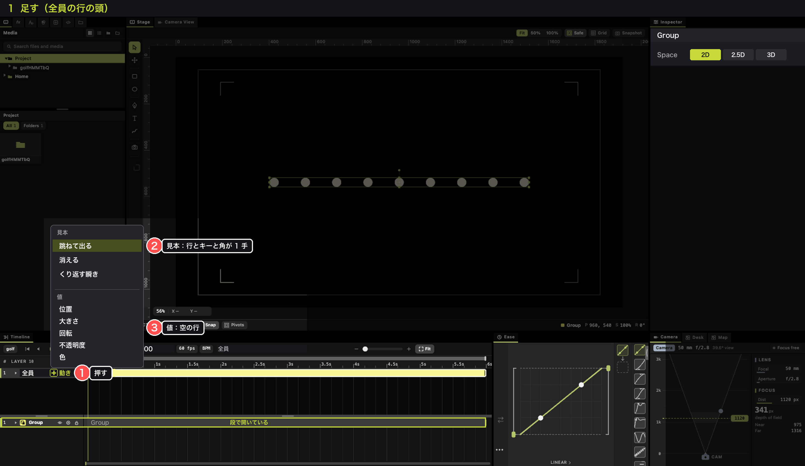
- 中身の多い物：文字や Copies の物を 1 度押した時も、インスペクターの頭に「＋ 動き」。見本を選ぶと段の行ができ、段が下りる。
- 順番の行：見本で作った行は 1 本（CapCut の文字のアニメーションも 1 つの品物）。名前は見本の名前（「跳ねて出る」）。中の値（位置・大きさ…）は ▸ で開く。角は 1 つ。

順番の行の表の 1 行目：

| 触る物 | 何が起きる | 出典 |
|---|---|---|
| 全員の行の頭の「＋ 動き」 | 一覧の上は見本（跳ねて出る・消える・くり返す…）。1 つ選ぶと、行とキーと角が 1 手でできる。出る見本は頭に、消える見本はおしりに付く。下は値（位置・大きさ…）で、選ぶとその値の空の行。段に行が何本あっても、いつもここにある | 見本：CapCut の文字の In・Out・Loop（選ぶだけ）。TextoN の設定の保存と読み込み（同梱の FastBlink）。「＋」：Figma の Fill・Effects の見出しの「＋」 |

段の行の分け方：`## 段の行は 3 種類` の下に `**1. 全員の行（一番上）**`・`**2. 順番の行＝配る**`・`**3. 名指しの物＝例外**`。

## 後で（土台ができるまで作らない）

11/7 の朝までに足した節（多くは疑問の表 GROUP_QUESTIONS.md に答えながら）。文はそのまま移し、見出しだけ 1 段下げた。
土台と同じ事を言う文も残っている。土台と食い違う文の頭には「（土台と食い違う）」と付けた。直していない。

### 何を解くか

300 匹、1000 文字を並べると、タイムラインは 1000 行になる。After Effects はそうなる。TextoN も文字をレイヤーに
分けるから、結局そうなる。

Motolii は、グループを**違う物の配列**として扱う。1 つにまとめない。円も文字も 3D の物も、2.5D の札も 3D の板も、
形・Space・自分のキーを持ったまま並び、行は配列の i 番目ごとに配られる（GSAP がターゲットの配列に関数で値を配るのと同じ）。
子は行に並べない。1000 匹でも行の数は変わらない。

文字の動き（文字アニメーター）も、写しの動き（クローナー・Copies）も、今は文字や写しにくっついている。
その「動き」だけを壊さずに切り離し、グループの行として何にでもかける。TextoN は層に割るので壊してしまう。
文字は文字組だけ、Copies は写しを何枚どう置くかだけを持つ。動きは持たない。

### 絵

本物の窓に操作を描き込んだ物（9 匹の円を ⌘G でまとめ、段を下ろした所から）：

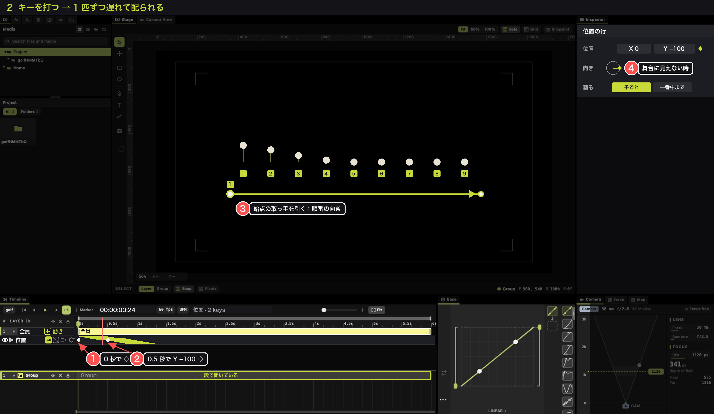
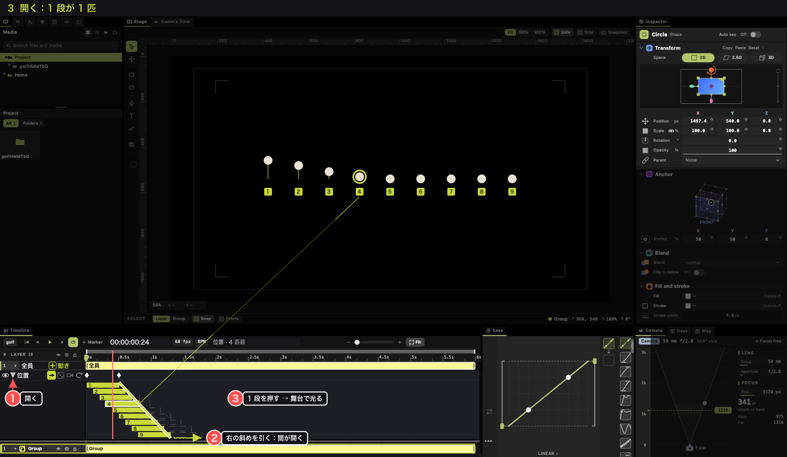
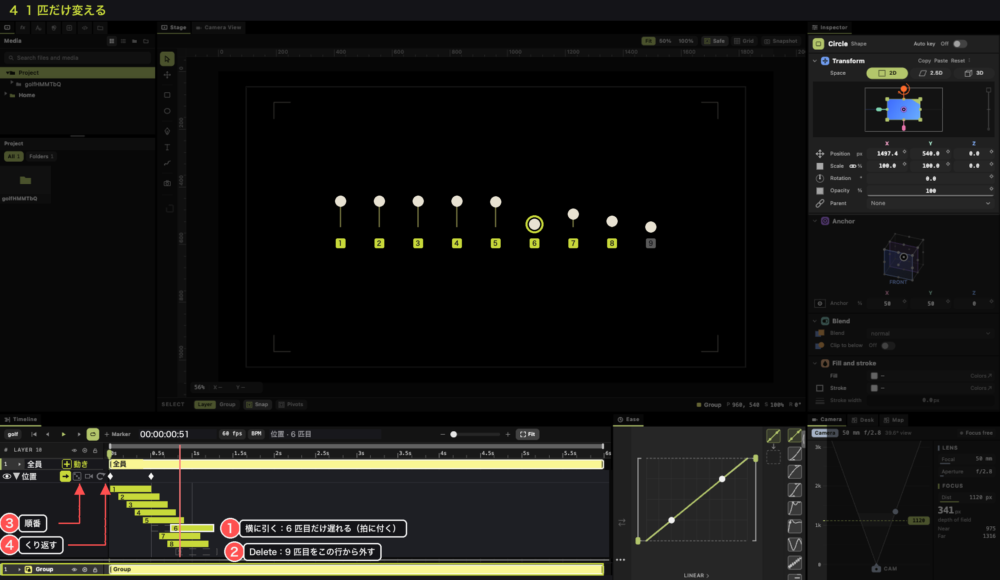
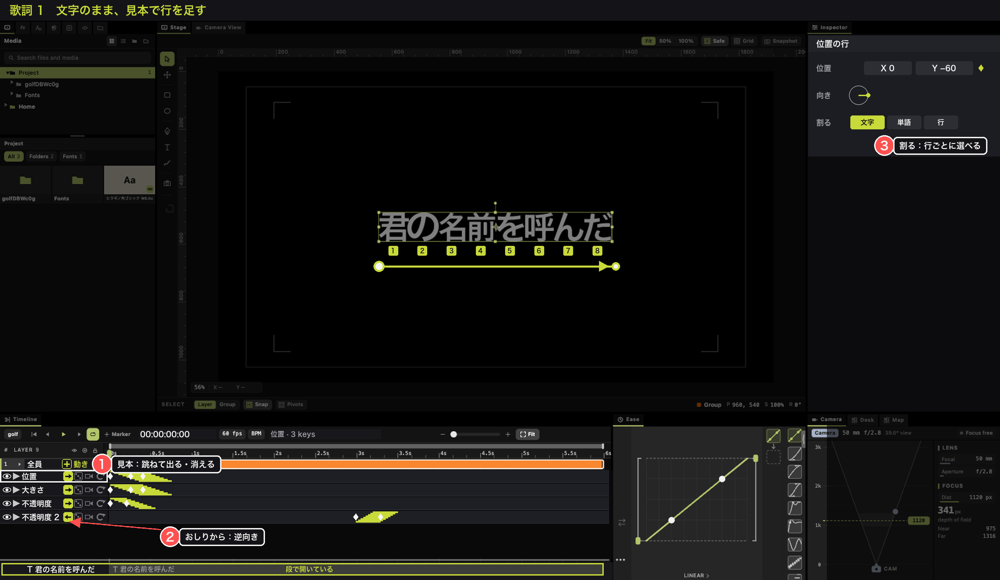
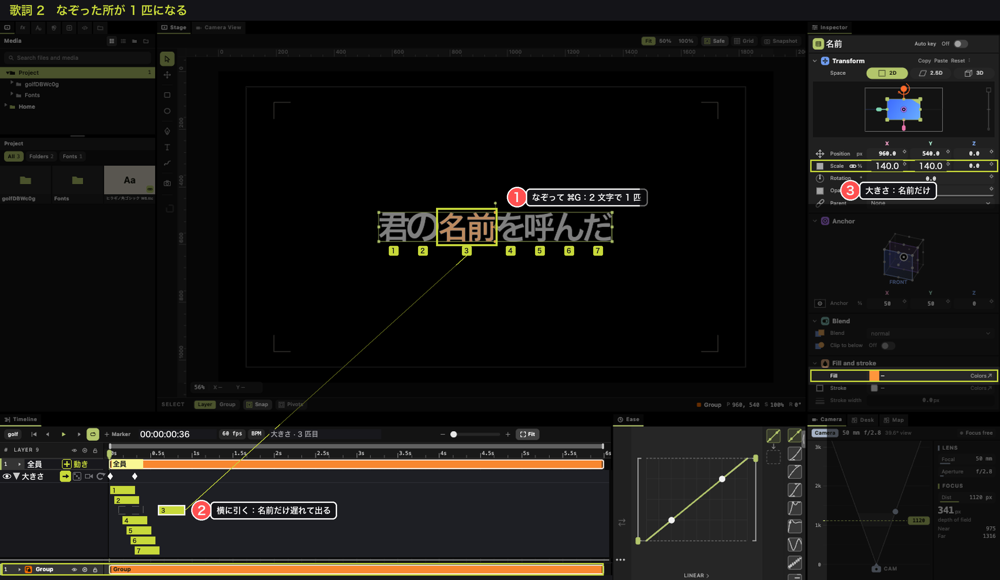
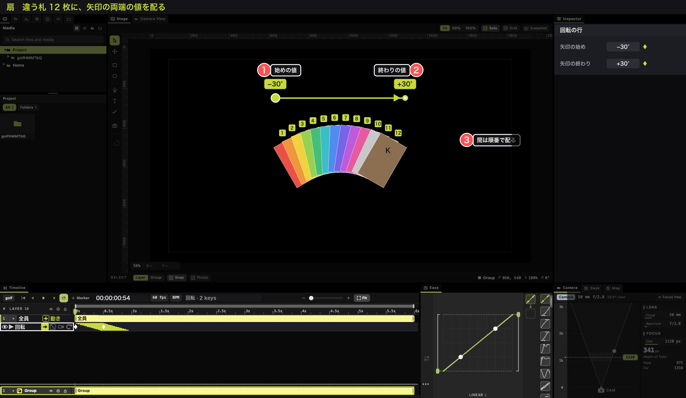
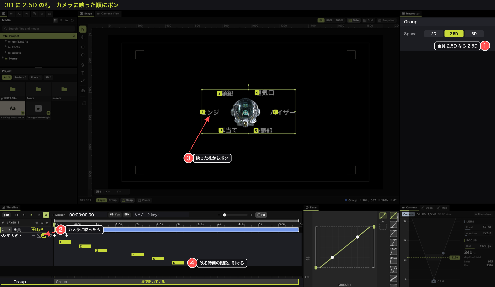
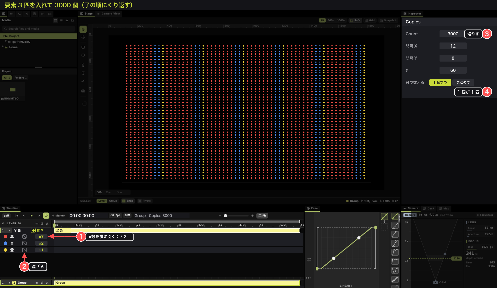
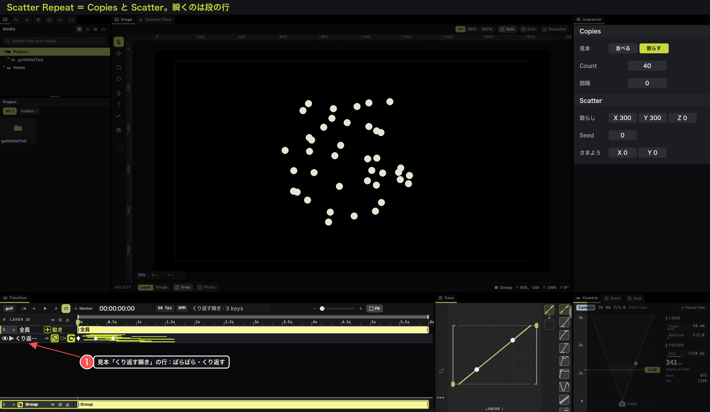
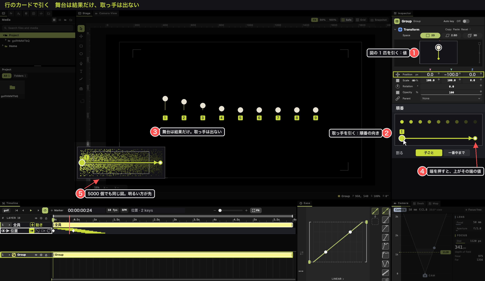

絵の描き方：scratchpad の markup5.py（使い捨て）。元の窓は golf_play_test.dart の fish・lyric・tags の穴。
行のカードで引く絵は card.py（同じく使い捨て、fish の穴）。

### 入る

- 物を選んで ⌘G。グループを 2 度押すか、行の ▸ を押すと（Figma のレイヤーの ▸ と同じ印。2 度押しも Figma のグループに入る手）、目盛りの下に段が上からスッと下りてくる。全体のタイムラインは下に残る。
  Ableton Live のクリップビューと同じ。
- 段の高さは縁のハンドルで決める。段と全体は色で分かれて見える。
- 段が開いている間、下の全体の Group の行は帯を薄くし、「段で開いている」と縁取る（Ableton の、Clip View に出ているクリップ）。
  触るのは段の方。（土台と食い違う）段の一番上の行の名前は「全員」。
- 段は、縁を閉じきるか、パンくずで外に出るまで閉じない。段の中の行を押しても、全員の行を押しても閉じない。

### 全員の行（一番上）

グループそのもの。キーを打つと全員が同時に動く。FX を乗せれば群れ 1 枚にかかる。順番は無い。
大きさ・回転は、グループのアンカーを中心に効く（Figma でグループを回すのと同じ）。

### 順番の行＝配る

触る物は 5 つだけ。どれも目に見えている物をつかむ。

| 触る物 | 何が起きる | 出典 |
|---|---|---|
| 行のキー | 1 匹の動き。1 つの物と同じ打ち方。行を押すと、インスペクターの Transform の図に 1 匹だけ描かれ、それを引くとキーの値（舞台では引かない）。次の匹から順に遅れて配られる | GSAP の stagger。図：Motolii の Transform の図（inspector_direct_transform_canvas.dart：カードの絵を引くと値が変わる） |
| 開いた行の階段 | 1 段が 1 匹。右下の角を横に引くと間隔。1 段を横に引くと、その 1 匹の出番がずれる（全部の行でいっしょに。拍とマーカーに吸い付く）。1 段を押して Delete で、この行だけその 1 匹に効かない。段は囲んで何段も選べる | GSAP の `each`、TextoN の「ずらし（フレーム）」、Ableton Live 12 の Strum の見え方と MIDI ノートの囲み。1 段で全部の行がずれるのは、TextoN が作る文字ごとのレイヤーを AE で動かした時と同じ |
| 行のカードの順番の図 | 行を押すと、インスペクターの Transform のカードの下に出る。矢印と取っ手はここにだけあり、舞台には出さない。メンバーを点で、舞台と同じ向きから、全員が入る大きさで描く。点は行の最初のキーの時刻の所（順番を読む所と同じ）。先に動く物ほど明るい。（土台と食い違う）取っ手を引くと順番の向き。始点が 1 匹目、真ん中に置けば両側へ。何も無い所を撫でると、押した所が始点・離した所が終点の矢印に引き直す。取っ手は見ている面の中で動く。矢印は世界の中の向きで、3D では奥にも向く。両端の取っ手はそれぞれ値を持つ。既定は両端同じ値。何も押していない時、上の Transform の図と欄は両端いっしょ：両端が違えば欄は「−」（「2.5D と 3D」のグループの欄と同じ）、図は両端の 1 匹を重ねて描く（始点は塗り、終点は輪。順番の図の取っ手と同じ印）。欄に打つと両端が同じ値になり、図を引くと両端に同じだけ足す（扇はそのまま）。端の取っ手を押した時だけ、その端だけが変わる。始点 −30°・終点 +30° なら、間の物に並び順で配られる（扇） | 混ざった値：Figma（help.figma.com「Adjust alignment, rotation, position, and dimensions」：違う値の欄に数を打つと置き換わり、Mixed+100 でそれぞれに 100 足す）。図：Motolii の Transform の図と、GROUP_INSPECTOR.md §7 の図（点で並べ、明るさが早さ、撫でる）。パネルの絵を引いて向きを決める：Blender の Normal ノード（docs.blender.org「Normal Node」：ノードの球を引いて向き）。見ている面の中で動く：Blender の移動ギズモの白い小丸（「Viewport Gizmos」）。撫でて引き直す・始点の両側：Photoshop Elements のグラデーション（helpx「Using gradients」：押した所が始点、引いて終点。Reflected は始点の両側）。端ごとの値：Figma のグラデーション（help.figma.com「Use gradients as a fill or stroke」：既定で止まりが 2 つ、止まりを選んで色）。計算は GSAP の `from`・`axis` と `distribute` |
| 行の頭の印 | 順番を 矢印 ／ サイコロ（ばらばら）／ カメラ（カメラに入った時に動く）から 1 つ。⟳ はくり返す。目は切って比べる。入っている印は塗る | Alight の Random Order、Unity の OnBecameVisible、Ableton のクリップの Loop、Figma のレイヤーの目 |

- 行の値は「ずれ」で、0 から始まる（大きさ・不透明度は 100%）。位置・回転は足し、大きさ・不透明度は掛ける。
  大きさ・回転は 1 匹ずつ自分の中心で効く（GSAP の `y: "+=40"` は今の値に足す。GSAP で並びを回すと、1 つずつ自分の中心で回る）。
- （土台と食い違う）行を押すと、インスペクターは Transform のカード（図に 1 匹と、その値の欄 Y −100 ◇）と、その下に順番の図と、割る（下の「中身の多い物」）。
  舞台は結果を見せるだけで、段の行は舞台に取っ手を出さない。舞台で引く物（いつもの物の取っ手、枠選び、文字なぞり）とぶつからない。
- 順番の図は舞台と同じ向きから描くので、点の並びは舞台の見え方のまま。奥へ向けるのは、舞台の見る向きを回してから図の取っ手を引く（Blender の移動ギズモも、見ている面の中で動く）。
  全員が入る大きさなので、カメラの外・3D の裏の物も図にいる。5000 個でも点と明るさで向きが読める（絵の 5）。
  図の番号は始点の 1 だけ。1 匹ずつは開いた行の階段の段で選ぶ。
- 角は間隔を保つ。打ち直して文字が増えても、匹や Copies の数が増えても、1 匹ずつの速さは変わらず、終わりが伸びる
  （TextoN はずらしをフレーム数で持つ。GSAP の stagger の `each`）。角を押すと間隔の数字を打てる（フレームか秒）。
- 角を押すと、窓の下の Ease が階段の曲がり方になる。等間隔は直線。曲げると、後ろほど詰まる・開く（GSAP の stagger の `ease`）。新しいつまみは足さない。
- 行は ⌘C で写し、別の物の全員の行で ⌘V（Figma の Copy・Paste properties）。
- 畳んだ行は見るだけ：キーの下に小さな階段。取っ手は開いた行にだけ出る。キーと取っ手が重ならない。
- 開いた行の階段は縦に流れる。3000 段でも流して探せる。1 段を押すと、舞台のその 1 匹が光る。
  舞台の奥の 1 匹は ⌘ を押しながら押す（Figma の深い選択）。
- （土台と食い違う）順番は矢印を動かした時に 1 度だけ決める。再生中は変わらない。位置は行の最初のキーの時刻で読む（再生ヘッドの所ではない）。舞台に見えている位置で読むので、入れ子でも同じ。矢印に沿って同じ所に並ぶ物は、並び順で割る。
  後から入った物は一番後ろに付く（GSAP も作った時に 1 度だけ並べる）。
  矢印をまだ引いていない行は並び順：文字は読む順（縦書きなら上から）、グループは ⌘G の時の重なり順。
- カメラの印の時は、1 匹ずつ、カメラに映り始めた時刻に、キーの動きを始める。角は無い。札が見えてくる順にポンと出る。
  最初のキーの時刻にもう映っている物は、その時に同時。裏に回って戻った時は、⟳ が切れていれば動かない、入っていればまた動く
  （GSAP の ScrollTrigger：`once` と、入るたびに restart）。階段は映る時刻から描かれ、1 段を引くとその時刻からずれる。
- サイコロと ⟳ をいっしょに入れると、1 匹ずつ違う所から瞬き続ける（星）。サイコロを切ると元の順に戻る。
- 選んだ取っ手と段は、矢印キーで 1 コマ、Shift で 10 コマ動く。Tab で次の段・次の行へ（Figma の矢印キーと Tab）。取り消しは ⌘Z。
- 引き始めは数 pt 動いてから（OS の決まり）。Delete は選んで光っている物にだけ効く。
- 角と 1 段は、秒・拍・マーカー・クリップの端に吸い付く（Ableton のグリッド）。1 コマより狭い間隔は、同じコマの匹が 1 段にまとまって描かれる。

外した物と理由（どれも、触る物の数を増やすから）：
- Min：1 匹目の時刻はキーを動かせばよい。GSAP の stagger にも無い。
- 間隔を曲げる取っ手、往復、全体の長さの欄：曲げは窓の下の Ease。往復はキーで書ける。全体の長さは角そのもの。
- 順番の元の選択肢（左から・上から・手前から）と、柱：矢印 1 本で全部書ける。
- ◇ を引いて行を作る形：◇ は押すとキー。同じ印に 2 役は持たせない。
- 1 本の行に値を 2 つ：どのキーがどの値か分からなくなる。行を 2 本にする。
- 舞台の矢印と取っ手、矢印の向きの丸い目盛り：舞台で引くと他のギズモとぶつかる。図が全員を描くので、舞台に見えない時も図で引ける。
- 図を振ってばらばら、図の 2 度押しで全員いっしょ（GROUP_INSPECTOR.md §7 の案）：サイコロは行の頭の印、全員いっしょは角を 0 へ。同じ事を 2 か所に置かない。

### 名指しの物＝例外

- 舞台で 1 匹を押すか、開いた行の 1 段を押すと、インスペクターはその 1 匹のいつものカード（塗り・大きさ…）になる。
  色を変えるのも、自分のキーを打つのもここ。キーを打った時だけ、段にその物の行が残る。
- ずらす・外すは、上の階段の 1 段でする。例外の行は要らない。

### 中身の多い物（グループ・文字・Copies）

- どれも 2 度押すと段が下りる。メンバーは中身。行・矢印・階段・例外は同じ。
- Copies を付けた物の段は、写し 1 枚が 1 匹（既定）。Alight の Repeat を付けたのと同じく、すぐ並びに沿って動く。
- 中身の位置は、元の決め方のまま：文字は文字組（書体・字間・行送り）、Copies は並び、グループは各自の位置。
  行のずれはその上に足す（GSAP の SplitText も、文字組で置いた文字に動きを足す）。
- 行のインスペクターの「割る」で、その行が何を 1 匹と数えるか。行ごとに違ってよい（GSAP の SplitText は `chars, words, lines` で割り、動きごとにどれを使うか選ぶ）。
  歌詞の「行ごとに 0.3 s、行の中は文字ごとに 0.05 s」は、割る＝行の行と、割る＝文字の行の 2 本：
  - 文字：文字・単語・行。日本語の単語の切れ目は ICU の辞書（空白の無い言葉を辞書で切る）。ルビは親の文字の一部
  - グループ：子ごと（既定）／一番中まで。100 の群れ × 30 匹なら、子ごとで 100 に、一番中までで 3000 に配る。
    中に Copies の物があれば、子ごとで 1 匹、一番中までで写し 1 枚ずつが 1 匹。
  - 文字と同じ欄。覚える物を増やさない。割るを変えても矢印と間隔はそのまま、数が変わるので角が動く。
  - 例外は物に付いている。割るを変えて、その物が 1 匹でなくなれば、中の全員に効く。
- 単語の切れ目が歌と合わない時は、舞台でなぞって ⌘G。なぞった所が 1 匹になる（グループを作るのと同じ手）。
- 文字の行は読む順に通しで数える。2 行目は 1 行目の後に来る。行と行の間を空けるのは、2 行目の段を囲んで引く。
- 打ち直し：文字はいつもの文字の欄。行も間隔も残る。変えていない文字は同じ文字のまま（差分で読む）。全部を選んで貼り替えると、文字に付けた色やずれは消える（Figma の文字の色も同じ）。TextoN は層に割るので打ち直せない（GROUP_INSPECTOR.md §5）。ここを解く。
- 例外の文字は、舞台で文字をなぞる。番目ではなく文字そのものに付く。前に文字を足しても付いて動き、消せば消える
  （Google ドキュメントのコメントが、本文を直しても同じ言葉に付いているのと同じ）。

**要素だけ入れて、3000 個に増やす**
- 赤・青・黄の魚を 1 匹ずつグループに入れ、グループに Copies 3000。写しが要素を使う。
- （土台と食い違う）要素（グループの本当の子）は段に行として出て、行の頭に「×7」。横に引くと割合。赤 ×7・青 ×2・黄 ×1 で 7:2:1。
  （Blender の粒子の Collection の Use Count：物ごとに数を並べる。Cinema 4D の Cloner は割合の欄が無く、子を 2 つと 3 つ入れて 2:3 にする）
- 割合は「どの写しがどの要素か」で、動く順番（矢印）とは別。子の順にくり返す（赤 7・青 2・黄 1 の順で）。要素の行のサイコロで、ばらばらに混ぜる
  （Cinema 4D の Cloner の Iterate と Random）。3000 で割り切れない分は端数の大きい要素から 1 つずつ。
- グループに Copies を付けると、数は子の数から始まる。要素の位置は消えて、並びの位置に置かれる（Cinema 4D の Fix Clone）。
- 写しの例外は何番目の写しかで覚える。数を減らしてその写しが無くなったら、例外の行は空のまま残る。

### 群れに足す

- メンバーはいつもグループの今の子全員（Figma のグループ）。段を開いたまま貼った物はグループに入り、順番の一番後ろに付く。

### 2.5D と 3D

- Space は 1 つずつの物が持つ。ヘルメットは 3D、札は 2.5D、板の札は 3D のまま 1 つのグループに入る。カメラが動いた時に、回る物・こっちを向く物・傾く物が混ざるのが配列の強み。
  グループの欄は、揃っていればその値、混ざれば「−」と出るだけ（Figma の混ざった値）。グループの欄を押すと全員が揃うので、普段は触らない。
  大きさの行は札の面の上で効く。遠い札が小さく見えるのはカメラの遠近。

### 例：スイミー

1. 32 匹を選んで ⌘G。全体の Group の行を 2 度押して段を下ろす。
2. 全員の行の X にキーを 2 つ（0 秒と 4 秒）。群れが全員いっしょに右へ。
3. （土台と食い違う）「＋ 動き」→ 位置。Y の行ができる。0 秒 0、0.2 秒 +40、0.4 秒 −40、0.6 秒 0。
   （土台と食い違う）行を押して、順番の図の矢印の始点を右端（先頭）へ引く。角を引いて 0.04 s ずつ。1 匹ずつ順にうねる。
4. （土台と食い違う）「＋ 動き」→ 見本の「消える」。おしりに付く。（土台と食い違う）順番の図で、左端（しっぽ）から右へ撫でる。
5. 位置の行を開き、スイミーの 1 段を押して Delete。スイミーはまっすぐ進む。
6. 段を開いたまま 5 匹を貼る。順番の後ろに付いてうねりに加わる。間隔は同じで、終わりが 5 匹分伸びる。

### After Effects のリピーターとの対応（計算の照らし合わせ。触り方の出典にはしない）

| リピーター | Motolii |
|---|---|
| Copies、Offset | グループ（Copies の札、⌘G、文字の割り） |
| Transform の Position 100（i 番目に i 倍） | 並び（Copies の間隔） |
| Start Opacity 100、End Opacity 0 | 並び（Copies の写しを薄くする） |
| 欄にキーを打つ | 行のキー（1 匹の動き） |
| 全員いっしょ | 全員の行 |
| Offset（何番目から） | （土台と食い違う）順番の図の矢印 |
| 無い（全員が同時に変わる） | 階段の角（1 匹ずつの間隔） |

### Alight のリピーター（Linear・Grid・Radial・Scatter）

Alight の Repeat のカードは、2 つが 1 枚に混ざっている：
並べる（Count・間隔・半径・散らし）と、Range（Range Transform と Start・End・Phase・Shape・Ease・Random Order）。
Range は After Effects の範囲セレクタそのもの（reports/alight_range.md の実測）。邪魔だったのはこっち。

Motolii では 2 つに分ける。並べるのは Copies、動かすのはグループの段。Copies を付けた物は中身の多い物なので、2 度押すと段が下りる。

| Alight | Motolii |
|---|---|
| Linear・Grid・Radial Repeat の Count・間隔・列・半径 | Copies のカードの `copies`・`copy_x`・`copy_y`・`copy_columns`・`copy_rotate`（どれも続いた値なので Grid から Radial へもキーで行ける） |
| Scatter Repeat の Count・Radius・Seed | Copies の見本「散らす」：Count・間隔 0・Scatter のカード（`scatter_x`・`scatter_y`・`scatter_z`・`seed`）を一度に入れる（今の Repeater の見本と同じ作り、dock_make） |
| Scatter Repeat の Evolution（さまよう） | Scatter のカードの `drift_x`・`drift_y`（今ある値） |
| Range Transform（Offset・Angle・Scale・Alpha・Fill Color） | （土台と食い違う）「＋ 動き」で作る行 |
| Range を Phase のキーで動かす（順に動く） | 行のキー＋階段の角 |
| Shape（RAMP・TRIANGLE・SMOOTH）・Overlap | キーの形と長さ。山はキーを 0 → 40 → 0 と打つ。山が何匹にかかるかはキーの長さ ÷ 間隔で、Count を変えても同じ匹数（Alight は割合なので、Count で匹数が変わる） |
| Invert（効き具合を 1 − w） | 行のキーの値を入れ替える（0 → 40 を 40 → 0）。（土台と食い違う）順を逆にするのは矢印 |
| Random Order・Seed | 行の頭のサイコロ |
| Range を動かさない（コピーごとに量が違う） | 並び（Copies の写しを薄くする・回す） |
| Ease In・Ease Out（並びに沿った坂の曲げ） | 角を押して、窓の下の Ease で曲げる |
| Start・End（一部のコピーだけ） | 段を囲んで Delete |

### 真似しない物

- After Effects の文字アニメーター（範囲セレクタの 0%〜100%）。分かりづらく、それが不満で TextoN ができた。
- TextoN の、文字ごとのレイヤーに並ぶ階段。1000 文字で 1000 行。
- クリップのフェードで順を表すこと。区間キーフレームが分かりづらくなる。
- カードを裏返して全体と分配を切り替えること。2 度手間。
- 全員の行のキーに ▸ を付けること。全員は全体で、順番ではない。

### 決めていない事（今朝の版）

- 近づいたら光る：順番の行ではなく、並びの Field（`region` と `falloff_soft`）に置く。時刻ではなく場所で量が決まるので。
  Field の絵は別に描く。
