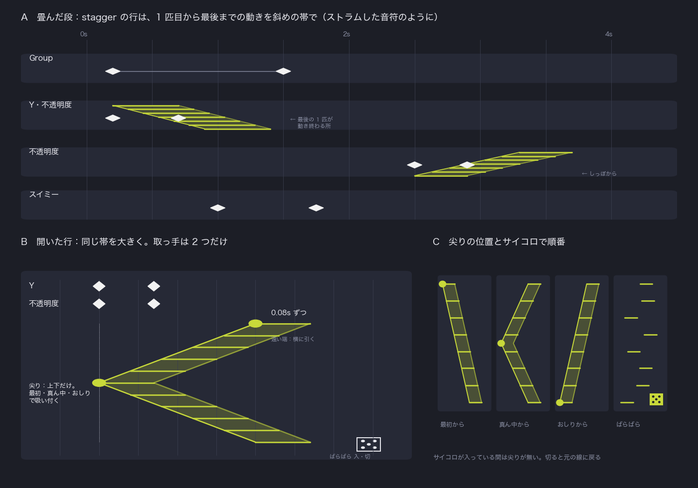

# グループの仕様

経緯と、いつ誰が決めたかは、このファイルの git log にある。ここは仕様だけ。

## 何を解くか

300 匹、1000 文字を並べると、タイムラインは 1000 行になる。After Effects はそうなる。TextoN も文字をレイヤーに
分けるから、結局そうなる。

Motolii は、グループそのものを行にする。子は並べない。例外だけが実体として出る。1000 匹でも行の数は変わらない。

## 絵

```
┌ 目盛り（1 本を共有）─────────────────────────────┐
│ ▼ グループの段：上から下りてくる                    │
│   Group     ◆────────────◆      全体。全員いっしょ    │
│   Y         ◆───◆                stagger。Group の Y に足す │
│   スイミー   ◆                    例外。自分のキー        │
├══ 縁：つまんで高さを変える ═══════════════════════┤
│ 全体のタイムライン（グループは 1 本のまま）            │
└────────────────────────────────────┘
```

## 入る

- 物を選んで ⌘G。グループを 2 度押すと、目盛りの下に段が上からスッと下りてくる。全体のタイムラインは下に残る。
  Ableton Live のクリップビューと同じ。
- 段の高さは縁のハンドルで決める。段と全体は色で分かれて見える。

## 段の行は 3 種類

**1. Group の行（一番上）＝全体**
グループそのもの。キーを打つと全員が同時に動く。FX を乗せれば群れ 1 枚にかかる。stagger は無い。

**2. stagger の行＝配る**
- 作り方：グループのインスペクターの札から、値を 1 つつまんで段に落とす。Y を落とせば「Y」の行。
- Group の値に重ねる。重ね方は親子と同じで、位置・回転は足し、大きさ・不透明度は掛ける。不透明度の行で 100 → 0 なら消える。
  （Figma のグループの不透明度は子に掛かる。After Effects の親子は位置・回転を足し、大きさを掛ける）
  Group の値には別にキーを打てる。
- 1 本の行に値をもう 1 つ落とせる。同じ順番・同じ間隔で動く（After Effects の文字アニメーターに Property を足すのと同じ）。
  浮きながら現れる、が 1 本で書ける。
- 独立したキーフレームの行。バーやクリップではなく、フェードも無い。
- 行のキーは、1 匹が動く動きそのもの。1 つの物にキーを打つのと同じ。キーの間の区間イージングは、1 匹ずつの動きの感じ。
- その動きを、1 匹ずつ時刻をずらして配る。
- 1 匹目はキーの時刻どおりに動く。次の匹から、決まった間隔ずつ遅れる。間隔は等しい。
  メンバーの数が変わっても間隔を保つ。歌詞を 5 文字から 20 文字に打ち直しても、1 文字ずつの速さは同じ
  （GSAP の stagger の `each`、TextoN のオフセットは 1 文字ずつの間隔）。
- 同じ値の行は何本でも重ねられる。円のパスの行の次に、うにょんのパスの行。
- 行の中身は 3 つ：対象（どの値に効くか）、動き（キーと区間イージング）、配り方（順番と間隔）。
  （Cinema 4D のエフェクターの 3 つのタブと同じ）
- どのコピーがどれだけ動くか（量の違い）は、行ではなく並びの側（Copies・Wave・Field・Scatter）に置く。
  量と順番を 1 つに混ぜると「Fade In で最後の文字の重みが 0 だと永遠に出ない」になる（GROUP_INSPECTOR.md §7、
  コードで踏んだ物）。

**見え方と触り方**



- 畳んだ行：キーの後ろに、1 匹目から最後までの動きを斜めの帯で描く。縦は何匹目（上が 1 匹目）、横は時刻。
  帯の右の縁で、最後の 1 匹が動き終わる所が見える。1000 匹でも帯 1 本。
  （Ableton Live 12 の Strum：和音の出だしを斜めにずらす。ずらした音符はそのまま斜めに並んで見える）
  三角形の扇にはしない。クリップのフェードに見えるから（真似しない物）。
- 開いた行：同じ帯を大きく描く。取っ手は 2 つだけ。
  - **尖り**（1 匹目）：上下にだけ引く。上＝最初から、真ん中＝真ん中から、下＝おしりから。この 3 か所で吸い付く
    （GSAP の stagger の `from`：start・center・end）。横には動かない。いつ始まるかはキーを動かす。
  - **遠い端**：横に引くと間隔が変わる。数字は「1 匹ずつ何秒」（GSAP の `each`）。
- サイコロ：ばらばらの入・切。入っている間は帯が点に崩れ、尖りは無い。切ると元の線に戻る（Alight の Random Order の切り替え）。
- 行ごとに違ってよい。先頭から泳ぎ出し、おしりから消える、が 2 本の行で書ける。
  別の所から始めたい（スイミーの目から）なら、例外（名指しの物）で作る。
  （GSAP は stagger を tween ごとに、Alight は Range と Random Order をカードごとに、Cavalry は Stagger を振る舞いごとに
  持つ。群れ全体で順番を 1 つだけ持つ道具は見つからなかった）
- 外した物と理由：
  - Min：1 匹目の時刻をずらすのは、キーを動かすのと同じ。GSAP の stagger にも無い。
  - 間隔を曲げる取っ手（Ableton の Tension、GSAP の stagger の ease）：1 文字ずつ跳ねさせたい時に、ここを曲げてしまう。
    跳ね方はキーの区間イージングで、1 つの物と同じ。要るとゴルフで分かったら足す。
  - 両端の Max：尖りが端にない時、どちらが Max か決まらない。遠い端 1 つにした。

**3. 名指しの物＝例外**
1 匹だけ変えたい時は、舞台でそれを押す。段にその物がそのまま出る。自分のキーを打てば、配られた動きの上に乗る。
除外ではなく「そこに出ている」こと。

## 行を押すと

インスペクターは押した行の物になる。stagger の行を押すと、その行の stagger が出る。

## 文字

1 文字ずつレイヤーに割る。割ればあとはグループと同じ。打ち直しても、歌詞を変えても、同じ。
1 文字だけの例外は後でいい。

## 例：スイミー

1. 31 匹を選んで ⌘G。2 度押して段を下ろす。
2. Group の行の X にキーを 2 つ。群れが全員いっしょに右へ。
3. 札の Y をつまんで段に落とす。Y の行ができる。キーを 2 つ打つと、1 匹ずつ順に Y が動き、群れの動きの上に足される。
   開くと帯が大きくなり、尖りで順番、遠い端で間隔を変える。
4. 札の不透明度を落として 2 本目の行。キーを 100 → 0、尖りを下へ。しっぽから順に消える。
5. スイミーを舞台で押す。段にスイミーの行が出る。キーを打てば、スイミーだけ違う動き。

## After Effects のリピーターとの対応

リピーターは 1 枚の札に 3 つが混ざっている。

| リピーター | Motolii |
|---|---|
| Copies、Offset | グループ（Copies の札、⌘G、文字の割り）。段には出ない |
| Transform の Position 100（i 番目に i 倍） | 並び（Copies の間隔）。段には出ない |
| Start Opacity 100、End Opacity 0 | 並び（Copies の写しを薄くする）。段には出ない |
| 欄にキーを打つ | 行のキー（1 匹の動き） |
| 全員いっしょ | Group の行 |
| Offset（何番目から） | 開いた行の尖り |
| 無い（全員が同時に変わる） | 開いた行の遠い端（1 匹ずつの間隔） |

## 真似しない物

- After Effects の文字アニメーター（範囲セレクタの 0%〜100%）。分かりづらく、それが不満で TextoN ができた。
- TextoN の、文字ごとのレイヤーに並ぶ階段。1000 文字で 1000 行。
- クリップのフェードで順を表すこと。区間キーフレームが分かりづらくなる。
- カードを裏返して全体と分配を切り替えること。2 度手間。
- Group の行のキーに ▸ を付けること。Group は全体で、stagger ではない。

## 決めていない事

- 近づいたら光る。やりたい、まで。
- 順番を番号でなく場所で決める（群れの先頭から、手で置いた物）。候補：GSAP の stagger の `grid` と `from:[x, y]`、
  今のコードの `stagger_x`・`stagger_y`（押した点から外へ）。
- 文字の中で単語ごと・行ごとに順番を区切る。候補：After Effects の範囲セレクタの Based On（文字・単語・行）、
  GSAP の SplitText。無いと 200 単語で 200 グループになる。
- 量の違う動きを順に（12 枚の札が −30°〜+30° に順に開く）。候補：GSAP の `distribute`（値を配る）と stagger（時刻を配る）を
  1 本の行に。Cavalry は Stagger を Duplicator の回転につなぐ。
- 1 匹ずつの繰り返し（星がばらばらに瞬き続ける）。候補：GSAP の stagger の `repeat`・`yoyo`。

## 今のコードとの違い

| 仕様 | 今のコード |
|---|---|
| Group の行は全体。stagger は無い | ▸ が Group の行のキーに付いている（timeline_hand.dart `_grab`） |
| stagger の行は Y の行で、自分のキーを持つ | ▸ を引くと「Order」の行ができ、遅れの数だけ持つ |
| Group の行は全員いっしょ | 遅れ（engine/doc_relations.h `doc_group_delay`）が、グループの動きごと子を遅らせる |
| 子ごとの物は出さない | echo（timeline.dart `_echoesOf`）が子ごとのキーの時刻を 1 個ずつ菱形で描く。1000 匹で 1000 個 |
| 値を落として行を作る | まだ無い |
| 畳んだ行の斜めの帯、開いた行の尖りと遠い端 | まだ無い |
| 誰から始めるかは行ごとの尖りとサイコロ | 言葉で 5 つ（engine/doc_kinds.h `stagger_from`・`lag_from`：start centre end edges random）。スライダーは無い。Order の札に 1 つだけ |
| 文字は 1 文字 1 レイヤー | まだ無い |

合っている物：段が上から下りる、縁で高さ、段の色、名指しの子が段に出る（d5384a68b・2f5a09e36）。
使えそうな物：behaviour の file "group" は、自分の y のキーを i 番目ごとに遅らせて読み、各子に足している
（doc_relations.h `doc_related`）。
