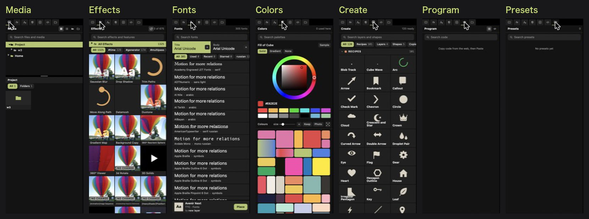
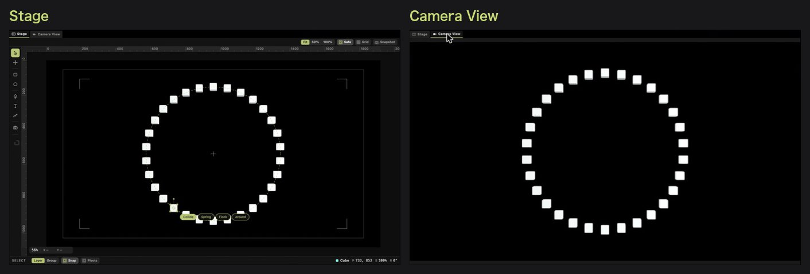
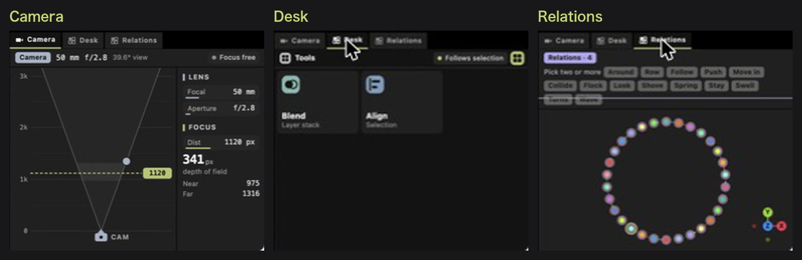

# The tabs

*日本語: [tabs.md](tabs.md)　·　[Back to "The screen" in the README](../README.en.md#the-screen)*

The pictures show the app on 2026-11-03.

## Left tabs

Switch with the small icons at the top left (left to right, as in the picture). Every tab has a search box at the top.

| Tab | What it holds | How to use it |
|---|---|---|
| **Media** | The project's folder and your Mac's folders (`Home`) | Select a video, photo or song, then **Place** at the bottom |
| **Effects** | Effects, and features such as Trim Paths: the bundled ones and those you put in `effects/` | Select a layer, press a tile, then **Add** at the bottom. Hovering a tile plays its preview. Tags such as `#time` narrow the list |
| **Fonts** | The fonts on your Mac and those in the project's folder. **Title** and **Body** at the top are the two for headings and body text (the same idea as PowerPoint's theme fonts) | Select a text layer, press a font, then **Apply**. With no text layer selected, **Place** makes a new one |
| **Colors** | The selected layer's fill (Solid, Gradient, None), a colour wheel, palettes | **Sample**: take a colour from anywhere on the screen (the Mac's eyedropper). **Keep**: make the colours this project uses into a palette of your own. **Photo**: take colours from the photo selected in Media |
| **Create** | Recipes (ready-made pieces), layers (Text, Camera, Null, Adjustment), shapes, Repeater (copies) | Press a tile, then **Create** at the bottom |
| **Program** | p5.js and Shadertoy code you pasted | Copy a sketch's code on the web and press ⌘V in the app. Press one to see its code; as you edit it, the preview and the inspector follow at once |
| **Presets** | Combinations you saved | Saving is not there yet (empty for now) |

## Preview tabs

| Tab | What you see |
|---|---|
| **Stage** | Where you edit: the selected layer's frame, and the tools in the column on the left |
| **Camera View** | The finished picture through the camera |

## Bottom-right tabs

| Tab | What it holds | How to use it |
|---|---|---|
| **Camera** | The camera seen from above, with the layers at their depth; the lens (Focal, Aperture) and focus (Dist) on the right | Drag the focus line (it snaps to a layer) |
| **Desk** | A list of tools (Blend: how layers stack, Align: line up what is selected) | Press a tile to open that tool |
| **Relations** | Relations (Around, Row, Follow, Spring, …). The picture below is the scene seen from outside the camera, each relation drawn as a shape | Select two or more layers and press a relation; they move together |
