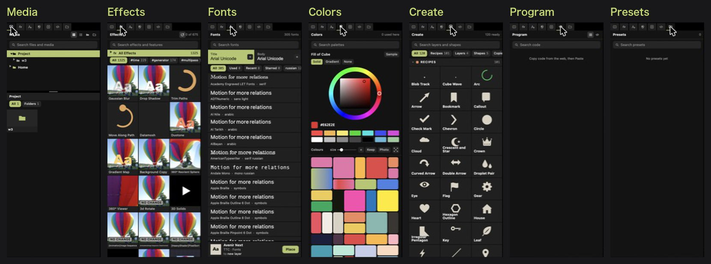
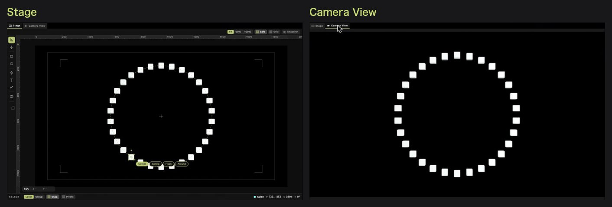
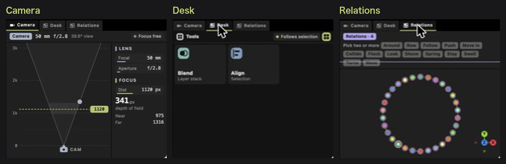

# タブの紹介

*English: [tabs.en.md](tabs.en.md)　・　[README の「画面の見方」に戻る](../README.md#画面の見方)*

絵は 2026-11-03 の画面です。

## 左のタブ

左上の小さなアイコンを押して替えます（左から、絵の順）。どのタブも上に検索があります。

| タブ | 何がある | 使い方 |
|---|---|---|
| **Media** | プロジェクトのフォルダと、Mac のフォルダ（`Home`） | 動画・写真・曲を選んで、下の **Place** |
| **Effects** | エフェクトと、Trim Paths などの機能。同梱の物と、自分で `effects/` に置いた物 | レイヤーを選んで、タイルを押し、下の **Add**。タイルにポインタを乗せると見本が動きます。`#time` などのタグで絞れます |
| **Fonts** | Mac に入っている書体と、プロジェクトのフォルダに置いた書体。上の **Title** と **Body** は、見出しと本文に使う 2 つ（PowerPoint のテーマのフォントと同じ考え） | 文字のレイヤーを選んで書体を押し、**Apply**。文字のレイヤーを選んでいなければ **Place** で新しく置きます |
| **Colors** | 選んだレイヤーの塗り（Solid・Gradient・None）、色の輪、パレット | **Sample**：画面のどこからでも色を取る（Mac のスポイト）。**Keep**：このプロジェクトで使った色を自分のパレットに。**Photo**：Media で選んだ写真から色を取る |
| **Create** | レシピ（作例）、レイヤー（Text・Camera・Null・Adjustment）、図形、Repeater（コピー） | タイルを押して、下の **Create** |
| **Program** | 貼った p5.js・Shadertoy のコード | ネットで作品のコードをコピーして、アプリで ⌘V。押すとコードが出て、書き換えるとプレビューとインスペクタがすぐ追いかけます |
| **Presets** | 自分で保存した組み合わせ | 保存はまだ出来ません（今は空） |

## プレビューのタブ

| タブ | 何が見える |
|---|---|
| **Stage** | 編集する所。選んだレイヤーの枠や、左の道具の列が出ます |
| **Camera View** | カメラから見た仕上がり |

## 右下のタブ

| タブ | 何がある | 使い方 |
|---|---|---|
| **Camera** | 上から見たカメラ。レイヤーは奥行きの位置に並び、右にレンズ（Focal・Aperture）とピント（Dist） | ピントの線をドラッグで動かします（レイヤーに吸い付きます） |
| **Desk** | 道具の一覧（Blend：レイヤーの重なり、Align：選んだ物を揃える） | タイルを押すと、その道具が開きます |
| **Relations** | 関係（Around・Row・Follow・Spring など）。下の図は、カメラの外から見たシーンで、関係が形で描かれます | レイヤーを 2 つ以上選んで、関係を押すと、まとめて動きます |
