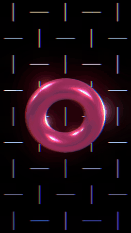

# ガイドの頭の 8 秒の作り方

*How the 8 seconds at the top of the guide ([guide.md](guide.md)) were made: the calls below, pasted as they are into a shell at the repository's root once the engine is built (README, "Build and run"), write `~/Movies/Motolii/mv.mp4`.*



組み立てた後（README の「Build and run」）、リポジトリの直下でそのまま貼ると `~/Movies/Motolii/mv.mp4` ができます。1 行が `engine/edit.sh` の命令 1 つ（一覧は `help`）：レシピ Weave、3D の輪、文字、Glow、最後に画面全体へ RGB のずれ（`shelves/effects/glitch/rgbshift.wgsl`）。

```zsh
mkdir -p ~/Movies/Motolii && rm -f ~/Movies/Motolii/mv.motolii
engine/edit.sh ~/Movies/Motolii/mv.motolii <<EOF | grep -E 'NOT|write'
make Weave
add solid ring
say 2 fill ff3366
set 2 size 1.1
set 2 metallic 0.6
set 2 roughness 0.2
key 2 rotate_y 0 0
key 2 rotate_y 8 360
key 2 rotate_x 0 25
key 2 rotate_x 8 -25
add text /System/Library/Fonts/Supplemental/Arial Black.ttf
say 3 text MOTOLII
say 3 fill ffffff
set 3 size 0.26
key 3 y 0 -2.4
key 3 y 1.5 -1.25
key 3 opacity 0 0
key 3 opacity 1.5 1
effect 3 Glow
say 0 script $PWD/shelves/effects/glitch/rgbshift.wgsl
write $HOME/Movies/Motolii/mv.mp4
EOF
```
